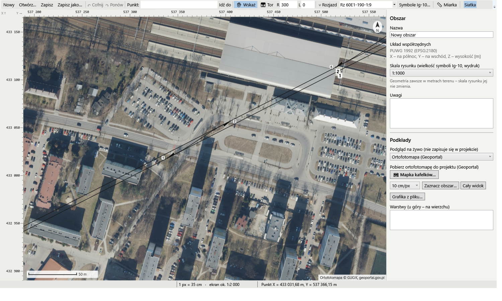
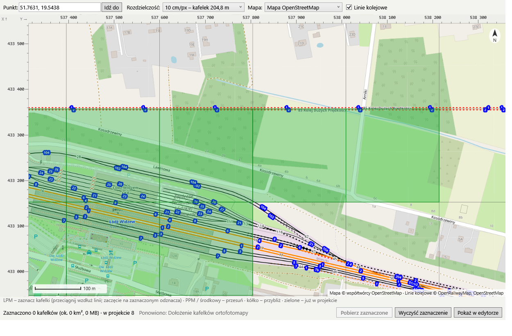
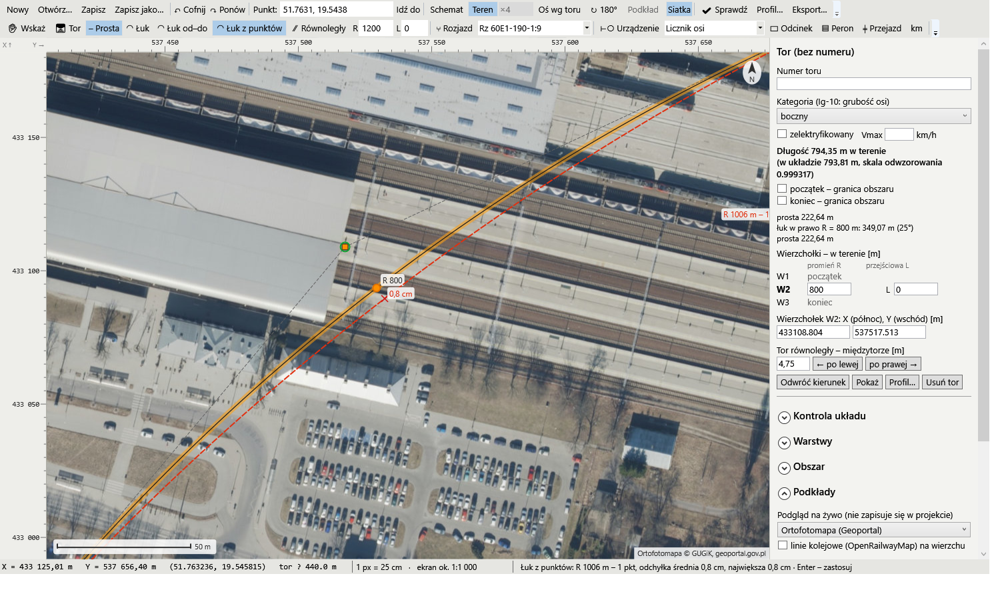
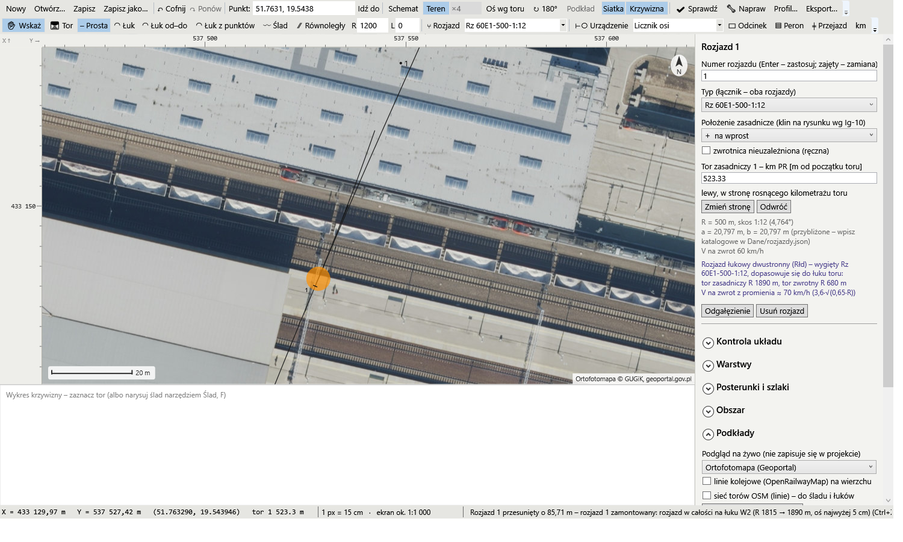
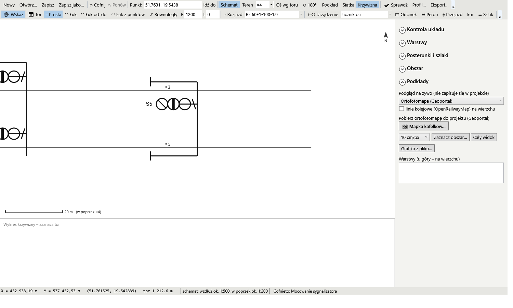
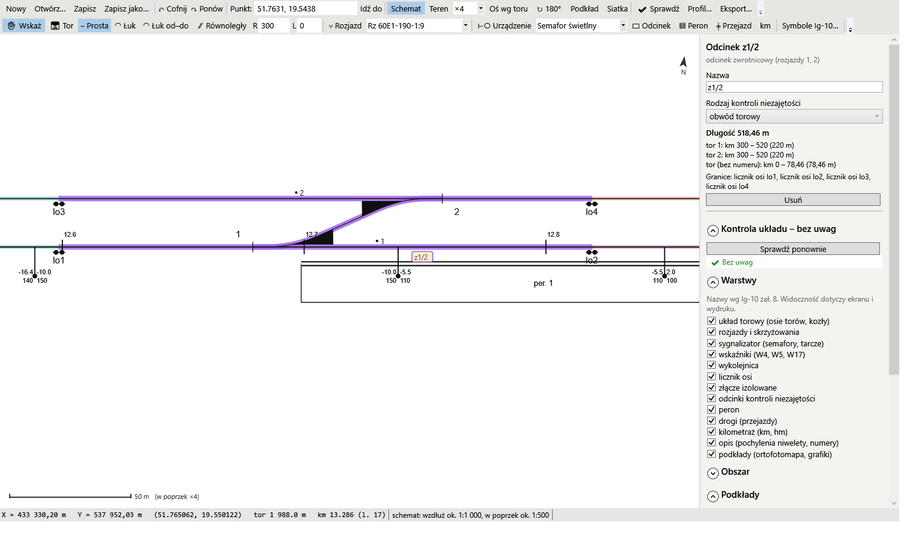
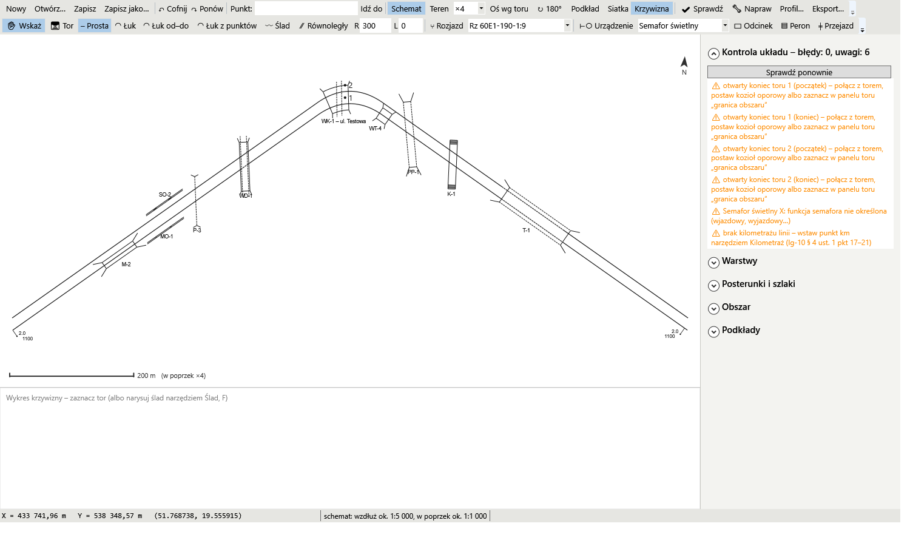
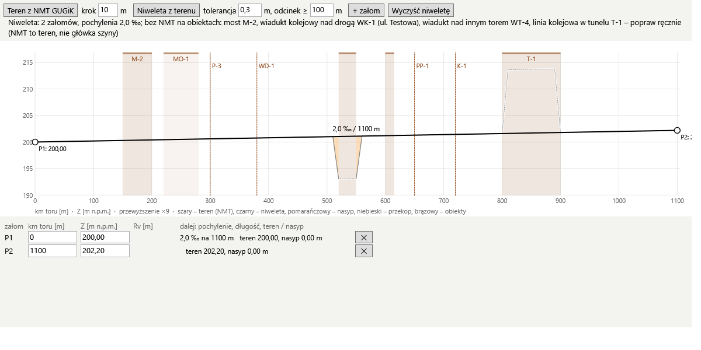
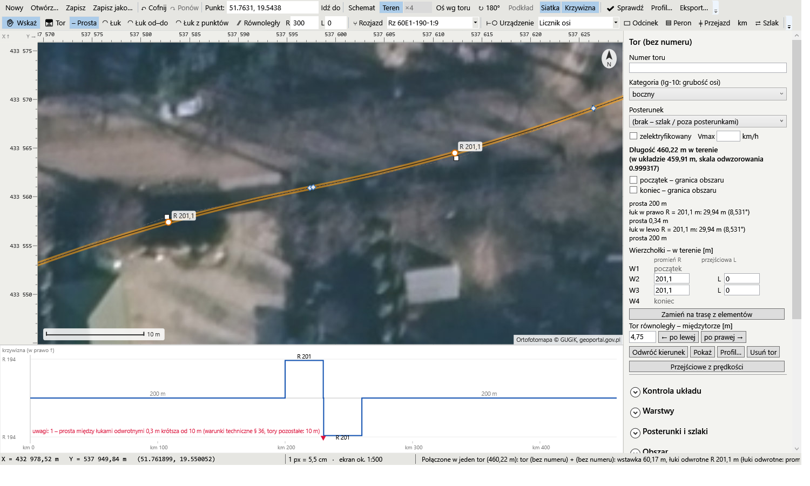
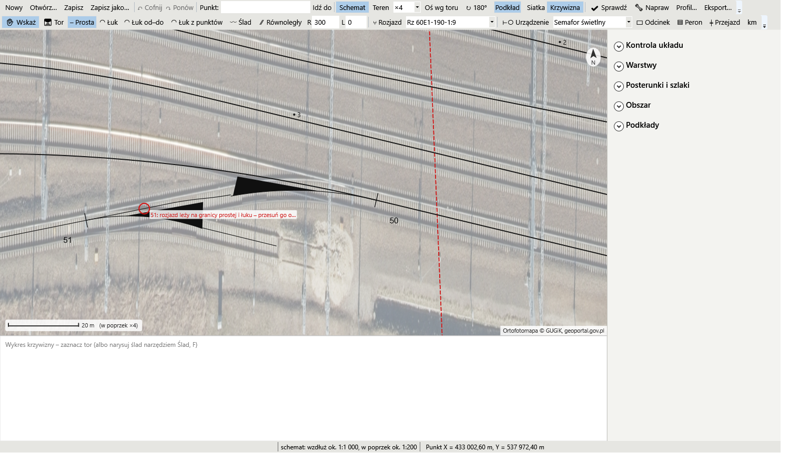

# Edytor układu torowego (UT) – dokumentacja

Stan na 2026-10-29. Program: `EdytorUT.exe` (`app/Lcs.EdytorUT`, model danych `app/Lcs.Model`).

Ten dokument opisuje obsługę edytora krok po kroku, w kolejności, w jakiej zwykle powstaje układ. Pełny wykaz funkcji z drobnymi szczegółami jest w `README.md` (rozdział „Edytor układu torowego (UT)”), decyzje i plan w `PLAN_EDYTOR_UT.md`, historia prac w `HISTORIA_EDYTOR_UT.md`.

## Spis treści

1. [Do czego służy edytor](#1-do-czego-służy-edytor)
2. [Uruchomienie](#2-uruchomienie)
3. [Okno programu](#3-okno-programu)
4. [Pojęcia i zasady](#4-pojęcia-i-zasady)
5. [Kolejność pracy](#5-kolejność-pracy)
6. [Podkłady](#6-podkłady)
7. [Tory](#7-tory)
8. [Łuki](#8-łuki)
9. [Rozjazdy, łączniki, skrzyżowania](#9-rozjazdy-łączniki-skrzyżowania)
10. [Urządzenia](#10-urządzenia)
11. [Odcinki kontroli niezajętości](#11-odcinki-kontroli-niezajętości)
12. [Perony, przejazdy, obiekty inżynieryjne](#12-perony-przejazdy-obiekty-inżynieryjne)
13. [Kilometraż](#13-kilometraż)
14. [Profil podłużny (Z)](#14-profil-podłużny-z)
15. [Posterunki i szlaki](#15-posterunki-i-szlaki)
16. [Podpowiedzi z OpenStreetMap](#16-podpowiedzi-z-openstreetmap)
17. [Zaznaczanie i edycja](#17-zaznaczanie-i-edycja)
18. [Kontrola i naprawa układu](#18-kontrola-i-naprawa-układu)
19. [Warstwy, wydruk i eksport](#19-warstwy-wydruk-i-eksport)
20. [Plik projektu](#20-plik-projektu)
21. [Skróty klawiszy](#21-skróty-klawiszy)
22. [Testy automatyczne](#22-testy-automatyczne)
23. [Częste problemy](#23-częste-problemy)
24. [Dla programisty](#24-dla-programisty)

---

## 1. Do czego służy edytor

Edytor UT rysuje **układ torowy w rzeczywistej geometrii**: tory, łuki z krzywymi przejściowymi, rozjazdy z katalogu, urządzenia srk, odcinki, perony, przejazdy, obiekty inżynieryjne, kilometraż i profil. Wszystko leży tam, gdzie w terenie, w układzie **PUWG 1992** (EPSG:2180).

Z układu korzystają dalej:
- **edytor zobrazowania** (`EdytorZobrazowania2.exe`) – rysuje obrazy pulpitu wg Ie-104, czyta UT tylko do odczytu;
- **symulator** – przez „Do symulatora…” w edytorze zobrazowania z UT i obrazu powstaje `station.json` (topologia, długości, pochylenia, prędkości, sygnalizatory).

Zasada nadrzędna: **projektuje człowiek**. Edytor daje narzędzia, przyciąganie, wymiary z klawiatury, dopasowania i kontrolę, ale sam nie rysuje stacji. Dane z OpenStreetMap są tylko podpowiedzią, którą projektant przyjmuje albo nie.

## 2. Uruchomienie

```bash
uruchom_edytor_ut.bat
```

albo wprost:

```bash
app/Lcs.EdytorUT/bin/Release/net10.0-windows/EdytorUT.exe projekty_ut/mijanka_testowa/mijanka_testowa.ut.json
```

- Bez argumentu program otwiera pusty projekt (albo ostatni widok).
- `uruchom_edytor_ut.bat` buduje program wspólnym launcherem (`tools/uruchom_program.cmd`, SDK z `app/global.json`) i uruchamia go. Przy błędzie budowania okno terminala zostaje otwarte.
- Budowanie ręczne (przy zamkniętym programie): `dotnet build -c Release` w `app/Lcs.EdytorUT`.
- Nieobsłużone błędy trafiają do `bledy.log` obok `EdytorUT.exe`. Program pokazuje komunikat i działa dalej.

Przykładowe projekty w `projekty_ut/`:
- `mijanka_testowa/` – mała mijanka z testów;
- `lcs_testowe/` – dwie stacje, rozjazdy krzyżowe Rkp / Rkpd, szlak wewnętrzny.

Do podkładów, NMT i OSM potrzebny jest internet. Bez niego edytor działa, tylko bez zdjęć i danych z sieci (pobrane wcześniej kafelki i sieć OSM są w pamięci podręcznej na dysku).

## 3. Okno programu

| Część | Co zawiera |
|---|---|
| **Pasek narzędzi** | Plik, Cofnij / Ponów, narzędzia (Wskaż, Tor, Rozjazd, Urządzenie…), listy typu rozjazdu i rodzaju urządzenia, pola R i L, Prosta / Łuk, Schemat / Teren, Siatka, Podkład, Oś wg toru, ↻ 180°, Krzywizna, 🔧 Napraw, ✔ Sprawdź, pole „Punkt” |
| **Płótno** | układ, podkłady, symbole Ig-10; linijki, podziałka, strzałka północy |
| **Panel z prawej** | panel zaznaczonego obiektu (na wierzchu), a pod nim zwijane sekcje: Obszar, Podkłady, Warstwy, Posterunki i szlaki, Kontrola układu, Naprawa, Ślad, podpowiedzi OSM |
| **Wykres krzywizny** | pod mapą, po wciśnięciu „Krzywizna” – krzywizna zaznaczonego toru wzdłuż km |
| **Pasek stanu** | X, Y, szerokość i długość geograficzna pod kursorem, km, Z niwelety, rozdzielczość (1 px = … m), skala na ekranie, podpowiedzi bieżącego narzędzia |

**Poruszanie się po płótnie:** kółko myszy przybliża wokół kursora (od 2 mm do 2 km na piksel), przeciągnięcie lewym albo środkowym przyciskiem przesuwa widok. W polu **Punkt** wpisz współrzędne z Google Maps (`51.7631, 19.5438`) albo `X Y` w PUWG 1992 i Enter.

### Dwa widoki

- **Schemat** (domyślny, klawisz S) – jak UT w ISDR: oś stacji poziomo, w poprzek rozciągnięte ×4 (zmiana na liście obok), białe tło, sama oś toru. Podkład jest ukryty, pole „Podkład” go pokazuje. „Oś wg toru” kładzie poziomo zaznaczony tor, „↻ 180°” obraca schemat. Kierunek osi zapisuje się w projekcie.
- **Teren** – północ u góry, skala 1:1, ortofotomapa. Do odrysowywania torów ze zdjęcia.

Rysować i edytować można w obu widokach. Widok to tylko przeliczenie świat ↔ ekran – zapis zawsze idzie w metrach terenu.

**Siatka** (pole na pasku) ma osobny przełącznik dla każdego widoku: w Terenie biegnie po współrzędnych PUWG (krok 1 / 2 / 5 · 10ᵏ m), w Schemacie wzdłuż i w poprzek osi stacji (domyślnie wyłączona).



## 4. Pojęcia i zasady

- **Współrzędne:** PUWG 1992, **X – na północ, Y – na wschód**, Z – wysokość główki szyny, wszystko w metrach (dokładność 1 mm).
- **Długość w terenie, nie w układzie.** PUWG 1992 zniekształca odległości (na południku 19° o −70 cm/km). Długości torów, miarka i km liczą się z poprawką skali odwzorowania.
- **Kierunek toru A → B:** każdy tor ma początek i koniec. Kierunek urządzenia (+1 / −1) i strona (lewa / prawa) są liczone względem kierunku toru. Kilometraż urządzeń na torze to odległość od początku toru (w terenie).
- **Przypięcie do toru:** rozjazdy, urządzenia, odcinki, perony, przejazdy, obiekty i punkty km leżą na torze (tor + odległość + strona + kierunek). Przesunięcie toru przenosi je razem z nim.
- **Skala arkusza** (panel Obszar): „1:2000 wzdłuż, 1:500 w poprzek” albo 1:4000 / 1:1000 wg Ig-10 § 3. Zmienia **tylko wielkość znaków i wydruk**, nie geometrię. Znaki Ig-10 mają wymiary w mm arkusza i skalują się razem z torami.
- **Symbole** wg Ig-10 zał. 8, wzory w `app/Lcs.EdytorUT/Dane/symbole_ig10.json`. Przycisk „Symbole Ig-10…” pokazuje katalog, „Wczytaj ponownie” – po poprawkach w pliku.
- **Katalog rozjazdów** w `app/Lcs.EdytorUT/Dane/rozjazdy.json`. Wymiary a i b są przybliżone (liczone z promienia i skosu) – katalogowe można tam wpisać.

## 5. Kolejność pracy

Zalecany przebieg dla nowej stacji:

1. **Nowy projekt** (Ctrl+N), w panelu Obszar nazwa i skala arkusza. Zapisz go w `projekty_ut/`.
2. **Idź do stacji** polem Punkt, przełącz na **Teren**, włącz podgląd ortofotomapy (§ 6). Do dokładnej pracy pobierz kafelki 5–10 cm do projektu.
3. **Tory główne zasadnicze** – narzędziem Tor albo Ślad (§ 7). Potem łuki dokładnie: Łuk z punktów (J) na zdjęciu (§ 8).
4. **Rozjazdy i łączniki** (§ 9), potem tory boczne – od odgałęzień, narzędziem Tor albo Równoległy.
5. **Numery torów i rozjazdów**, kategorie, Vmax w panelu toru.
6. **Kilometraż** – co najmniej jeden punkt km na torze głównym (§ 13).
7. **Urządzenia:** semafory (z funkcją i komorami), tarcze, wykolejnice, kozły, wskaźniki (§ 10).
8. **Granice odcinków** (liczniki osi / złącza) i **nazwy odcinków** (§ 11).
9. **Perony, przejazdy, obiekty inżynieryjne** (§ 12), **profil** z NMT (§ 14).
10. **Posterunki i szlaki** (§ 15).
11. **✔ Sprawdź (F7)** – aż lista będzie pusta albo zostaną tylko świadome uwagi (§ 18).
12. Dalej: obraz pulpitu w edytorze zobrazowania i „Do symulatora…”.

Ctrl+Z cofa każdą zmianę – śmiało próbuj.

## 6. Podkłady

Panel **Podkłady**.

- **Podgląd na żywo** – ortofotomapa Geoportalu dla bieżącego widoku (zapasowo zdjęcia Esri albo mapa OSM). Nie zapisuje się w projekcie.
- **Linie kolejowe (OpenRailwayMap) na wierzchu** – przezroczysta warstwa z osiami torów i numerami linii.
- **🗺 Mapka kafelków…** – ortofotomapa do projektu. Wybierz rozdzielczość (5 cm – widać podkłady, 10 cm – szyny), zaznacz kafelki lewym przyciskiem, przeciągając wzdłuż linii (prawy przesuwa mapę), „Pobierz zaznaczone”. Pobrane robią się zielone. Na płótnie są też „Zaznacz obszar…” i „Cały widok”. Wszystko jednej rozdzielczości składa się w jedną warstwę w `podklady/orto_Ncm/` obok projektu. „Dopobierz” – nieudane, „Napraw puste kafelki” – białe kafelki z Geoportalu.
- **Grafika z pliku** (skan planu, mapa): z plikiem world (`.pgw` / `.jgw` / `.tfw`) ląduje na miejscu. Bez niego – **Kalibruj punktami**: klik na grafice, potem klik w prawdziwym miejscu na ortofotomapie. 2 punkty wystarczą, 3–4 daleko od siebie są lepsze; panel pokazuje odchyłki. Do tego „Przesuń”, obrót, rozmiar piksela.
- **Warstwy podkładów:** widoczność, krycie, kolejność, usuwanie.
- **Sieć torów OSM (linie)** i „Pobierz sieć OSM z widoku” – osie torów z OSM jako fioletowe linie (używa ich narzędzie Ślad).
- **Miarka (M)** – długość łamanej w terenie. Backspace cofa punkt, PPM czyści.

Pamięć podręczna: kafelki w `%LOCALAPPDATA%\LcsEdytorUT\kafelki` (30 dni), sieć OSM w `%LOCALAPPDATA%\LcsEdytorUT\osm\siec.json`.



## 7. Tory

### Tor (T)

Tor buduje się **odcinkami stycznymi**, jak w ISDR. Tryb „─ Prosta” / „◠ Łuk” – przycisk albo Tab.

- Pierwszy klik – początek toru albo koniec istniejącego (wtedy go przedłużasz).
- Dopóki tor ma jedną prostą, każdy klik przestawia jej koniec. Klikaj daleko na osi toru na zdjęciu – kierunek będzie dokładniejszy.
- **Prosta** – na przedłużeniu końca; długość z kursora albo z klawiatury + Enter. **Alt** – wolny kierunek (załamanie z łukiem R w wierzchołku).
- **Łuk** – R i L z pól na pasku, strona i kąt z kursora, długość łuku z klawiatury. **Shift** – łuk kończy się równolegle do osi schematu. R = 0 – łuk przez punkt pod kursorem (R wynika z kliknięcia).
- **Łączenie:** klik na końcu innego toru łączy stycznie – jednym łukiem albo łukami odwrotnymi (esowanie). Gdy R się nie mieści, program bierze największy możliwy. Start na końcu toru A i klik na końcu B łączy dwa gotowe tory.
- Backspace – cofnij odcinek, Enter / PPM / dwuklik – koniec, Esc – rezygnacja, Ctrl – bez przyciągania.

### Równoległy (P)

Klik na torze wzorcowym, potem na osi nowego toru w miejscu początku (odstęp co 1 cm, z Shift co 0,25 m), potem klik końca albo Enter – do końca wzorca. Łuki stają się współśrodkowe. W panelu toru jest też „Tor równoległy” z wpisanym międzytorzem.

### Ślad (F)

Budowa toru po osi z OSM / OpenRailwayMap albo ze zdjęcia, z rozpoznaniem łuków.

1. Kliknij przy fioletowej linii OSM w miejscu początku toru, potem w miejscu końca. Ślad biegnie po liniach, także przez rozjazdy (przy rozgałęzieniu kliknij po drodze).
2. Klik obok linii albo z Ctrl – punkt ze zdjęcia; Ctrl + przeciągnięcie – maluje punkty co 2 m.
3. Wykres krzywizny i lista łuków w panelu „Ślad” (R, L, kąt). Bazę krzywizny program dobiera sam (można wpisać).
4. **Enter** – propozycja toru, drugi **Enter** – „Utwórz tor” (wielobok). „Utwórz jako trasę z elementów” – trasa z elementów.

Uwagi w propozycji: „ślad przeskakuje na sąsiedni tor” (cofnij ślad Backspace przed przeskok i klikaj gęściej po jednym torze) albo „tor odchodzi od śladu” (sprawdź na zdjęciu, wpisz mniejszą bazę albo podziel ślad). Z OSM promień wychodzi z dokładnością kilku procent, a krzywych przejściowych nie widać – popraw je potem Łukiem z punktów. Ślad nie zapisuje się w projekcie.

### Panel toru

Numer, kategoria, elektryfikacja, Vmax, długość w terenie, „Należy do” (posterunek / szlak), „początek / koniec – granica obszaru”, lista wierzchołków z R i L, „Odwróć kierunek”, „Tor równoległy”, „Przejściowe z prędkości”, „Napraw tor i łuki”, „Dopasuj promienie”, „Zamień na trasę z elementów”, „Profil…”. Błędy geometrii (np. łuk się nie mieści) – czerwone kółko na torze i opis w panelu.

## 8. Łuki

Tor jest zapisany jako **wielobok styczny** (wierzchołki z R, L wejścia i L2 wyjścia) albo jako **trasa z elementów** (prosta, klotoida, łuk). Do budowy łuku jest kilka metod – wybierz według tego, co masz:

| Masz | Użyj |
|---|---|
| zdjęcie, łuk widoczny | **Łuk z punktów (J)** – najdokładniejsze |
| zdjęcie, wiesz gdzie łuk się zaczyna i kończy | **Łuk od–do (K)** |
| linie OSM | **Ślad (F)**, potem poprawka J |
| opis z planu schematycznego (R, L, T, Ł, α, km PŁ / KŁ) | **Łuk z opisu planu** w panelu wierzchołka |
| tylko prędkość | **Przejściowe z prędkości** w panelu toru |

- **Łuk z punktów (J):** klik łuku toru, potem punkty na osi toru na łuku i kawałek na prostych obok (co najmniej 4). Program dobiera wierzchołek, R i (po Tab) L metodą najmniejszych kwadratów, końce toru zostają. Przy punktach odchyłki w cm. W – proste stałe, O – węzły OSM do 8 m, G – punkty śladu, Shift + klik ×2 – odcinek linii OSM, Ctrl + przeciągnięcie – malowanie, X – pomijanie odstających. Enter / PPM – zastosuj.
- **Łuk od–do (K):** klik w miejscu początku łuku i w miejscu końca. Wierzchołki pośrednie znikają, R dobiera się sam.
- **Łuk koszowy:** PPM na łuku – „Podziel łuk tutaj” / „na części” (2, 3, 4, 6), potem każda część osobno albo J naraz dla wszystkich części.
- **Wygładź łuk** (PPM): grupa łuków w tę samą stronę → jeden łuk z L, bez L albo dwa łuki.
- **Uchwyty** (Wskaż, tor zaznaczony): kółko w środku łuku zmienia R (do wierzchołka – usuwa łuk), kwadracik w środku prostej przesuwa ją równolegle, romb na początku / końcu łuku przesuwa go wzdłuż prostej.
- **Panel wierzchołka:** R, L, L2, długość łuku albo styczna T (program dobierze R), kąt zwrotu, „zablokuj R”, „Łuk z opisu planu” z porównaniem plan / rysunek.
- **Wykres krzywizny** (przycisk „Krzywizna”): prosta = 0, łuk = poziomy odcinek, przejściowa = skos. Etykiety R i L, czerwone trójkąty – uwagi. Na trasie z elementów przeciąga się granice (■) i poziom łuku (●), PPM: podziel, wstaw przejściową, zamień, usuń.

**Uwagi do łuków** (wykres i Sprawdź): skok krzywizny bez przejściowej (tory główne albo V > 40 km/h), za krótka prosta między łukami (tor główny V/2,5, min. 20 m; pozostałe 10 m), R za mały dla Vmax, za krótka przejściowa, załamanie na styku torów powyżej 0,1°.



## 9. Rozjazdy, łączniki, skrzyżowania

**Rozjazd (R)** – typ z listy na pasku. Wciśnij na torze w miejscu **PR** i przeciągnij w stronę odgałęzienia. Program pyta o numer. Gdzie puścisz:

| Puszczenie | Wynik |
|---|---|
| blisko toru | samo odgałęzienie do końca rozjazdu |
| na torze sąsiednim (odchylenie do 3°) | **łącznik**: dwa rozjazdy i tor łączący |
| obok toru, ≥ 2 m | odgałęzienie + łuk zwrotny R z paska + prosta równoległa w tym odstępie (co 0,25 m) |

- Odgałęzienie przedłuża się narzędziem Tor od jego końca. Wierzchołek za rozjazdem przesuwa się tylko wzdłuż skosu – kąt zawsze zgadza się z typem.
- Dwa osobne rozjazdy złączysz w łącznik narzędziem Tor (od odgałęzienia jednego do odgałęzienia drugiego) albo przyciskiem „Łącznik z rozjazdem N” w panelu.
- **Rozjazd krzyżowy (Rkp, Rkpd) i skrzyżowanie (St):** wciśnij w miejscu środka i przeciągnij w stronę toru przecinającego, albo kliknij istniejące przecięcie dwóch torów.
- **Rozjazd łukowy:** rozjazd na łuku sam się wygina (Rłj – odgałęzienie do środka łuku, Rłd – na zewnątrz). Nie może leżeć na przejściowej ani na granicy prostej i łuku. **Montaż samoczynny:** gdy go tam postawisz, łuk toru sam się dopasuje, jeśli oś przesunie się najwyżej o 30 cm. Inaczej panel podaje warianty „Popraw łuk: …”, „Przesuń: …”, „Typ: …”.
- **Łącznik na łuku:** we wstawce powstaje łuk wyrównujący; uwaga dopiero przy R < 140 m albo rozejściu skosów > 3°.
- **Przesuwanie:** rozjazd przeciągasz od razu (łącznik jedzie w całości), strzałki – 0,1 m, z Shift 1 m.
- **Panel rozjazdu:** numer (Enter; zajęty numer – propozycja zamiany), typ, położenie zasadnicze, zwrotnica ręczna, km PR, strona, odwrócenie, wstawki międzyrozjazdowe (l ≥ v/10, min. 6 m, ψ), uwagi. To samo w menu PPM.
- **Znak Ig-10:** kreska początku, numer, czarny klin po stronie kierunku zamkniętego.



## 10. Urządzenia

**Urządzenie (U)** – rodzaj z listy: semafor świetlny, tarcza ostrzegawcza, tarcza manewrowa, wykolejnica, kozioł oporowy, licznik osi, złącze izolowane, ukres (W17), W4, W5, W8, W9.

- **Urządzenia z kierunkiem** (semafor, tarcze, wykolejnica, W4, W5, W8, W9): wciśnij na torze w miejscu urządzenia i przeciągnij **w stronę jazdy, której dotyczy, po stronie, po której stoi**.
- **Bez kierunku** (licznik, złącze, ukres): klik – staje po stronie kliknięcia. Kozioł przyciąga się do końca toru.
- Program podpowiada nazwę (A, B…, Tm1, Wk1, lo1). We Wskaż urządzenie przeciągasz wzdłuż toru albo strzałkami. PPM: strona, kierunek, połącz / odłącz, usuń.

**Panel semafora i tarczy:**
- **Funkcja:** wjazdowy, wyjazdowy, drogowskazowy, odstępowy, powtarzacz (Sp), PK – od niej zależy symbol na pulpicie i szlaki.
- **Komory** od masztu: układ gotowy albo po kolei (kolor, „pulsuje”, ↑ ↓, ✕, „+ komora”), albo tekstem, np. `B*PCZ*`. `*` – stałe lub pulsujące, `**` – tylko pulsujące, `-` – nieczynna (nie idzie do symulatora).
- Komora świecąca w stanie zasadniczym, pas pomarańczowy / zielony, W24, W21 z cyfrą prędkości.
- **Mocowanie:** maszt, wysięgnik, bramka, karzełkowy. Sygnalizatory na jednej konstrukcji („Połącz z…”, do 60 m, ten sam kierunek) stoją w jednym przekroju i przesuwają się razem. Słupy (dwa / lewy / prawy), tory pod belką bez sygnalizatora, przesunięcie belki względem semaforów, „↕ Odwróć kolejność” komór.
- **Powtarza** (tarcza ostrzegawcza, powtarzacz): semafor albo szlak; „Zaproponuj” wskazuje pierwszy semafor przed urządzeniem.

**Wskaźniki w symulatorze:** W4 – pociąg z postojem staje czołem 5 m przed nim; W5 – granica przetaczania (manewr na szlak); W8 / W9 – ograniczenie prędkości (prędkość co 5 km/h, „litera C”); W17 – czoło staje 3 m przed ukresem. Szczegóły: `ZALACZNIK_WSKAZNIKI_IE1.md`.



## 11. Odcinki kontroli niezajętości

1. Postaw **granice**: liczniki osi albo złącza izolowane (narzędzie Urządzenie).
2. Program sam wyznacza kawałki torów między granicami, także przez rozjazdy i łączniki.
3. Narzędziem **Odcinek (O)** kliknij kawałek – nadajesz nazwę. Podpowiedź: `It` + numer toru albo `Iz` + numery rozjazdów; nazwa może być dowolna.
4. Kolor na planie – odcinek, czerwone kreski – kawałek bez odcinka. Klik w nazwany kawałek zaznacza odcinek.

Panel: nazwa, rodzaj (liczniki osi / obwód torowy), długość, kawałki z km, granice. Nazwę przeciągasz we Wskaż. Skrzyżowanie i rozjazd krzyżowy leżą w jednym odcinku; granica między PR a KR rozjazdu to uwaga.



## 12. Perony, przejazdy, obiekty inżynieryjne

- **Peron** (przycisk na pasku): wciśnij w miejscu początku krawędzi, przeciągnij wzdłuż toru do końca, po stronie peronu. Panel: numer, km od–do, długość, odległość od osi (domyślnie 1,725 m), wysokość (0,76 m), szerokość, strona, dwukrawędziowy.
- **Przejazd** (przycisk na pasku): klik – droga prostopadła, przeciągnięcie wzdłuż drogi – kąt i długość. Panel: opis, kategoria A–F albo przejście (P), km, kąt, szerokość, rogatki.
- **Obiekt (I)** – rodzaj z listy: most, wiadukt nad drogą, wiadukt nad torem, tunel, wiadukt drogowy nad torami, tunel pod linią, przepust, przejście piesze, kładka, ściana oporowa, mur oporowy, nastawnie (parterowa / piętrowa, ręczna / mechaniczna / elektryczna / komputerowa).
  - wzdłuż toru (most, wiadukt, tunel, ściana, mur, nastawnia): klik OD, klik DO (albo przeciągnięcie); ściana, mur i nastawnia stają po stronie kliknięcia DO;
  - poprzeczne (przepust, przejście, kładka, wiadukt drogowy, tunel pod linią): klik w osi przeszkody albo przeciągnięcie wzdłuż niej;
  - jeden obiekt pod kilkoma torami: Ctrl + klik na kolejnym torze; „Rozdziel na tory” – osobne obiekty;
  - na moście, wiadukcie i w tunelu „Niweleta z terenu” pomija NMT.



## 13. Kilometraż

Narzędzie **km** (przycisk na pasku): wciśnij na torze w miejscu znanego km i przeciągnij w stronę rosnącego km. Wpisz numer linii i km, np. `17 25.452`.

- Drugi punkt na tym samym torze ustala kilometr skrócony albo wydłużony.
- Tory bez punktów biorą km z rzutu prostopadłego na tor z kilometrażem.
- Na planie wskaźniki hektometrowe i kilometrowe; km pod kursorem na pasku stanu.
- **Słupki km z OSM:** w panelu „Kilometraż ze słupków OSM” → „Szukaj słupków km w widoku”. Propozycje (fioletowe romby) grupowane w osie – jedna linia, jeden tor. Zaznacz i „Dodaj zaznaczone”. „Położenie szacowane” – sprawdź na zdjęciu lub planie.

## 14. Profil podłużny (Z)

**Profil…** (panel toru) dla zaznaczonego toru:
- **Teren z NMT GUGiK** – wysokości terenu co krok (domyślnie 10 m);
- **Niweleta z terenu** – odcinki stałego pochylenia (tolerancja 0,3 m, najkrótszy odcinek 100 m – do zmiany);
- załomy przeciągasz na wykresie w pionie albo wpisujesz w tabeli (km, Z, promień łuku pionowego Rv);
- wykres: pochylenia ‰, długości, nasyp (pomarańczowy), przekop (niebieski), obiekty inżynieryjne brązowym pasem.

NMT to teren, nie główka szyny – na wiaduktach i w przekopach popraw niweletę ręcznie. Pochylenia widać na planie (Ig-10 s. 58), Z – na pasku stanu. Pochylenia idą do symulatora.



## 15. Posterunki i szlaki

Panel **Posterunki i szlaki** (rozwinięty podświetla tory posterunków ich kolorem, a szlaki pasem z numerem).

- **Posterunek:** zaznacz tory (Shift + prostokąt albo Ctrl + klik) → „+ posterunek” → kod (np. LW) i nazwa. Albo w panelu toru „Należy do”. Rozjazdy i urządzenia należą do posterunku swojego toru. Nazwy semaforów i numery rozjazdów są unikalne w obrębie posterunku.
- **Szlak – narzędzie Szlak (B):** klik OD (semafor, koniec toru, dowolne miejsce toru), klik DO; między klikami zielony podgląd drogi. **Ctrl + klik** na torze – program sam znajdzie oba końce (semafory wjazdowe albo granica obszaru); czerwony podgląd mówi, czego brakuje.
- **Szlak z torów:** zaznacz tory szlaku, w panelu „Należy do” wybierz szlak albo „+ nowy szlak z tych torów…”. Tory muszą łączyć się końcami w jeden ciąg.
- **Panel szlaku:** oznaczenie, nazwa pełna i skrócona („Zaproponuj”), linia, tor szlakowy, blokada (SBL, PBL, telefoniczna), stawność SBL, kierunek pociągów parzystych, dla każdego końca – posterunek sąsiedni i oznaczenie na pulpicie (np. 1G).
- Del – usuwa zaznaczony posterunek (tory zostają) albo szlak.

Kolejność ma znaczenie: program pozna granicę stacji po posterunku i semaforze z funkcją „wjazdowy”. Najpierw posterunki i funkcje semaforów, potem szlaki.

## 16. Podpowiedzi z OpenStreetMap

W narzędziach Tor, Rozjazd i Urządzenie panel podpowiedzi → „Szukaj w widoku”. Program pobiera z OSM sygnalizatory, wykolejnice, kozły, zwrotnice i numery torów **przy torach już narysowanych**:
- urządzenie na osi toru (do 10 m) z rodzajem, nazwą i kierunkiem z tagów;
- numer zwrotnicy najbliżej PR (do 15 m);
- numer toru, gdy tor OSM leży przy co najmniej połowie toru.

Fioletowe znaki na planie, w panelu grupy z zaznaczaniem, „Przyjmij zaznaczone” – jeden krok cofania. Sprawdź miejsca na zdjęciu, funkcję i komory semaforów ustaw ręcznie.

## 17. Zaznaczanie i edycja

Narzędzie **Wskaż (V)**:
- klik – zaznacza i otwiera panel; przeciągnięcie wierzchołka, rozjazdu, urządzenia, opisu – przesuwa;
- **Shift / Ctrl + klik** – dodaje do zaznaczenia albo zdejmuje; **Shift + przeciągnięcie** od pustego miejsca – prostokąt;
- **Del** – usuwa zaznaczone (jedno Ctrl+Z przywraca wszystko);
- **strzałki** – tor / wierzchołek o 5 cm (Shift 0,5 m), rozjazd / urządzenie wzdłuż toru 0,1 m (Shift 1 m); w Schemacie góra / dół zmienia międzytorze;
- **Ctrl + przeciągnięcie** zaznaczonego toru – cały tor z rozjazdami;
- **dwuklik na boku** – nowy wierzchołek, dwuklik na łuku – podział łuku;
- **Ctrl+J** – łączy zaznaczone tory (styk wprost albo wstawka łukowa; obiekty przechodzą na tor wynikowy).

**PPM na torze:** usuń ten kawałek (prosta / łuk), rozetnij tor tutaj (także w łuku), podziel łuk, wygładź łuk, połącz zaznaczone tory, usuń tor. Co leży za cięciem, przechodzi na nowy tor z kilometrażem od jego początku.



## 18. Kontrola i naprawa układu

**✔ Sprawdź (F7)** – lista w panelu „Kontrola układu”: błędy na czerwono, uwagi na pomarańczowo. Klik pozycji pokazuje miejsce i zaznacza obiekt. Sprawdzane są m.in.:
- geometria torów, łuki (§ 8), nakładające się tory, załamania na stykach;
- otwarte końce (tor bez połączenia i bez kozła – oznacz „granica obszaru”, jeśli tor biegnie dalej poza projektem);
- tory i rozjazdy bez numeru, powtórzone nazwy, urządzenia poza torem;
- rozjazdy: przejściowa, granica łuku, nachodzenie, wstawki, wyjście poza koniec toru;
- odcinki (kawałek bez odcinka, brak granicy między odcinkami, granica w rozjeździe), odstępy SBL bez granicy odcinka;
- perony, przejazdy, obiekty, kilometraż, profil;
- semafor bez funkcji, tarcza bez „Powtarza”, posterunki i szlaki.

**🔧 Napraw** (pasek – cały układ; panel toru – jeden tor): usuwa zbędne wierzchołki, dopasowuje łuki, które się nie mieszczą (R w dół po 1 %), montuje rozjazdy na granicy łuku (do 30 cm). Lista „Naprawa”: ✔ – zrobione, ⚠ – do decyzji projektanta. Jedno Ctrl+Z cofa całość.



## 19. Warstwy, wydruk i eksport

- **Warstwy** (panel) – nazwy wg Ig-10 zał. 8: układ torowy, rozjazdy, sygnalizator, wskaźniki, wykolejnica, licznik osi, złącze izolowane, odcinki, peron, drogi, budowla, budynek, kilometraż, opis, podkłady. Dotyczą ekranu i wydruku, zapisują się z widokiem.
- **Eksport…:** Schemat Ig-10 (1:2000 / 1:500) albo Teren (1:500 … 1:5000); cały projekt albo widok; kartka dopasowana albo A4–A0 (podział na kartki); 150 / 200 / 300 dpi; **PDF** albo **PNG**. Na dole opis i podziałka 100 mm. Drukuj w „rzeczywistym rozmiarze” – wtedy 1 mm na kartce odpowiada skali. Podkłady nie są drukowane.

## 20. Plik projektu

- Format: `*.ut.json` (JSON, UTF-8), domyślnie w `projekty_ut/`. Przy zapisie poprzednia wersja zostaje jako `.bak`. Zapisuje się też ostatni widok.
- Obok, z tą samą nazwą, edytor zobrazowania trzyma obraz pulpitu (`*.v2.zob.json`), a pobrane kafelki leżą w `podklady/`.
- Główne pola:

| Pole | Zawartość |
|---|---|
| `version`, `name`, `crs`, `drawingScale`, `notes` | nagłówek: wersja formatu, nazwa obszaru, `EPSG:2180`, skala arkusza, uwagi |
| `backgrounds` | podkłady (plik, georeferencja, krycie, kolejność) |
| `tracks` | tory: `number`, `cat`, `elec`, `vmax`, `vertices` (X, Y, R, L…) albo trasa z elementów, `openStart` / `openEnd`, `post`, `profile`, `terrain` |
| `turnouts`, `crossings` | rozjazdy (`type`, `track`, `s`, `dir`, `side`, `zas`, `manual`, `branch`, `partner`…), skrzyżowania |
| `devices` | urządzenia (`kind`, `name`, `track`, `s`, `dir`, `side`, komory, `funkcja`…) |
| `sections` | nazwy odcinków przypięte do miejsca na torze |
| `platforms`, `levelCrossings`, `obiekty` | perony, przejazdy, obiekty inżynieryjne |
| `kmPoints` | punkty km (`line`, `track`, `s`, `km`, `dir`) |
| `posts`, `lines` | posterunki (`kod`, `nazwa`) i szlaki (`numer`, `linia`, `typ`, `konce`…) |
| `view` | ostatni widok, ukryte warstwy |

`s` to zawsze odległość od początku toru w metrach terenu. Plik nie zawiera śladu, podglądu na żywo ani propozycji OSM.

## 21. Skróty klawiszy

| Klawisz | Działanie |
|---|---|
| V | Wskaż |
| T | Tor (Tab – Prosta / Łuk) |
| P | Równoległy |
| K | Łuk od–do |
| J | Łuk z punktów (Tab – L, W – proste stałe, O – OSM, G – ślad, X – odstające) |
| F | Ślad (Enter – propozycja, drugi Enter – utwórz) |
| R | Rozjazd |
| U | Urządzenie |
| O | Odcinek |
| I | Obiekt inżynieryjny |
| B | Szlak |
| M | Miarka |
| S | Schemat / Teren |
| F7 | Sprawdź |
| Del | usuń zaznaczone |
| strzałki (+ Shift) | przesuń zaznaczone |
| Enter / Backspace / Esc | zatwierdź / cofnij krok / rezygnuj |
| Alt / Shift / Ctrl w narzędziu Tor | wolny kierunek / łuk równoległy do osi / bez przyciągania |
| Ctrl+J | połącz zaznaczone tory |
| Ctrl+N / O / S, Ctrl+Shift+S | nowy / otwórz / zapisz / zapisz jako |
| Ctrl+Z / Ctrl+Y (Ctrl+Shift+Z) | cofnij / ponów |

Peron, Przejazd i km – tylko przyciskiem na pasku.

## 22. Testy automatyczne

Z katalogu `app/Lcs.EdytorUT/bin/Release/net10.0-windows/`:

| Polecenie | Działanie |
|---|---|
| `EdytorUT.exe --test wynik.txt [zrzut.png]` | test „jak użytkownik” przez kontrolki i mysz (budowa mijanki klikami, rozjazdy, urządzenia, łuki, podkłady, NMT, zapis, wydruk); ostatnia linia `błędów: 0`; okno poza ekranem; dodatkowe zrzuty `_mapka.png`, `_szyny.png`, `_symbole.png`, `_schemat_blisko.png` |
| `EdytorUT.exe --shot zrzut.png [plik.ut.json] ["punkt" [m/px]]` | sam zrzut okna z projektem w podanym miejscu |

Część sprawdzeń potrzebuje internetu (Geoportal, NMT, Overpass); ich chwilowe błędy sieci nie oznaczają błędu programu. Po każdej zmianie edytora: build Release, test, zrzut, wpis w `HISTORIA_EDYTOR_UT.md` (zasady w `CLAUDE.md`).

## 23. Częste problemy

| Objaw | Co zrobić |
|---|---|
| Nie widać fioletowych linii OSM | włącz „sieć torów OSM (linie)”; przy widoku ponad ok. 5 km przybliż; po błędzie serwera program ponawia co 15 s |
| Biały kafelek ortofotomapy | „Napraw puste kafelki” w mapce kafelków |
| „łuk nie mieści się” | uchwyt łuku, mniejszy R w panelu albo „Dopasuj promienie” / 🔧 Napraw |
| Rozjazd na granicy łuku, uwaga w Sprawdź | warianty „Popraw łuk / Przesuń / Typ” w panelu rozjazdu |
| Klik urządzeniem – odmowa | sprawdź tor i km podane w komunikacie |
| Szlak nie powstaje, czerwony podgląd | nadaj posterunek torom stacji i funkcję „wjazdowy” semaforom |
| Tor po śladzie „przeskakuje” | cofnij ślad Backspace przed przeskok, klikaj gęściej po jednym torze |
| Program zgłosił błąd | szczegóły w `bledy.log` obok `EdytorUT.exe`; Ctrl+Z cofa przerwaną zmianę |

## 24. Dla programisty

- **`app/Lcs.Model`** – model bez okien: `UtProject` / `UtDocument` (zapis, odczyt, cofanie), `UtTrack` + `UtTrasaElem` (geometria, trasa z elementów), `UtBudowa` (budowa i dopasowanie łuków), `UtTurnout` + `UtKrzyzowe` (rozjazdy), `UtDevice`, `UtOdcinki`, `UtObiekty`, `UtWyposazenie`, `UtPosterunki`, `UtKontrola` (Sprawdź), `UtNaprawa` (montaż, Napraw, `Reanchor`), `UtCiecie`, `UtLaczenie`, `UtSlad`, `UtKrzywizna`, `UtPrzechylka`, `Geo` (PUWG 1992, długość w terenie), `KilometrazOsm`, `UrzadzeniaOsm`, `DoSymulatora` (UT + obraz → `station.json`).
- **`app/Lcs.EdytorUT`** – aplikacja WPF: `MainWindow*.cs` (pasek, panele – plik na obszar), `UtView*.cs` (płótno i narzędzia – plik na narzędzie), `SymbolPainter` (znaki Ig-10), `KrzywiznaView`, `ProfilWindow`, `TileMapWindow`, `Pobieranie`, `ImageCache`, `LivePreview`, `OsmPunkty`, `Eksport`, `Test*.cs` (test automatyczny – plik na obszar).
- **Dane:** `Dane/rozjazdy.json` (katalog typów), `Dane/symbole_ig10.json` (wzory znaków, generator `tools/symbole_ig10.py`).
- Zasady: X to zawsze północ (`XY.X`); długości przez `Geo.GroundDistance`; nie zaszywaj nazw stacji; nie generuj układu automatycznie – tylko propozycje do przyjęcia; nie zmieniaj skali rysunku przy nowych funkcjach.
