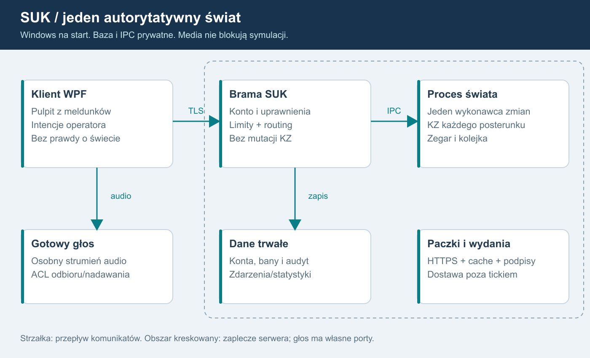

# 03. Architektura docelowa
REKOMENDACJA: modułowy serwer aplikacyjny i odizolowany proces świata na Windows. Początkowo jeden host i jeden świat. Izolacja procesowa nie wymaga osobnych maszyn.

## Opis diagramu dla AI
Klient WPF łączy się przez HTTPS/WSS z bramą SUK. Brama sprawdza konto i kieruje zweryfikowane intencje przez lokalny IPC do procesu świata. Świat zawiera zegar, nadrzędną obsługę poleceń, KZ, urządzenia, ruch, rozkład i Otoczenie. Jest jedynym właścicielem stanu. Oddaje niemutowalne meldunki i zdarzenia do zapisu. Głos płynie osobno do serwera mediów, nigdy przez tick. Baza i IPC nie są publiczne. Pobrania wydań są oddzielone od symulacji.

## Moduły
| Moduł roboczy | Odpowiedzialność | Granica |
|---|---|---|
| SUK.Client WPF | pulpit i urządzenia łączności | nie ustala stanu świata |
| SUK.Contracts | DTO, wersje, błędy, schematy | bez logiki srk |
| SUK.Core | C#: teren, ruch, rozkład i koordynacja; adapter natywnego KZ | bez HTTP/WPF/bazy; zależności wykonuje Ada |
| SUK.Kz.Native | Ada: Kz_A/Kz_B, grupy, porównanie i domenowy selektor | jedna DLL/C ABI, bez sieci, kont i fizyki |
| SUK.Server | konta, SignalR, przydziały, moderacja | bez bezpośrednich mutacji urządzeń |
| SUK.WorldHost | kolejka, czas, Tick, migawki | nie czeka na sieć |
| SUK.Communications | urządzenia, ACL, tokeny głosu | tekst nie jest zgodą KZ |
| SUK.Persistence | audyt i projekcje statystyk | zapis poza tickiem |
| SUK.Update | dystrybucja i zgodność | nie atestuje klienta |

Nazwy projektów są propozycją; nie przenosić plików jedynie dla nazwy.

## Jedna sekwencja zmian
Polecenia człowieka, instruktora i później AI trafiają do ograniczonej kolejki. Jeden wykonawca świata porządkuje je względem ticków, kierując do odrębnego KZ właściwego posterunku. Wątki połączeń nie mutują KZ. Osobne zadania serializują DTO, zapisują i wysyłają.

Zegar wykonania jest monotoniczny; czas symulacji jest oddzielny od UTC audytu. Pierwsza migracja zachowuje kroki rdzenia 0,1 s i dotychczasową kolejność; meldunki początkowo 5 Hz. Akceptowane wcześniej opóźnienie rozkaz-meldunek w planie modułów jest osobnym tematem, a nie zgodą na zmianę parametrów podczas wydzielania hosta.

Nie dzielimy pierwszego połączonego świata na niezależne serwery stacji. Pociąg ma jedno trainId i jednego właściciela również na granicy posterunków. Odcinek dyżurnego jest podziałem praw, nie procesu fizyki.

## Granica procesu
Na Windows rekomendowane Named Pipes z ACL kont usług, limitami i epoką świata. Brama nie ma klucza publikowania wydań; świat nie ma haseł/SMTP. Prototyp może użyć adaptera in-process, ale publiczny pilot wymaga sprawdzonej izolacji procesu i limitów zasobów.

## Singleplayer
LocalSession używa tego samego SUK.Core i lokalnego cyklu, bez konta i Internetu. Lokalne statystyki są oddzielne od serwerowych. AI obsługuje tylko styczne poza zadeklarowanym obszarem gracza, bez symulowania całego okręgu. W multiplayerze lokalny rdzeń nie jest źródłem wiążących wyników, nawet jeśli EXE zawiera go dla singleplayera.

## Gotowe elementy
- ASP.NET Core i SignalR, oficjalny klient .NET, JSON na start. MessagePack dopiero po benchmarku.
- ASP.NET Core Identity i OpenIddict w monolicie: konta oraz OIDC. Nie pisać własnych haseł ani tokenów.
- PostgreSQL jako usługa Windows, jedna instancja, ograniczona pula połączeń. Nie zapisujemy każdego ticku.
- .NET Generic Host/WindowsServices do hostowania usługi.
- Istniejący serwer mediów po prototypie S10.
- Framework aktualizacji, np. Velopack, z oddzielną bramką bezpieczeństwa metadanych.

To rekomendacje, nie instalacja komponentów. Redis, Kubernetes, broker i klaster bazy nie są potrzebne na start. Każdy dodatkowy element wymaga wskazania rzeczywistego wąskiego gardła.

## Pakiety obszaru
Manifest pakietu zawiera schemaVersion, topologyVersion, interlockingVersion, displayVersion, timetableVersion, contentHash i pochodzenie. Człowiek zatwierdza dane, przebiegi i zobrazowanie. Serwer weryfikuje odwołania i ładuje autorytatywną wersję, klient tylko potrzebne dane do rysowania. Paczki nie wykonują skryptów. Nazwy miejsc są danymi.

Zmiana paczki wpływającej na logikę wymaga kontrolowanego zakończenia/przeniesienia sesji. Nie podmieniamy zależności w trakcie ticku. Obecny station.json obsługuje adapter tylko do odczytu.

## Sterowanie kolejką i prawa w tej samej sekwencji
Przydziały, odebranie praw, logout, kick i sankcje trafiają jako komunikaty sterujące do tej samej sekwencji świata co komendy. Host utrzymuje authorizationVersion i controlEpoch, bez zapytań DB w ticku. Administracja rozróżnia zapis sankcji w bazie od potwierdzonego zastosowania jej we wszystkich właściwych światach. Po granicy zastosowania oczekujące żądanie starej wersji praw nie wykonuje się.

Host ma mierzony budżet liczby i czasu obsługi komend między tickami. Nie opróżnia całej kolejki kosztem zegara. Zapewnia sprawiedliwy udział kont oraz jawny maksymalny wiek przyjętego żądania. Przekroczenie terminu przed wykonaniem daje Rejected/Expired bez skutku. Priorytety awaryjne wymagają ustaleń domenowych; nazwa komendy nie jest podstawą obejścia limitów.

## Wiele niezależnych KZ w jednym świecie
USTALONE: jeden moduł zależności dla każdego posterunku. WorldHost jest gospodarzem modułów, a nie wspólnym komputerem zależności całego LCS. Przykład: KZ posterunków P1/P2 zawierają te same wersje dwóch odrębnych implementacji Ada Kz_A oraz Kz_B, ale mają własne definicje, stany, kolejki domenowe, status i usterki. Nie czytają wzajemnie prywatnych przebiegów ani utwierdzeń.

KZ są połączone wyłącznie jawnymi interfejsami komunikatów blokad i zatwierdzonych funkcji między posterunkami. Wspólna warstwa terenu/ruchu nie daje KZ dostępu do pociągów ani skrótu do stanu sąsiada. Każda karta/obiekt sterowany ma jednoznacznego właściciela. Harmonogram świata koordynuje fazy i wspólny czas; nie zmienia ukradkiem zaakceptowanej kolejności rozkaz-meldunek.

Jeden proces dla wielu modułów oszczędza zasoby i zapewnia spójność świata. Logiczna usterka jednego KZ nie wyłącza wszystkich; awaria całego procesu nadal dotyka wszystkie jego moduły. Ewentualna niezależność procesowa KZ to osobny późniejszy projekt, nie obietnica obecnego hosta.

Nie tworzyć pełnego Simulator wraz z Trains/Rozklad dla każdego posterunku: to duplikowałoby pociągi i zajętości. Wydzielić kontekst KZ z istniejących algorytmów oraz wspólny świat fizyczny. To obowiązkowe kryterium S01-S02, a nie funkcja odłożona do AI.

## Wspólne zasoby i lokalny stan
Współdzielone definicje są niemutowalne. InterlockingInstance ma prywatny kontekst i lokalne utwierdzenia. Identyfikatory przebiegów, potwierdzeń i zdarzeń zawierają kzId albo są globalnie unikalne. Kontekst operatora przekazujemy jawnie; brak tymczasowej podmiany globalnego CurDesk do wykonania komendy.

Dwa końce blokady mają lokalne stany właściwych KZ i jawny interfejs komunikacji. Wspólny fizyczny stan szlaku i urządzeń odstępowych ma jednego właściciela, bez dwóch kopii mutable BlockState. Zasilanie jest przypisane do zaprojektowanych domen, które mogą obejmować wiele urządzeń lub posterunków; nie zakładamy automatycznie jednej globalnej ani osobnej sieci dla każdej stacji.

Harmonogram dostarcza KZ spójny zestaw statusów danej fazy. Kolejność rejestracji w słowniku nie może ukradkiem zmieniać reakcji. Kiedy komunikat przechodzi między cyklami, określa kontrakt i scenariusz różnicowy. Wielocelowy przebieg/polecenie obejmujące cudzą ochronę boczną wymaga zatwierdzonej granicy i protokołu; nie kierujemy go do KZ tylko według sygnalizatora początkowego.

## Odrębne prawa obserwacji i sterowania
ViewGrant i ControlLease mają różne cykle życia. Przekazanie posterunku usuwa sterowanie dotychczasowego dyżurnego, zachowując podgląd LCS. Agregator publikuje meldunki według ViewGrant; pipeline komend wymaga bieżącego ControlLease. Nie opierać obu uprawnień na jednym bool „Controls”.

## Korekta po audycie źródeł - wersja 1.3
### Dwie grupy każdego logicznego KZ
PostKz = stałe kzId/postId + Group1 + Group2 + Selector + interfejsy. Każda grupa ma własne dynamiczne zależności, timery, historię wejść i diagnostykę. Współdzielić można tylko niemutowalne definicje. Obie rzeczywiście obliczają tę samą uporządkowaną CycleInput; rezerwa nie jest flagą ani pustą instancją.

Model kanałów opisuje rozdział 18, a realizację rozdział 23. Kz_A i Kz_B powstają niezależnie w Ada, w osobnych czatach. Oba działają w każdej grupie 1/2. Wspólna specyfikacja lub dwóch autorów nie są automatycznym dowodem certyfikowanej różnorodności i SIL.

### Jeden skutek
OutputPlan obu grup nie zmienia urządzeń, kart, pociągów, książki ani statystyk. AdaGroupRuntime per kzId wskazuje plan wyłącznie aktywnej, zakwalifikowanej grupy. C# OutputGate egzekwuje pochodzenie, epoki, jednokrotność i prawa nowych intencji; karta wykonuje rozkaz wobec jednego świata. Ta sama bramka obejmuje komunikaty wychodzące KZ-KZ. Odrzuca dawne selectionEpoch/groupRunId i powtórzone effectId. ZeroLO, zgoda blokady i wpis statystyki muszą wykonać się raz.

System nadrzędny, parser, Pending/potwierdzenia operatora, książka, PIP i prawa nie są kopiowane do grup. Intencja przyjmowana jest raz, jej niezmienna reprezentacja trafia do obu obliczeń. Przy zatwierdzeniu nowej intencji ponownie sprawdza się aktualne prawa. Autonomiczne dozorowanie wcześniej zatwierdzonego stanu nie zależy od dalszego lease poprzedniego operatora. Przełączenie nie zmienia ControlLease/ViewGrant.

### Cykl i trwałość
Fazy: statusy → uporządkowane wejścia → obliczenia grup/kanałów → kontrola kwalifikacji → wybór wyjść → karty/teren → meldunki. Szczegółowe opóźnienia rozkaz-meldunek zachowują zatwierdzony scenariusz bazowy. Train/Trains/Rozklad i fizyczny teren wykonują krok raz. Jeden logiczny strumień KZ trafia do klienta.

Hot failover zmienia selectionEpoch. Restart grupy zmienia groupRunId. Restart logicznego KZ i restore świata mają odrębne epoki. Checkpoint obejmuje oba stany grup/kanałów, selektor, wejścia i zatwierdzone wyjścia oraz jeden świat. Dwie grupy w procesie nie chronią przed crashem Windows. S02A-S02D są obowiązkowe przed S04 i pilotem.

## Operator algorytmiczny - ustalone F17
IOperator obsługuje autorski algorytm SUK: automaty stanów, reguły oraz ograniczone planowanie na danych i meldunkach. LLM nie występuje jako operator, planista ani zapasowy tryb decyzyjny. Ten sam moduł działa na serwerze lub lokalnie offline, korzystając z istniejącego Otoczenie/Rozklad i normalnej drogi poleceń. Nie ma osobnego modelu językowego, klucza API ani zewnętrznej inferencji do prowadzenia ruchu. Szczegóły kontraktu i powtarzalności w 07.

## Granica Ada-C# i końcowe interfejsy
Domenowa logika KZ, oba programy A/B, ich prywatne stany, porównanie, kwalifikacja i wybór aktywnej grupy należą do Ada. C# WorldHost porządkuje autoryzowane wejścia i wykonuje jedną wybraną paczkę rozkazów wobec kart/terenu. Jego OutputGate egzekwuje prawa, epoki i effectId; nie jest drugim silnikiem zależności ani samodzielnym wyborem grupy.

Jedna SukKz.dll zawiera oba niezależne pakiety i jeden runtime GNAT. Współpraca przez wersjonowane C ABI/LibraryImport/SafeHandle, bez przechodzenia wyjątków Ada przez granicę. Grupy 1/2 zawierają po A+B; łącznie cztery prywatne konteksty. Jeden teren/ruch i jeden pipeline poleceń. Dokładny kontrakt, inicjalizacja i snapshoty: 23.

Wynik losowania grupy zasadniczej jest jawnie nadanym wejściem startowym, zapisywanym przed rozpoczęciem sterowania. Replay korzysta z niego, a nowe uruchomienie świata losuje po odtworzeniu/uzgodnieniu obu grup. Reconnect, zmiana obsady i restart pojedynczej grupy nie uruchamiają losowania.

Panel S18 używa istniejących usług przez prywatny interfejs web. Dyspozytor S19 jest widokiem WPF w istniejącym kliencie, z projekcją okręgu i dyspozycjami domenowymi, bez domyślnego sterowania KZ.

## Administracja 1.6
SUK.Admin.exe C#/WPF → prywatny SUK.AdminApi → istniejące konta/sankcje/audyt i kontrolowane kolejki świata. Osobny listener operacyjny wymaga mTLS ORAZ tokenu konta i aktualnych praw. Ograniczony enrollment nie oferuje czynności admina. Klient nie łączy się z bazą, pamięcią świata ani Ada; szczegóły 21.

## Istniejące moduły jako punkt migracji - 1.7
Na bazie 5eddb5c istnieją C# Sim/Kz/KomputerZaleznosci, Sim/Pulpit/SystemNadrzedny/Pip i Sim/Urzadzenia z kartami oraz Zasilanie. To szwy do ponownego wykorzystania, bez potrzeby nowej implementacji kart lub parsera. Simulator tworzy nadal jeden KZ całego Station i przez Fasada udostępnia jego mutable słowniki. Oddzielna klasa nie jest odrębnym KZ posterunku.

Docelowa granica obejmuje również istniejącą Komputerownię: prywatne, autoryzowane projekcje diagnostyczne oraz osobną kompetencję instruktora do usterek. Nie transportować starego dowolnego t=serwis/usterka przez nową bramę jako zaufanej komendy. Wykonanie błędu/usterki musi trafić do tej samej uporządkowanej sekwencji praw co inne intencje. Komputerownia nie jest kanałem B, rezerwą ani komparatorem zależności.

Pakiety przyszłych obszarów uwzględniają zaakceptowany PLAN_EDYTOR_ZOBRAZOWANIA: UT tylko do odczytu, ręcznie projektowane .zob.json i stałe identyfikatory obiektów. Obecny symulator nadal czyta station.json. Import UT+zobrazowanie nie powstał i nie jest dowodem zgodności schematów; adapter bieżących danych pozostaje konieczny.

## Obowiązkowe logowanie modułowe - 1.8
Każdy moduł ma adapter logów z rozdziału25 i zakres moduleId/worldRunId; dotyczy hosta, KZ/kart, ruchu, sieci, auth, usług, klientów i narzędzi. W Ada diagnostyka jest biernym wynikiem o ograniczonym rozmiarze, który host mapuje na logi; nie ma zapisu do pliku ani wywołania loggera C# w Evaluate. Diagnostyka czterech kontekstów nie tworzy czterech wpisów o jednym zatwierdzonym skutku. Diagnostyka, dziennik domenowy i trwały audyt/commit mają odrębne gwarancje.
