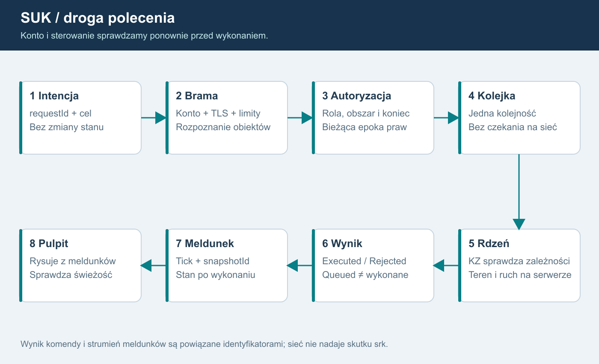

# 04. Protokół i spójność
REKOMENDACJA: SignalR przez HTTPS/WSS dla .NET. Najpierw WebSocket; fallback dopuszczamy po sprawdzeniu zachowania i limitów. SignalR nie zapewnia sam autoryzacji domenowej, trwałości świata ani jednokrotności skutku.

## Opis dla AI
Pulpit wysyła intencję. Brama sprawdza uwierzytelnienie, limit, dokładny cel i przydział. Kolejka świata porządkuje polecenia; istniejący KZ sprawdza zależności. Wynik wraca z requestId. Aktualny stan potwierdzają meldunki, nie samo odebranie ramki. Wolny odbiorca nie blokuje ticku.

## Wejście do świata
1. Bootstrap HTTPS zwraca minimum: protokoły, minimalny build i kanał aktualizacji.
2. Logowanie: przeglądarka systemowa, Authorization Code + PKCE, publiczny klient bez sekretu.
3. Brama sprawdza podpis, issuer, audience, ważność tokenu, konto, bany i limity.
4. Hello wymienia clientVersion, protocolVersion, contentSchema i capabilities.
5. Serwer wyznacza worldId, sessionEpoch, contentHash i stanowisko. Niezgodność blokuje wejście.
6. Pełna migawka dozwolonego zakresu i potwierdzenie snapshotId poprzedzają komendy.

Przed uwierzytelnieniem brak planu świata i danych osób. Konto/rola nie pochodzą z klientowego User.

## Koperta polecenia - szkic
~~~json
{
  "protocolVersion": 1,
  "worldId": "world-uuid",
  "sessionEpoch": "fresh-random-uuid",
  "requestId": "request-uuid",
  "controlAreaId": "area-uuid",
  "controlEpoch": 7,
  "expectedContextVersion": 41,
  "expectedKzEpoch": "kz-incarnation-uuid",
  "command": {
    "kind": "InterlockingCommand",
    "targetId": "object-uuid",
    "blockEndId": null,
    "arguments": {}
  }
}
~~~
To szkic, nie produkcyjny schemat. accountId, role i deskId przypisuje serwer. Brak API SetSignal, SetTrainPosition, SetOccupancy i „dodaj punkty”.

Istniejący parser tekstowy zostaje adapterem. Najpierw rozpoznaje wszystkie obiekty, nazwy ze spacją i dokładny koniec blokady, potem sprawdza uprawnienia. Cel nie może zmienić się po autoryzacji.

## Wyniki i potwierdzenia
Stany: Queued, Executed, Rejected, AwaitingOperatorConfirmation. Queued nie oznacza wykonanego polecenia. Wynik zawiera requestId, tick, kod i correlationId. Teksty po polsku mapują stabilne kody.

Polecenie specjalne ma serwerowe confirmationId związane z kontem, stanowiskiem, celem, treścią, controlEpoch i czasem ważności. Rozłączenie i zmiana praw je unieważniają. Przed wykonaniem z kolejki ponownie sprawdzamy ban i epokę praw. Stare polecenie nie wykonuje się po odebraniu sterowania.

## Powtórzenia
Klucz: konto + świat + sessionEpoch + requestId. Propozycja pamięci wyników: co najmniej 10 min, do pomiaru. Ten sam requestId z inną treścią odrzucamy. Po timeout UI pokazuje „wynik nieznany”, pyta o status lub ponawia identyczny requestId.

Restart świata tworzy nową sessionEpoch. Klient nie odgrywa poprzednich poleceń. Nie obiecujemy exactly-once przez awarię bez trwałego dziennika. Niepewny stan wymaga resynchronizacji i nowej świadomej decyzji. S06 wybiera trwałość krytycznych wyników i sprawdza awarię przed/po zapisie.

## Migawki i delty
Migawka zawiera worldId, sessionEpoch, serverTick, simulationTime, snapshotId, projectionId, stateVersion i controlEpoch. Każda delta zawiera projectionId, baseVersion oraz stateVersion; klient stosuje ją tylko wtedy, gdy baseVersion równa się wersji jego bieżącego stanu. baseSnapshotId może wskazywać bazę pełnej migawki, ale nie zastępuje ciągłości wersji kolejnych delt. Luka, zmiana zakresu lub epoki wymaga synchronizacji. Wersje dotyczą konkretnej projekcji dozwolonego zakresu.

Nie wolno wybierać „ostatniej delty”, jeśli pomija ona niezastosowane zmiany. Można zastąpić kolejkę pełną najnowszą migawką albo przeliczyć deltę względem potwierdzonej bazy. Alarmy i wyniki komend mają osobną numerowaną kolejkę; nie giną z pominiętą klatką obrazu. Po wyjściu poza bufor następuje jawny resync.

Subskrypcja wynika z serwerowych praw. pageId nie daje dostępu do cudzego obszaru. Podgląd nadzorcy może być rzadszy od własnego pulpitu: propozycja 1-2 Hz wobec 5 Hz, do pomiaru. Obecny Seq na publikację nie jest tickiem świata.

## Łącze i reconnect
Heartbeat nie zastępuje świeżości świata. Propozycja: 2 s bez meldunku oznacza brak danych i blokadę komend; powrót po pełnej synchronizacji. Rezerwacja stanowiska po zerwaniu: roboczo 30 s, decyzja D04.

Reconnect ma backoff z losowością, ponowne uwierzytelnienie i odczyt obsady. Konto nie odzyskuje posterunku przejętego prawidłowo przez inną osobę. Ban lub wygaśnięcie sesji kończy także istniejący WebSocket.

Rozłączenie nie resetuje sygnałów, przebiegów ani pociągów. Stan trwa na serwerze. Procedura po braku operatora wymaga odrębnej decyzji merytorycznej, a nie transportowego resetu.

## Dokładna granica ponowienia i odzyskania
Rejestr przyjętych/wykonanych requestId należy do autorytatywnego hosta świata. Restart bramy go nie zeruje. Równoległe kopie współdzielą jeden wpis od przyjęcia do kolejki. Serwer przekazuje termin bezpiecznego ponowienia. Po wygaśnięciu pamięci brak wpisu oznacza „wynik nieznany”, nie dowód niewykonania; klient nie ponawia automatycznie starej intencji.

S06 wyznacza wspólny punkt trwałości komendy, wyniku i skutku w odtwarzanym świecie. Executed z poprzedniego przebiegu nie dowodzi przetrwania skutku istniejącego tylko w RAM. Po starszym checkpoint świat publikuje nową epokę i zakres cofnięcia; wyniki dotyczące utraconych skutków są historyczne. Test obejmuje zapis wyniku przed/po utrwaleniu skutku.

Epoka uruchomienia świata jest nowym losowym UUID przy każdym starcie i odtworzeniu, także z backupu. Nie powstaje wyłącznie przez zwiększenie licznika w odtwarzanej bazie. Jest odrębna od logowania i połączenia. controlEpoch/authorizationVersion pozostają wersjami wewnątrz bieżącego uruchomienia.

Limit wieku polecenia wyznacza host na podstawie monotonicznego czasu odbioru; zegar klienta nie może przedłużyć jego ważności. Ponowna walidacja celu i kontekstu nadal obowiązuje przy wykonaniu.

## Adresowanie konkretnego KZ
Polecenie po rozpoznaniu targetId jest przypisane przez serwer do postId i kzId z zatwierdzonego rejestru obiektów. Klient może wskazać kontekst, ale nie zmienić właściciela urządzenia. Sprawdzamy lease dla obiektu i właściwego końca blokady oraz status jego KZ. Odcinek zawierający kilka posterunków kieruje komendy do kilku odrębnych modułów.

Meldunki zawierają sourceKzId, postId, kzEpoch danego KZ oraz stan świeżości jego łącza. Agregator LCS składa projekcję z wielu źródeł, zachowując ich pochodzenie. Brak danych KZ_A nie maluje automatycznie całego LCS na brak danych. Równocześnie awaria całego świata/łącza stanowiska unieważnia wszystkie objęte nią projekcje.

Komunikat między KZ jest serwerowym komunikatem modułów z correlationId, identyfikatorami końców i epoką uruchomienia; nie endpointem klienta do podszywania się pod sąsiedni KZ. Nie wprowadzamy uniwersalnego cross-KZ SetState.

Restart logicznego modułu ma nową kzEpoch. Nie odtwarzamy starego KZ do nowszego terenu bez zatwierdzonej procedury uzgodnienia: starsze utwierdzenia mogłyby nie odpowiadać zajętościom. Prototyp zaczyna od spójnego odzyskania całego świata; niezależny restart KZ wymaga osobnych testów, a nie samego wymienienia obiektu w pamięci.

## Podgląd po przekazaniu
Rozłączenie prawa sterowania nie rozłącza subskrypcji objętej zachowanym ViewGrant. Meldunek zawiera bieżącego operatora/tryb podglądu oraz wersje praw. X po oddaniu otrzymuje dalsze meldunki, ale każda komenda do oddanego celu i stare potwierdzenie jest odrzucone. Po reconnect serwer odtwarza osobno ViewGrant i ControlLease.

## Korekta po audycie źródeł - wersja 1.3
Klient adresuje logiczny kzId/obiekt; nie wybiera grupy 1/2 ani nie przesyła własnych wyników kontroli kanałów. Diagnostyka ma osobny uprawniony kontrakt. Ukryty przycisk nie jest kontrolą dostępu.

Gorące przełączenie utrzymuje logiczny strumień meldunków i prawa operatorów. Wersja oraz stan źródła pozwalają wykryć nieaktualność. Brak danych nie wygląda jak świeży poprawny stan. Wyjścia KZ-KZ także przechodzą jednokrotne zatwierdzenie; rezerwa nie wysyła drugiej zgody blokady. Restore wymaga nowej epoki świata i resynchronizacji, bez replay starych poleceń.

## Granica natywna i dyspozycje 1.5
Klient nadal wysyła DTO przez HTTPS/WSS. Nie wysyła wskaźników, natywnych uchwytów, adresów funkcji ani dowolnych danych ABI. Brama waliduje typy i limity, a WorldHost buduje jawne wejścia dla Ada. Nie przyjmujemy kodu Ada ani DLL od użytkownika.

S18 korzysta z wersjonowanych operacji administracyjnych i ich identyfikatorów. S19 dodaje typowane dyspozycje z odrębnymi stanami wydania, odbioru, akceptacji i realizacji. Received nie oznacza wykonania. Żadna dyspozycja lub rola administracyjna nie zastępuje ControlLease, normalnej autoryzacji i KZ w Ada.

## Kanał serwisowy istniejącej aplikacji - 1.7
W bieżącym LcsServer deklaracja t=serwis daje dostęp do diagnostyki oraz usterek bez weryfikacji konta; ten handler działa również na serwerze stanowisk. Nowy protokół nie ma ogólnej operacji „prześlij dowolny JSON do starego handlera”. Publiczne wejście gry odrzuca serwisowe/instruktorskie operacje bez skutku.

Prywatne API rozdziela odczyt kart/KZ, sprawdzenie przebiegu i mutacje instruktora; każda ma własne kompetencje, zakres postId/kzId, limity oraz aktualną epokę praw. Ograniczyć również parametry, częstotliwość i rozmiar odpowiedzi diagnostycznych. Deklaracja klienta, port loopback lub pole wersja=1 nie potwierdzają tożsamości, praw ani zgodności wersji. N42/O20 obejmuje utratę uprawnień w otwartej sesji i oczekującej mutacji.

## Korelacja z logami - 1.8
Serwer nadaje zaufane identyfikatory oraz wiąże requestId z tożsamością, światem, tickiem i wynikami. Dane z klienta są niezaufanymi polami o limitowanej długości; CR/LF nie tworzy nowego rekordu. Bez kopiowania całych żądań, JWT i nagłówków Authorization. Przyjęcie, odmowa i pojedynczy skutek mają odrębne eventId oraz wspólne correlationId. Trwałość przed Applied nie wynika z samego loggera; patrz25 i S06.
