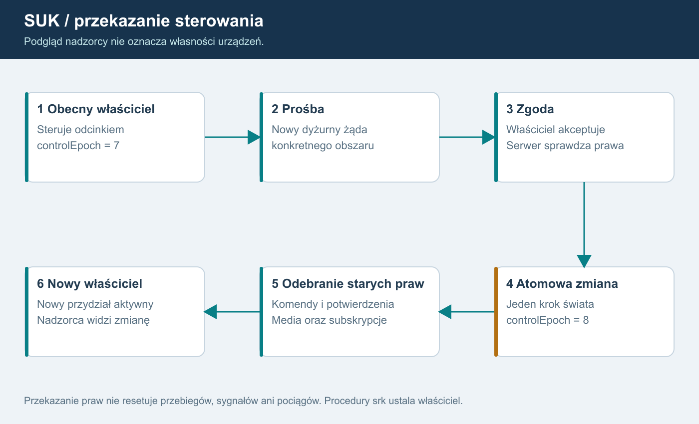

# 06. LCS, odcinki i stanowiska
REKOMENDACJA modelu uprawnień; nie jest definicją procedur srk.

## Opis dla AI
Nadzorca obserwuje cały LCS. Każdy odcinek ma jednego właściciela sterowania i własną epokę. Prośba, zgoda i atomowe przekazanie zmieniają właściciela; serwer unieważnia poprzedni przydział, oczekujące potwierdzenia i odpowiednie uprawnienia łączności. Podgląd nie daje prawa wydawania poleceń. Pomocniczy otrzymuje wyraźnie ograniczone czynności.

## Hierarchia
Świat zawiera obszary LCS i posterunki. Odcinek jest konfigurowalną grupą posterunków albo zatwierdzonym zakresem urządzeń. Stanowisko to aktywna sesja operatora, konto jest trwałą tożsamością. Jedno nie jest synonimem drugiego.

Najprostszy pierwszy wariant: odcinek jako grupa całych posterunków. Podział wnętrza posterunku wymaga ręcznie zaprojektowanych granic, wspólnych urządzeń, reguł konfliktu i procedur. To decyzja D01; plan nie ogranicza funkcji docelowej, ale oddziela jej bezpieczny pierwszy zakres.

Nie utożsamiać sieciowej własności obszaru z blokadą stacyjną Dn/On, Dz/Oz itd. Ta ostatnia jest osobną funkcją domenową z wcześniejszego planu.

## Macierz ról - propozycja
| Rola | Widoczność | Sterowanie | Administracja kont |
|---|---|---|---|
| Obserwator | przydzielony zakres | brak | brak |
| Dyżurny odcinkowy | własny i dozwolony podgląd | posiadany odcinek | brak |
| Dyżurny pomocniczy | przydzielony zakres | tylko zatwierdzone delegowane czynności | brak |
| Nadzorca LCS | podgląd całego LCS | prośba o przejęcie; przymus osobną decyzją | brak |
| Instruktor | scenariusz i stan dydaktyczny | jawne usterki/tempo zgodnie z rolą | brak domyślnie |
| Moderator | minimum potrzebne do interwencji | kick/mute/blokady wg polityki | bez praw operacyjnych hosta |
| Administrator usługi | audyt i konfiguracja | uprawnienia nadawane osobno | konta i role |

Każdy wiersz to zestaw uprawnień, nie sztywny pojedynczy enum. Konto może mieć kilka ról, ale serwer liczy ich zakres. Administrator nie dostaje automatycznie możliwości omijania KZ. Moderator nie otrzymuje automatycznie prawa podsłuchiwania rozmów.

## Przydział sterowania
ControlLease zawiera leaseId, accountId, deskId, worldId, areaId, controlEpoch, issuedAt i status. Odcinek ma jednego właściciela; pokrywające się delegacje sterujące tym samym urządzeniem są odrzucane. Podgląd wielu osób jest dozwolony.

Przekazanie z przygotowaniem poza tickiem i atomową zmianą praw:
1. Sprawdzenie uprawnienia do żądania i bieżącego właściciela.
2. Zgoda dotychczasowego operatora albo zatwierdzony tryb interwencji.
3. Przygotowanie trwałego audytu i odcięcia mediów poza tickiem; potem atomowa zmiana właściciela i controlEpoch.
4. Unieważnienie starych komend i potwierdzeń przed wykonaniem.
5. Nowe projekcje i uprawnienia łączności.
6. Powiadomienie obu stanowisk i nadzorcy.

Przeniesienie praw nie zmienia nastawionych przebiegów i fizycznego stanu terenu. Jeśli urządzenia komunikacyjne wymagają odebrania dostępu, operacja kończy się dopiero po potwierdzeniu odcięcia lub odłączeniu starej sesji mediów.

## Pełny katalog komend
Dla każdej komendy: rozpoznany cel, zakres, rola, posiadany lease, wymagana procedura potwierdzenia i wpis audytu. Uwzględnić KW, NN/ONN, AGR, STW, alarmy, instruktor, tempo i działania na szlaku.

Szlak ma dwa odrębnie autoryzowane końce. Posiadanie jednego nie uprawnia do wskazania drugiego przez etykietę. Brak kodu posterunku i nieznany obiekt oznaczają odmowę, chyba że konkretne polecenie ma jawnie zdefiniowany globalny zakres.

## Utrata operatora
Transport odróżnia rozłączenie, logout, kick i ban. Rezerwacja przy reconnect jest techniczna; automatyczne przejście na nadzorcę/AI jest decyzją domenową D04. Nie zamieniamy utraty łącza w automatyczne „wszystko Stój”. Serwer nie resetuje pociągów ani blokad.

Ban posterunku oznacza brak możliwości uzyskania obejmującego go przydziału. Jeżeli odcinek zawiera zablokowany posterunek, trzeba odmówić takiego odcinka albo wcześniej jawnie go podzielić; nie pomijać blokady przez większy zakres.

Pomocniczy nie może działać równolegle na tym samym urządzeniu bez ustalonego modelu odpowiedzialności. Dokładny katalog delegacji i zasady komend specjalnych to D02. Zachowanie Wbl/Pzk po rozdzieleniu końców to D03, do decyzji właściciela na podstawie Ie-20 i materiałów.

## Asynchroniczne przygotowanie
Atomowość dotyczy właściciela i epoki wewnątrz świata. Cała operacja ma Preparing/Committed/Failed. Nie czekamy w ticku na DB ani serwer głosu. Nowe prawa wymagające potwierdzonego odebrania poprzednich uprawnień mediów nie są aktywne przed końcem przygotowania. Brak odpowiedzi nie przywraca automatycznie starego lease. S06 ustala stan po każdym punkcie awarii i timeout. Zapis sankcji/przekazania oraz potwierdzenie ich zastosowania są osobnymi wynikami.

## Odcinek i KZ to różne podziały
Każdy posterunek ma własny moduł zależności niezależnie od tego, kto nim steruje. Połączenie kilku posterunków w jeden odcinek ani przejęcie całego LCS nie scala ich KZ. Pomocniczy może mieć zatwierdzony podzakres jednego posterunku, lecz nie tworzy przez to nowego KZ. Podział danych zależności i granic urządzeń jest projektowany przez człowieka. Interwencja i komenda globalna wskazuje jawny zbiór KZ; nie otrzymuje domyślnie całego świata.

## Ustalenie właściciela F15 - bez ponownego pytania
Po oddaniu kontroli dyżurny LCS ma nadal podgląd posterunku, ale nie ma sterowania. ViewGrant pozostaje, ControlLease przechodzi na nowe stanowisko. Podgląd obejmuje obserwację skutków działań nowego dyżurnego. Nie usuwać wszystkich subskrypcji wraz z lease. Rola nadzorcza nie pozwala mimo to wydać komendy; potrzebne prawidłowe przejęcie. Wyjątkiem jest osobna sankcja odbierająca dostęp, nie zwykłe przekazanie.

Asynchroniczny Preparing nie jest jeszcze przekazaniem. Właściwa granica utraty/nabycia prawa to Commit w świecie. Jeśli operacja zawiedzie przed odebraniem prawa, dotychczasowe prawo nie wymaga „przywrócenia”; jeżeli zostało już odebrane, nie odtwarzamy go samoczynnie po błędzie. S06 ma testować oba przypadki bez blokowania ticku.

## Korekta po audycie źródeł - wersja 1.3
Prawa dotyczą posterunku/obszaru, nigdy chwilowo aktywnej grupy. Przełączenie grupy nie odnawia delegacji pomocniczego, nie przywraca utraconego sterowania i nie omija zakazu posterunku. Oddający LCS nadal ma aktualny podgląd po przełączeniu, ale jego komendy i potwierdzenia są odrzucane. N33 łączy te próby z N24.

## Końcowy dyspozytor i administracja
Administrator, dyspozytor ruchowy i dyżurny LCS są odrębnymi rolami. S18 zarządza kontami, sankcjami i utrzymaniem według kompetencji. S19 realizuje zatwierdzony przez właściciela nadzór i koordynację okręgu. Podgląd i wydawanie dyspozycji nie dają ControlLease ani prawa przełączania grup KZ. Szczegóły 21/22; po zwykłym oddaniu posterunku F15 nadal obowiązuje.

## Uwzględnienie systemu nadrzędnego - 1.7
Stanowiska i posterunek→stanowisko są już w Sim/Pulpit/SystemNadrzedny.cs, a Sim/Desk.cs stanowi fasadę. Wykorzystać to zachowanie po rozdzieleniu globalnego User/Page/Pending/CurDesk i dodaniu właściwych ViewGrant/ControlLease. Obrazy nowego edytora mogą pokazywać ten sam obiekt UT na dwóch obrazach; nie daje to dodatkowego prawa sterowania. Prawa wynikają z właściciela posterunku/obiektu, nie z aktualnej zakładki pulpitu.
