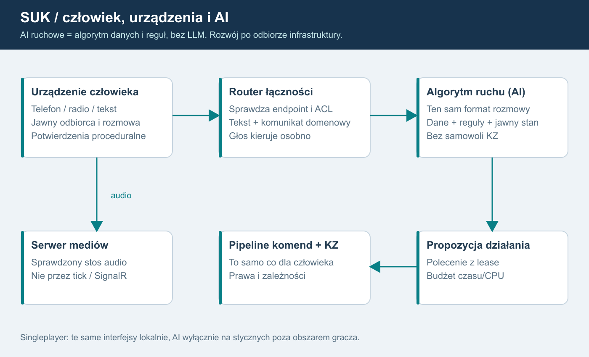

# 07. Łączność przez urządzenia i późniejsze AI

## Ustalenie właściciela: AI ruchowe jest algorytmem, bez LLM
W całym planie **AI prowadzące ruch oznacza autorski algorytm SUK**, który stworzymy na podstawie danych infrastruktury, rozkładu jazdy, parametrów pociągów, bieżących meldunków i zatwierdzonych zasad prowadzenia ruchu. Realizacja: automaty stanów, reguły decyzyjne i planista konfliktów z ograniczonym horyzontem. **Model LLM nie prowadzi ruchu, nie wybiera decyzji i nie stanowi trybu awaryjnego.** To ustalenie obejmuje multiplayer oraz singleplayer.

Algorytm działa na autorytatywnym serwerze albo lokalnie offline w singleplayerze. Nie wymaga usługi modeli językowych, klucza API ani opłat za tokeny. Parametry i reguły są jawne, wersjonowane i sprawdzane scenariuszami. Dla tych samych wejść, czasu symulacji i konfiguracji uzyskujemy odtwarzalny wynik.

AI w zwrocie „instrukcja dla AI” oznacza narzędzie pomagające programiście. Nie określa technologii automatycznego dyżurnego działającego w SUK.

## Opis dla AI
Urządzenie człowieka tworzy rozmowę/komunikat domenowy. Router sprawdza urządzenie, połączenie i uprawnionych odbiorców. Tekst trafia do innego urządzenia lub adaptera AI. Głos to osobny strumień do serwera mediów. AI proponuje odpowiedź i ewentualną komendę do normalnego pipeline; nigdy nie zmienia stanu KZ. W singleplayerze te same interfejsy pracują lokalnie.

## Wzorzec funkcjonalny
[Dokumentacja ISDR](https://www.symulator.isdr.pl/download/dokumentacja.pdf), wersja 2024.09.30, rozdział 2.4, s. 53-58, jest inspiracją dla centralek, telefonicznej łączności ruchowej i parametryzowanych rozmów. Nie traktujemy jej jako opisu protokołu, kodu ani licencji na kopiowanie grafiki. Nie odtwarzamy urządzeń z pamięci; pierwsze urządzenie i zakres procedur wybiera właściciel (D05).

## Model łączności
CommunicationEndpoint: endpointId, typ urządzenia, posterunek/obszar, linia lub grupa radiowa, dozwolona rola i odbiorcy. Konfigurację połączeń przygotowuje człowiek. Id urządzenia nie jest identyfikatorem konta.

Połączenie telefoniczne: Idle, Calling, Ringing, Connected, Busy, Ended/Failed. Radiotelefon: nasłuch, PTT, nadawanie oraz zajętość kanału. Kolizje nadawania, priorytety i podsłuch instruktora wymagają decyzji o odwzorowywanym urządzeniu. Interfejs to urządzenie, nie jedna globalna lista czatu.

Wiadomość zawiera messageId, conversationId, endpointFrom/To, typ, trainId/number, track/blockEndId, parametry, simulationTime, createdUtc, correlationId i status. Serwer nadaje tożsamość. Katalog telefonogramów i wymaganych parametrów wynika ze źródeł i decyzji właściciela, nie z generatora tekstu.

Statusy Delivered, Read i AcceptedOperationally mają różne znaczenie. Odczytanie tekstu i usłyszenie głosu nie są automatycznym potwierdzeniem zgody ruchowej. Dowolna wiadomość nie może uruchomić semafora.

## Tekst
Pierwszy kanał: tekst i ustrukturyzowane formularze przez te same urządzenia. Walidacja odbiorców, limity, kolejność, potwierdzenie i antyspam po stronie serwera. Renderowanie jako zwykły tekst; bez załączników w pilocie. Utrata prawa do konkretnego urządzenia odcina jego przyszłe wiadomości. Samo oddanie sterowania zachowuje podgląd i nie odbiera automatycznie odrębnych praw łączności.

Rejestrator srk, prywatna rozmowa i audyt moderacji są oddzielnymi strumieniami. Obecny Telefon w rejestratorze jest wspólny; nie spełnia prywatności.

## Głos: nie budujemy kodeka ani własnego stosu transmisji
S10 porównuje dwa istniejące rozwiązania na Windows:

| Kandydat | Potwierdzone | Bramka prototypu |
|---|---|---|
| Mumble Server | oficjalna wersja Windows; API Ice | integracja WPF/audio i wielu urządzeń, ACL |
| LiveKit | oficjalne binarki Windows, WebRTC/SFU | adapter C++ lub JS/WebView2, operacje Windows i fallback TURN |

Rekomendacja: zacząć od ograniczonego prototypu Mumble; przejść do LiveKit, jeśli spełnienie urządzeń wymagałoby utrzymywania rozległego własnego klienta. Ice administruje Mumble i nie jest SDK audio. Mumble ma kanał macierzysty, dodatkowy nasłuch i whisper; VoiceTarget 1-30 nie oznacza limitu posterunków.

LiveKit nie jest Linux-only. Oficjalne wydanie 1.13.10 zawiera Windows; produkcyjne zachowanie jako usługi nie zostało tu przetestowane. Kod tej wersji wskazuje brak capacity management na Windows. Istnieją SDK C++/JS, ale nie potwierdzono gotowego natywnego odpowiednika dla WPF/.NET.

S10 ma wykazać jednoczesny nasłuch radio + połączenie telefoniczne, PTT, brak podsłuchu obcych obszarów, odcięcie po banie, reconnect, pracę za NAT i ograniczonym firewallem, CPU/RAM oraz opóźnienie. Zewnętrzne okno komunikatora nie jest docelowym ukończeniem wymagania urządzeń w grze. Licencje klienta, bibliotek i dystrybucji sprawdzamy przed wyborem.

S11 integruje adapter audio, wybór mikrofonu/głośnika, PTT i automatyczne odnawianie uprawnień mediów. Krótkie tokeny nie wystarczają do natychmiastowego bana: serwer musi usunąć istniejącego uczestnika i odebrać publikację/subskrypcję. Obcy klient głosowy nie może ominąć ACL przez zgadnięcie kanału.

W przypadku WebRTC wymagane testy UDP oraz TURN/TLS. Wymiana metadanych przez HTTPS nie oznacza, że każdy serwerowy strumień głosu ma szyfrowanie end-to-end. Nie deklarujemy E2EE bez wdrożenia i testu. Nagrywanie głosu domyślnie wyłączone; polityka retencji i dostęp moderatorów to D07.

## Kontrakty algorytmu teraz, decyzje ruchowe później
Teraz definiujemy IOperator, ICommunicationEndpoint i adapter poleceń jako kontrakty. Nie dodajemy planisty krzyżowań przed S13.

S14 obejmuje testowy adapter regułowy i ustrukturyzowane rozmowy. Zachowuje możliwości Otoczenie, a jego obecna reguła odmowy przy pociągu w ciągu 60 s nie staje się wzorcem normatywnym.

S15 rozdziela uproszczonego sąsiada poza światem od pełnego nieobsadzonego posterunku wewnątrz świata. W multiplayerze pełne posterunki mają normalny stan serwerowy; AI otrzymuje lease. Człowiek i AI nigdy nie są jednocześnie właścicielem urządzenia. Zmiana obsady odbywa się na granicy ticku i przekazuje stan rozmów/uzgodnień.

Singleplayer symuluje tylko wybrany obszar i styczne. Uproszczony sąsiad nie potrzebuje pełnej topologii całego kraju. Multiplayer może używać pełnego operatora AI tam, gdzie posterunek należy do świata.

S16 dopiero wprowadza krzyżowania i wyprzedzania. Planista proponuje działania z horyzontem i budżetem CPU, uwzględnia rozkład i infrastrukturę, a KZ nadal rozstrzyga wykonalność. Reguły i miary jakości zatwierdza właściciel. Rezerwacje planisty nie są utwierdzeniem przebiegu.

LLM jest wykluczony z operatora i planisty ruchu. Decyzje oraz odpowiedzi proceduralne tworzy algorytm z reguł, automatów stanów i danych. Komunikaty człowiek-algorytm mają zatwierdzony katalog typów, parametrów i szablonów tekstu; nie zakładamy interpretowania dowolnej rozmowy przez model językowy.

STT (rozpoznawanie mowy) i TTS (synteza mowy) to ewentualne osobne funkcje audio. Nie są planistą ruchu ani obejściem zakazu LLM. Głos między graczami działa niezależnie od nich. Jeżeli później powstanie obsługa głosu człowiek-algorytm, rozpoznanie musi zostać sprowadzone do jawnego typu/parametrów, zwalidowane i potwierdzone według procedury; sama rozpoznana mowa nie uruchamia komendy. Katalog i sposób obsługi wymagają D05.

## Uwierzytelnienie mediów i ponowne wejście po banie
S10 sprawdza powiązanie tożsamości mediów z accountId SUK, odmowę anonimowego wejścia oraz próbę obejścia przez inny nick/certyfikat. W Mumble uwzględnia rejestrowaną tożsamość/ACL i synchroniczny autentykator Ice: krótki timeout, lokalne ograniczone dane przydziału, bez powolnego HTTP/DB i bez administracyjnych wywołań zwrotnych Ice z callbacku.

W LiveKit self-hosted usunięcie uczestnika lub aktualizacja praw nie unieważnia wcześniej wydanego JWT. S10/S11 musi sprawdzić wejście ze starym tokenem po banie i przekazaniu. Krótki TTL sam nie spełnia natychmiastowego odcięcia. Wybrana integracja musi blokować także ponowne zestawienie mediów z odebranymi prawami; jeżeli nie potrafi, nie spełnia bramki wyboru głosu. Rozwiązanie nie może polegać wyłącznie na Webhook po wpuszczeniu użytkownika do chronionej rozmowy.

Każdy pełny posterunek wewnątrz świata zachowuje swój KZ także przy braku gracza lub przy obsadzie AI. Zmiana operatora zmienia prawa, nie komputer zależności i nie jego stan. Uproszczony sąsiad poza granicą singleplayera ma jawny model graniczny; nie pozorujemy nim pełnego posterunku należącego do świata.

## Korekta po audycie źródeł - wersja 1.3
Dwie grupy nie tworzą dwóch operatorów AI, telefonów ani rozmów. Jeden endpoint obsady i system nadrzędny przyjmują intencję raz; oba zestawy ją obliczają, a wynik/rozmowa/potwierdzenie publikowane są raz. Pełny KZ obsadzony AI zachowuje dwie grupy.

Singleplayer używa identycznego wykonawcy pełnych KZ wybranego obszaru. AI tylko na stycznych poza nim; nie uruchamiać pełnej sieci kraju. Nowe planowanie krzyżowań/wyprzedzań nadal dopiero po S13.

## Dane, wybór działania i wyjaśnienie decyzji
Algorytm korzysta z ręcznie zatwierdzonych definicji układu i przebiegów, rozkładu oraz danych pociągów, a stan bieżący pobiera z meldunków i informacji dozwolonych jego roli. Nie odczytuje prywatnych utwierdzeń sąsiedniego KZ i nie projektuje sam zależności. Rozszerzamy istniejące Otoczenie, Rozklad i kontrakty poleceń, zamiast tworzyć drugi silnik świata.

Przebieg decyzji: odczyt danych i stanu → rozpoznanie potrzeby przejazdu/konfliktu → wyliczenie ograniczonego zbioru dopuszczalnych wariantów → ocena według zatwierdzonych reguł → uzgodnienie proceduralne → wysłanie zwykłego autoryzowanego polecenia → sprawdzenie wyniku i ponowne planowanie. Wyprzedzanie i krzyżowanie dochodzą w S16 po odbiorze infrastruktury. Dokładne priorytety i miary jakości to D13, a nie zasady wymyślone przez generator tekstu.

Dziennik decyzji zapisuje wersję algorytmu/reguł, identyfikatory wejść, rozważane warianty, kod przyczyny wyboru lub odmowy i wynik polecenia. Stabilny sposób rozstrzygania remisów umożliwia odtworzenie próby. Przekroczenie budżetu CPU, niepełne dane lub brak wariantu daje zdefiniowany wynik domenowy; nie uruchamia zastępczego LLM i nie omija KZ.

Rozmowy algorytmu powstają z parametrów i szablonów. Swobodny czat ludzi pozostaje osobną treścią, która sama nie steruje algorytmem, urządzeniami ani zależnościami.

## Odtwarzalność a budżet wykonania
Budżet decyzyjny ma deterministyczny limit pracy, np. maksymalną liczbę ocenionych wariantów lub rozwinięć planu, zapisany w wersjonowanej konfiguracji. Dla tych samych danych i tego limitu algorytm rozpatruje warianty w tej samej kolejności. Nie wybiera innego wariantu tylko dlatego, że szybszy komputer zdążył sprawdzić więcej opcji.

Limit czasu CPU jest osobnym zabezpieczeniem przed przeciążeniem. Jego przekroczenie przerywa niezatwierdzony krok, daje jawny wynik zgodny z zatwierdzonym profilem i zapisuje zdarzenie przerwania. Nie publikuje częściowo wybranego planu. Przy odtwarzaniu uwzględnia się również zapisane zdarzenia przerwania; nie obiecuje się identycznego momentu wystąpienia przeciążenia na różnych komputerach.

## Wykonawca dyspozycji i języki 1.5
Algorytm ruchu F17 pozostaje w C# jako moduł danych/reguł; KZ jest w Ada i sprawdza zależności. Nie utożsamiać automatycznego dyżurnego z silnikiem zależnościowym. Późniejszy dyspozytor S19 wysyła typowane dyspozycje do człowieka lub algorytmu; realizacja przechodzi normalne prawa i KZ. Parametry nie są dowolnym kodem ani zmianą reguł na żywo.
