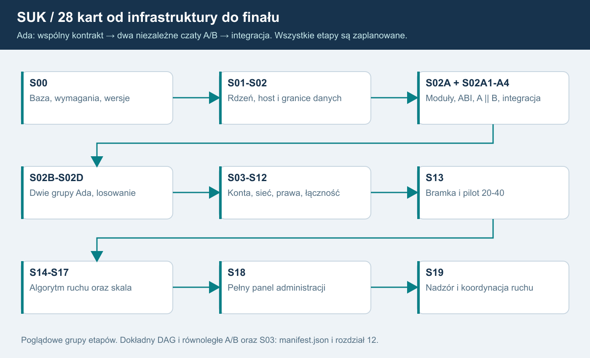

# 12. Etapy i praca osobnymi czatami
Wszystkie 28 etapów jest ZAPLANOWANYCH. Karty są pakietami kontekstu do przyszłych osobnych zleceń; nie są zgodą na implementację/Git.

## Opis dla AI
S00 ustala bazę i konkretne technologie. S01-S02 wydzielają rdzeń/host, S02A granice kart i terenu. S02A1 przygotowuje zamrożoną specyfikację/ABI. **S02A2 pisze A i S02A3 pisze B w dwóch osobnych czatach, niezależnie; obie karty zależą tylko od S02A1.** S02A4 integruje oba warianty. S02B tworzy dwie grupy Ada z A/B w każdej, S02C przełącza i losuje startową rolę, S02D transmisja/diagnostyka. S03 konta może powstawać równolegle po zależnościach.

S04-S12 prowadzą przez bezpieczną sieć, role, moderację, łączność i aktualizacje do S13. Po S13 rozwijamy algorytm F17 w S14-S16 i skalę S17. **Na końcu S18 pełny panel administracyjny po S16/S17, a ostatni S19 tryb dyspozytora.** Minimalne S08 nie jest odroczone.

## Mapa zależności
| Etap | Wynik | Zależności |
|---|---|---|
| S00 | Pomiar odniesienia i kontrakty | brak |
| S01 | Wydzielony rdzeń i wspierany runtime | S00 |
| S02 | Host świata Windows i singleplayer | S01 |
| S02A | Odbiór istniejących modułów i domknięcie granic | S02 |
| S02A1 | Ada: wspólna specyfikacja, toolchain i ABI | S02A |
| S02A2 | Ada: niezależna implementacja Kz_A | S02A1 |
| S02A3 | Ada: niezależna implementacja Kz_B | S02A1 |
| S02A4 | Ada: integracja, porównanie i migracja | S02A2, S02A3 |
| S02B | Dwie obliczające grupy każdego KZ | S02A4 |
| S02C | Synchronizacja, selektor i przełączenie | S02B |
| S02D | Transmisja i diagnostyka profilu EBILock | S02C |
| S03 | Konta i tożsamość | S00, S01 |
| S04 | Bezpieczna sesja i pełne migawki | S02D, S03 |
| S05 | Obszary, role i delegacja LCS | S04 |
| S06 | Przekazanie, reconnect i odtwarzanie | S05 |
| S07 | Subskrypcje, delty i bufory | S06 |
| S08 | Moderacja, audyt i statystyki | S05, S06 |
| S09 | Urządzenia łączności i tekst | S05, S08 |
| S10 | Prototyp wyboru głosu Windows | S03, S09 |
| S11 | Głos w urządzeniach i kontrola mediów | S10, S06 |
| S12 | Aktualizacje i zgodność wydań | S04, S03 |
| S13 | Bramka infrastruktury i pilot 20-40 | S07, S08, S09, S11, S12 |
| S14 | Kontrakt AI i regułowy sąsiad | S13 |
| S15 | Obsada AI i styczne singleplayera | S14, S06 |
| S16 | Krzyżowania i wyprzedzania | S15 |
| S17 | Wiele światów i wzrost skali | S13 |
| S18 | Pełny panel administracyjny | S16, S17 |
| S19 | Tryb dyspozytora: nadzór i koordynacja | S18 |

Numery pozostają stabilne. S02A1-S02A4 to osobne karty; A/B mogą powstawać niezależnie bez wspólnej historii implementacji. Nie wczytuj kodu drugiego wariantu do czatu autora. Integrator ma do niego dostęp po zamrożeniu obu źródeł i raportów.

## Mały wynik i przekazanie
OdczytajAI_START, wybraną kartę, minimalne źródła i faktyczny stan zależności. Podziel duże karty na małe podkroki. Zakończ dowodami iSZABLON_PRZEKAZANIA. Status nie zmienia się na ukończony bez odbioru. Dalsze prace wymagają osobnego zlecenia właściciela.

## Kamienie milowe
M1 po S02: baza hosta.
M1a po S02A4: obie niezależne implementacje Ada i kontrolowana migracja.
M1b po S02D: dwie grupy, porównanie, losowanie i pojedyncze wyjście.
M2 po S06: bezpieczna sesja/prawa/odzyskanie.
M4 po S13: odebrana infrastruktura z N36/N37/N40 oraz wcześniejszymi właściwymi próbami.
M5 po S16/S17: algorytm ruchu bez LLM i odebrany zakres skali.
M6 po S18: pełny panel administracji.
M7 po S19: końcowy nadzór i koordynacja dyspozytora.

Nie podajemy dat bez pomiaru pracochłonności. Ada, dwa niezależne czaty, losowanie oraz oba końcowe interfejsy są ustalone; do rozstrzygnięcia pozostają parametry/procedury z rejestru decyzji.

## Co zmienia baza 1.7
Kroki aplikacji 5/6/6a/7/9/10 są obecne w C#; nie są automatycznie zaliczonymi kartami Sxx multiplayera. S02A zachowuje istniejące moduły i odbiera brakujące kontrakty, prywatne stany, bierne plany skutków i projekcję ruchu. Krok 8 pozostaje odłożony. S00 najpierw zapisuje rzeczywisty wynik odniesienia nowej wersji. S04/S08/S13 wymagają także N42/O20 dla starego wejścia serwisowego. DAG i liczba 28 kart pozostają bez zmian.

## Jednostka wykonania od wersji 1.8
28 kart pozostaje mapą etapów nadrzędnych. Wykonuje się jedno małe zadanie z manifest.jobs i katalogu czaty/ na osobny czat. Rozdział26 pokazuje całą kolejność i wejścia; gotowy tekst startowy znajduje się w prompty_czatow/ID.md. Przy KZ obowiązuje dodatkowo27/prompty_kz. Sam status wszystkich zadań planned nie jest zgodą na implementację ani potwierdzeniem gotowości zależności. Każdy nowy moduł ma obowiązkowe logi25, a raport odnotowuje build/test/Git/wdrożenie osobno.
