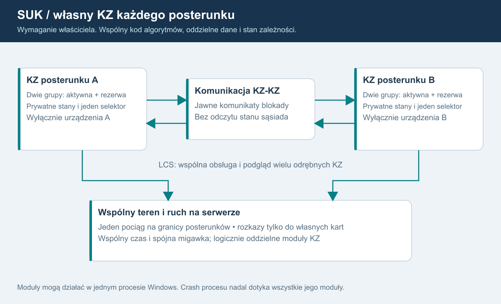

# 16. Własny moduł zależności każdego posterunku

**WYMAGANIE WŁAŚCICIELA:** każdy posterunek ma własny moduł komputera zależności (KZ), z naciskiem na maksymalny realizm. Jest to ustalenie kierunku SUK. Poniższy sposób realizacji stanowi rekomendację techniczną; nie jest opisem już zaimplementowanej funkcji ani potwierdzeniem procedur srk.

## Opis grafiki i kontraktu dla AI

W jednym świecie działają odrębne KZ posterunków A i B. Nad nimi system nadrzędny LCS agreguje zobrazowanie oraz kieruje autoryzowane polecenia do właściwego KZ. Między KZ biegną wyłącznie jawne komunikaty zatwierdzonych interfejsów. Pod nimi wspólna warstwa urządzeń i ruchu utrzymuje fizyczny stan świata. Pociąg przecina granicę bez kopiowania; oba KZ otrzymują właściwe meldunki urządzeń. LCS nie odczytuje prywatnych struktur KZ w celu samodzielnego liczenia zależności.

Dla AI wdrażającego: odrębność jest granicą danych, odpowiedzialności i interfejsu. Nie oznacza wymagania osobnej maszyny, bazy, procesu czy wątku dla każdego posterunku. Nie kopiuj dzisiejszego Simulator wraz z Trains i Rozklad dla każdej stacji. Migracja rozdziela istniejącą logikę według odpowiedzialności, zachowując wspólny świat i zatwierdzone zachowanie.

## Co należy do konkretnego KZ

Każdy moduł ma stałe postId i kzId oraz własne wersjonowane definicje: obsługiwane obiekty, tablicę zależności, przebiegi, ochronę i interfejsy graniczne. Definicje zatwierdza człowiek. Automat może kontrolować odwołania i proponować uzupełnienia; nie projektuje sam zależności.

Lokalny stan obejmuje między innymi przebiegi, utwierdzenia, lokalne liczniki czasu, oczekujące rozkazy, otrzymane statusy urządzeń, lokalny stan końców blokad oraz usterki i stan łączności modułu. Numery i położenia pociągów nie stają się źródłem wiedzy KZ zamiast urządzeń. Wspólny rejestrator może odbierać zdarzenia z wielu KZ, zachowując identyfikator źródła.

Polecenie zawiera jednoznaczny cel KZ i obiektu albo końca blokady. Brama sprawdza konto; system nadrzędny rozpoznaje cel i jego właściciela KZ, następnie sprawdza lease oraz epoki, a właściwy KZ sprawdza zależności. Deklarowany przez klienta kzId nie zmienia serwerowej mapy własności. Żaden KZ nie wykonuje komendy dla obiektu sąsiada. Ponowienia, potwierdzenia i wyniki pozostają skorelowane z modułem i wersją praw; nie wystarcza nazwa urządzenia bez kontekstu posterunku.

## LCS i podział pracy

Jeden pulpit może przedstawiać kilka KZ, a jeden dyżurny sterować wieloma posterunkami. Po podziale LCS odcinkowi otrzymują różne zakresy; pomocniczy działa zgodnie z zatwierdzoną delegacją, nadzorca obserwuje dozwolone projekcje. Zmiana obsady nie scala ani nie dzieli modułów zależności i nie zeruje ich stanu.

Wspólny obraz pulpitu nie nadaje prawa do wszystkich urządzeń widocznych na obrazie. Również oznaczenie szlaku jako wewnętrznego w LCS nie oznacza jednego KZ ani domyślnej zgody drugiego końca. Dotychczasowy skrót Internal wymaga sprawdzenia względem decyzji D03. Blokada stacyjna pozostaje osobną funkcją domenową.

## KZ-KZ: jawna wymiana zamiast wspólnej pamięci

Rekomendowany adapter łącza przekazuje wersjonowane komunikaty z nadawcą, odbiorcą, identyfikatorem interfejsu, numerem sekwencji i czasem symulacji. Katalog stanów, potwierdzeń, timeoutów i reakcji ustala się dla zatwierdzonego typu blokady. Nie zastępujemy rzeczywistej logiki ogólnym komunikatem „sąsiad pozwala na wszystko”.

KZ A nie czyta Routes, utwierdzeń, kolejki poleceń ani prywatnej tablicy KZ B. Otrzymuje wyłącznie przewidziany kontraktem meldunek. Rozmowy i uzgodnienia ruchowe operatorów mają osobny model łączności; tylko jawnie zdefiniowany skutek procedury może trafić do właściwego interfejsu. Sam Delivered, tekst lub głos nie zmienia zależności.

Można symulować przerwę łącza KZ-KZ, pulpit-KZ albo KZ-sterownik osobno. Nie są tym samym zdarzeniem. Nieznany status nie może zostać potraktowany jak pozytywne potwierdzenie. Dokładne wskazania i reakcje urządzeń wymagają zatwierdzonej dokumentacji oraz decyzji właściciela.

## Jeden teren, jeden ruch, spójny zapis

Wspólna warstwa terenu przechowuje urządzenia z jednoznacznym właścicielem sterowania i zadeklarowanymi odbiorcami meldunków. Wspólny silnik ruchu prowadzi każdy skład raz. Na granicy A/B czoło i koniec mogą zajmować różne obszary, lecz trainId, długość i historia ruchu pozostają jedne. Każdy KZ zna potrzebną zajętość z właściwego interfejsu urządzeń.

Koordynator świata porządkuje wykonanie modułów i komunikatów względem ticków. Kolejność oraz opóźnienia zapisuje kontrakt; nie należy zmieniać ich przy okazji wydzielania klas. Checkpoint obejmuje zgodną granicę ticku dla wszystkich KZ, urządzeń, ruchu, zegara i komunikatów w drodze. Niezależne zapisy wykonane w przypadkowych chwilach nie tworzą spójnego świata. Zapis na dysku pozostaje poza gorącą ścieżką ticku.

## Koszt i tryb lokalny

Dla początkowych 20-40 graczy rekomendujemy odrębne moduły w jednym procesie świata z ograniczonymi kolejkami i wspólnym zegarem; skalę trzeba zmierzyć. Usterka symulowana jednego KZ nie wymaga resetu pozostałych. Awaria całego procesu może jednak zatrzymać wszystkie moduły: niezależność logiczna nie jest odpornością na taki crash. Oddzielne procesy i odzyskiwanie to późniejszy etap uzasadniony pomiarami.

Singleplayer używa tego samego modelu: KZ posterunków wybranego obszaru, wspólny lokalny teren i ruch oraz uproszczone styczne AI poza granicą. Nie wymaga symulowania pełnych KZ całego kraju. AI nie zastępuje KZ i wydaje polecenia przez normalny interfejs.

## Kryteria przyszłego odbioru  -  jeszcze nie wykonano

| Próba | Oczekiwany dowód |
|---|---|
| Komenda z prawami A wskazuje obiekt lub koniec blokady B | Odmowa, rozpoznany cel w audycie, brak zmiany B |
| Usterka jednego KZ lub jego łącza | Lokalna reakcja zgodna ze scenariuszem; brak globalnego resetu; dopuszczalne skutki na styku udokumentowane |
| Blokada pomiędzy dwoma KZ | Zatwierdzona sekwencja komunikatów i zgodne lokalne stany, bez odczytu prywatnych struktur sąsiada |
| Checkpoint kilku KZ podczas przejazdu granicy | Po odtworzeniu jeden pociąg, zgodne zajętości, utwierdzenia, zegar i wiadomości; nowa epoka sesji |

Podstawa lokalna: ROZWOJ.md §4/ §5, PODZIAL_MODULOW.md §3, KOMPUTERY_notatki.md oraz EBILock_komputerownia.md §1/ §2/ §4. Opracowanie EBILock rozróżnia PEWNE, WTÓRNE i DOMYSŁ; nie zamieniamy domysłów w wymagania. Dwie grupy z gorącą rezerwą są obowiązkowym F16, opisanym w rozdziale 18. Nierozstrzygnięte pozostają szczegółowe parametry i reakcje, nie istnienie rezerwy. Dokument jest planem, bez zmian repozytorium i bez wyników uruchomienia.

## Korekta po audycie źródeł - wersja 1.3
Każdy logiczny KZ mieści Group1 i Group2: prywatne stany, rzeczywiste obliczenia obu grup i jeden selektor. Odrębność zachowuje się względem drugiego posterunku oraz pomiędzy grupami. Wspólny teren/ruch nie jest kopiowany. S02A-S02D i N25-N34 są obowiązkowe przed pilotem.

## Implementacja 1.5
Każdy logiczny KZ jest wykonywany przez natywny rdzeń Ada. Wewnątrz grup 1/2 działają niezależnie napisane Kz_A/Kz_B; cztery prywatne stany, jedna warstwa fizyczna. Kod jest wielokrotnego użycia dla dowolnego posterunku, a nazwy pozostają danymi. Losowanie roli przy starcie nie zmienia własności obiektów, praw i odrębności innych KZ.

## Rzeczywisty punkt startu po refaktorze - 1.7
KomputerZaleznosci jest już osobną klasą C# w Sim/Kz, ale Simulator.cs:43 tworzy jedną instancję dla całego Station. Wszystkie słowniki są nadal wspólne, a Fasada.cs:14-21 zwraca je innym modułom. Wymaganie per posterunek pozostaje niewykonane.

Oprócz stanów lokalnych końców blokad trzeba zinwentaryzować odczyty sygnału następnego semafora i ochrony przez wspólne Sigs/Routes. Zastąpi je zatwierdzony kontrakt między właściwymi KZ, bez duplikowania terenu. Ruch otrzyma przejściową zatwierdzoną projekcję istniejącego zachowania, nie referencje do przyszłych czterech kontekstów Ada. Nie zaliczać odłożonego kroku 8 przez samą zmianę nazw klas.
