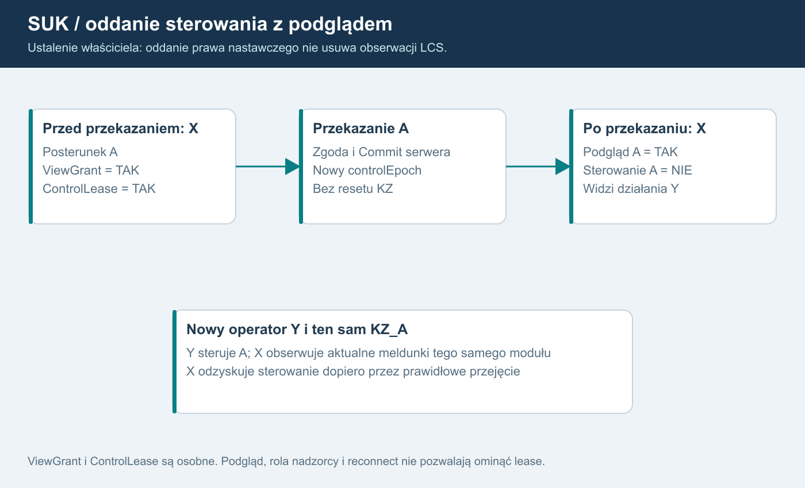

# 17. Oddanie sterowania z zachowaniem podglądu
USTALONE przez właściciela: dyżurny LCS po oddaniu kontroli nad posterunkiem zachowuje podgląd tego posterunku, ale nie może nim sterować. To wymaganie SUK, nie opcja do ponownego rozstrzygania.

## Opis diagramu dla AI
Przed przekazaniem X ma ViewGrant i ControlLease dla posterunku A. Po zatwierdzonym przekazaniu Y posiada ControlLease, a X zachowuje ViewGrant. Obaj widzą meldunki tego samego KZ_A, tylko Y może wysyłać do niego polecenia sterujące. Przejęcie posterunku przez Y nie resetuje KZ, pociągów ani przebiegów. Oddanie A nie zmienia praw X do innych posterunków.

## Weryfikacja w poradniku
Odczytano lokalny plik Zrodla/Poradnik_dla_inspektorow_TOM_I_Automatyka_sterowania_ruchem_kolejowym_i_prowadzenie_ruchu_kolejowego (1).pdf. Dokument liczy 728 stron. W sprawdzonych miejscach numer strony PDF zgadza się z numerem drukowanym.

| Strona i miejsce | Co wynika z materiału | Granica interpretacji |
|---|---|---|
| 121-122, §1.5.8, tabela 21 pkt 1/2/5 | zbieranie informacji i przekazywanie poleceń to odrębne funkcje; przewidziane przejście na nastawianie miejscowe stacji lub grup obiektów | nie podano tu pełnej procedury przekazania kont użytkowników SUK |
| 142, §1.5.8.1, tabela 23 | rozdzielenie warstwy pulpitu, zależności i urządzeń terenowych | wspólny obraz nie oznacza wspólnych praw do wszystkich KZ |
| 144-146, §1.5.8.1, tabela 25 i rys. 77 | polecenia na posterunku wybranym do sterowania; osobno odbiór meldunków i obrazy całego okręgu | wspiera rozdział obserwacji od nastawiania |
| 434, opis nastawni | definicje nastawni zdalnego sterowania i miejscowej | definicja nie rozstrzyga szczegółowej procedury oddania |

Nie znaleziono literalnego zapisu, że po oddaniu sterowania stanowisko zawsze zachowuje podgląd. Nie przypisujemy poradnikowi zdania, którego nie zawiera. Wymóg trwałego podglądu po przekazaniu pochodzi bezpośrednio od właściciela; jest zgodny z projektowym rozdzieleniem funkcji informacji i poleceń.

Przerwa Internetu klienta gry, symulowana utrata łącza pulpit-KZ oraz rzeczywista transmisja nastawnia zdalna-miejscowa to różne zdarzenia. Tabela 21 pkt 4 opisuje konkretną przerwę transmisji warstw rzeczywistych urządzeń; nie stosujemy jej automatycznie do zerwania połączenia użytkownika z serwerem gry.

## Kontrakt uprawnień
ViewGrant wskazuje dozwolony zakres obserwacji. ControlLease wskazuje bieżące prawo wykonywania poleceń. Odcinek może obejmować wiele odrębnych KZ; grant widoczności nie nadaje żadnego prawa nastawczego.

Zwykłe oddanie/przekazanie:
1. Przygotowanie operacji i zgoda zgodnie z zatwierdzonym modelem.
2. Commit w sekwencji świata zmienia właściciela i controlEpoch.
3. X traci ControlLease do oddawanego zakresu; stare komendy i confirmationId zostają unieważnione.
4. ViewGrant X nie jest usuwany. Meldunki pozostają aktualne i pokazują czynności nowego operatora.
5. Y otrzymuje prawo sterowania dopiero po zakończonym przydziale i synchronizacji.
6. X może ponownie sterować dopiero po prawidłowym przejęciu, nie przez samą rolę nadzorcy.

Sankcja konta, kick lub osobne odebranie prawa obserwacji są innym zdarzeniem. Zwykłe oddanie sterowania samo w sobie nie jest banem i nie wyłącza podglądu. Uprawnienia do urządzeń łączności rozpatruje się osobno; nie odbieramy ich wszystkich automatycznie tylko dlatego, że wygasło sterowanie.

## Zachowanie pulpitu i serwera
Pulpit pokazuje czytelnie „Podgląd - steruje [stanowisko]” dla tego zakresu, bez zmiany symboliki srk. Działania sterujące w menu i skróty są nieaktywne. Przeglądanie obrazów i dozwolonych dzienników nadal działa. Dokładny wygląd wymaga zrzutu do oceny przy implementacji.

Serwer odrzuca także komendę ręcznie wysłaną z przerobionego klienta. Dotyczy to pulpitu, tekstowego parsera, potwierdzeń specjalnych oraz operacji globalnych obejmujących cudzy posterunek. Nadzór i podgląd nie są obejściem. Polecenie obejmujące kilka KZ wymaga praw do wszystkich jego celów albo jawnie zatwierdzonej odrębnej operacji; brak cichego rozesłania do całego LCS.

Wyświetlenie brak danych jednego KZ wynika z rzeczywistej świeżości jego źródła, nie z oddania praw. Nie mylić „nie steruję” z „nie mam meldunków”.

## Test N24 - przyszły, nieprzeprowadzony
Wejście: X steruje A i B, Y może przejąć A, X ma podgląd całego LCS.
Czynności: X oddaje A; Y wykonuje dozwolone polecenie; X obserwuje jego skutek, próbuje polecenia i starego confirmationId na A, a następnie dozwolonej czynności na B.
Oczekiwanie: X widzi aktualne A, ale nie steruje A; stare żądania odrzucone. Y steruje A, X nadal steruje B. KZ_A i ruch nie są resetowane. Po reconnect przydziały pozostają rozdzielone; sam powrót X nie odbiera A od Y.
Dowód: ViewGrant, ControlLease/controlEpoch, audyt, wyniki żądań i meldunki tego samego KZ_A dla obu stanowisk.
Dodatkowa próba: globalna komenda X obejmująca A zostaje odrzucona zgodnie z katalogiem celów; nie obchodzi oddania.
Pokrycie: F15, S05/S06/S07/S13.

## Korekta po audycie źródeł - wersja 1.3
Zmiana grupy zachowuje aktualne ViewGrant/ControlLease. Oddający nadal obserwuje, nowy operator steruje. Stare potwierdzenie sprzed przekazania nie wykonuje się dzięki przełączeniu grupy. N33 łączy te przypadki z N24.
