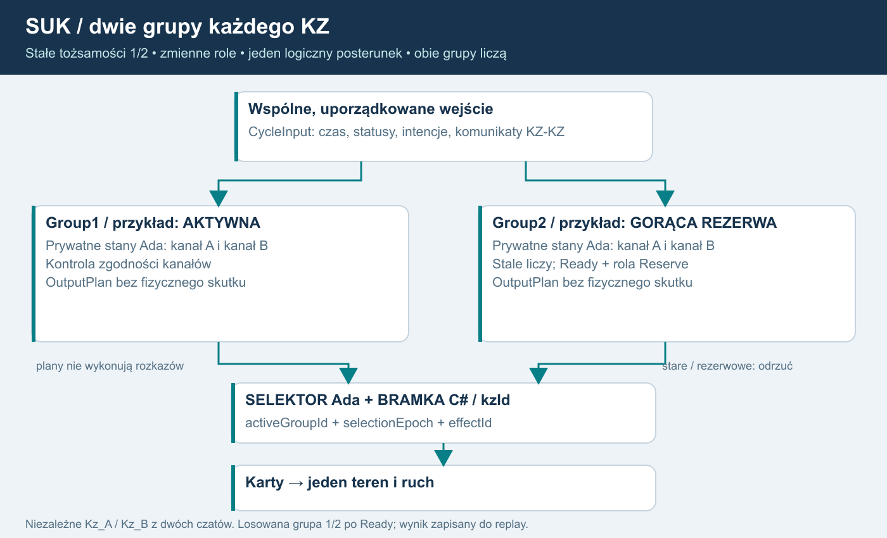
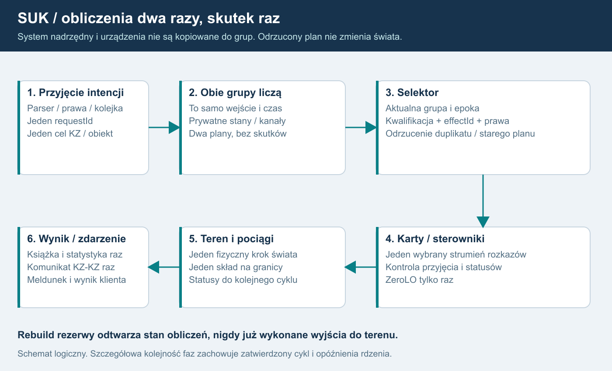

# 18. EBILock: dwie grupy każdego komputera zależności
**USTALONE:** każdy posterunek ma własny logiczny KZ, a każdy pełny KZ ma dwie wykonujące obliczenia grupy. Jedna pełni rolę zasadniczej/aktywnej, druga gorącej rezerwy. W multiplayerze wszystko liczy autorytatywny serwer Windows; ten sam rdzeń działa lokalnie w singleplayerze.

## Potwierdzenie źródłowe
Poradnik dla inspektorów, tom I, s. 126, §1.5.8 podaje dwa zestawy o identycznej strukturze sprzętowej, zasadniczy i gorącą rezerwę. Osobno opisuje przetwarzanie dwukanałowe przez dwa programy różnych zespołów, kontrolę zgodności w KZ i sterownikach obiektowych oraz przejęcie funkcji przez rezerwę przy niezgodności.

Grupy 1/2 to nazwy stałych tożsamości przyjęte w SUK; role mogą się zamieniać. W źródle występuje nazwa EBILock i określenie zestawy. Wskazane przez właściciela „EBILOG” odnosi się w tym planie do tego opisu.

Dwie grupy nie głosują 2z2 nad każdym rozkazem. Opis MOR-3 na s. 140 jest inną architekturą. Zestawy KZ nie są zapasowymi serwerami pulpitu EBISCREEN ani VPS. Źródło nie podaje pełnego protokołu synchronizacji, dokładnego czasu przełączenia, restartu i automatycznego powrotu. Informacji wtórnych nie zamieniamy w gwarancje.

## Opis diagramu dla AI
System nadrzędny przyjmuje jedną autoryzowaną intencję. Rejestr wejść rozprowadza identyczne uporządkowane CycleInput do Group1 i Group2. Obie mają prywatny stan i model kanałów, obie stale liczą. Selektor przepuszcza OutputPlan wyłącznie aktywnej, zakwalifikowanej grupy. Karty, teren i pociągi występują raz. Statusy urządzeń wracają do kolejnej fazy wejść obu grup.

Kanał jest wewnętrzną drogą obliczeń/kontroli grupy. Grupa jest zestawem mogącym przejąć funkcje. WorldHost to proces wykonujący wiele KZ, nie trzecia grupa i nie sprzętowy klaster HA.

## Docelowy profil dwóch niezależnych programów
REKOMENDACJA SUK: dwa prywatne konteksty kanałów w każdej grupie, porównanie wyników w grupie i jawna kwalifikacja jej stanu. Łącznie cztery konteksty obliczeń na pełny KZ, ale jedna fizyka i teren. Profil pozwala oddzielnie symulować niezgodność kanałów i awarię zestawu. Nie zastępować rezerwy samą kopią widocznego stanu pulpitu.

USTALONE 1.5: domenową logikę KZ implementujemy w Ada jako dwa niezależne programy Kz_A i Kz_B, każdy w osobnym czacie. W każdej grupie 1/2 wykonują się oba A/B z prywatnymi stanami. Wspólne kontrakty i dane nie oznaczają wspólnego kodu algorytmów. Zachowujemy ustalone reguły/dane i infrastrukturę aplikacji. Niezależność autorstwa, przegląd i testy trzeba udokumentować; samo rozdzielenie czatów i język Ada nie dowodzą certyfikacji SIL lub braku wspólnych błędów.

Porównanie kanałów w grupie, zgodność rezerwy z uporządkowanym strumieniem i wybór źródła wyjścia są trzema różnymi operacjami. Sam zgodny hash grup nie jest dowodem bezpieczeństwa.

## Identyfikatory i dane
| Element | Znaczenie |
|---|---|
| postId, kzId | Stała tożsamość posterunku i logicznego komputera |
| groupId = 1/2 | Stała tożsamość grupy, niezależna od aktualnej roli |
| groupRunId | Nowy po restarcie grupy; odcina stare obliczone plany |
| inputSeq, cycleId, lastEvaluatedTick | Porządek i świeżość faktycznie przetworzonych wejść |
| algorithmVersion, dataHash, schemaVersion | Zgodność algorytmów, definicji i kontraktów |
| activeGroupId, selectionEpoch | Jedno źródło wyjść; epoka zmienia się przy przekazaniu tej funkcji |
| effectId, committedCycle, outputWatermark | Jednokrotnie zatwierdzone logiczne skutki i granica wykonania |
| worldRunId/sessionEpoch, kzEpoch | Odrębne generacje świata i logicznego KZ; nie zastępuje ich selectionEpoch |
| health, syncState, channelStatus | Jawna diagnostyka; brak informacji nie oznacza stanu poprawnego |

CycleInput zawiera czas symulacji, statusy kart/obiektów, komunikaty graniczne i znormalizowane polecenia przyjęte raz. Nie daje referencji do mutowania świata. Każda grupa i kanał mają prywatne dynamiczne zależności, timery i utwierdzenia. Zatwierdzone przez człowieka definicje mogą być wspólne tylko do odczytu.

## Jedna bramka skutków

Dla AI: parser i wstępna autoryzacja występują raz. Równoważne wejście trafia do obu grup. Wyniki obliczeń nie zmieniają świata. AdaGroupRuntime sprawdza kwalifikację i wskazuje jeden plan domenowy. C# OutputGate sprawdza pochodzenie, epoki, kolejność, effectId i bieżące prawa dla nowych intencji; może odmówić, ale nie wybiera sam innej grupy. Jeden logiczny plan trafia do kart; wyniki rezerwy, stare plany i duplikaty nie wykonują skutków.

Książka, statystyka, wynik klienta i komunikat wychodzący KZ-KZ powstają z zatwierdzonego wyniku raz. Meldunek opisuje jeden świat. Szczególnie ZeroLO nie może opierać się na założeniu, że ponowne wykonanie jest nieszkodliwe. Ten sam zamierzony skutek ma wspólne effectId pomiędzy grupami, z osobną informacją diagnostyczną o pochodzeniu. Rebuild przelicza historię wewnętrzną, nie odgrywa już wykonanych rozkazów.

Zapisy dzisiejszego KZ bezpośrednio do urządzeń, ruchu i zasilania trzeba odseparować przed uruchomieniem pary. S02A realizuje zaakceptowane granice kart/Power z PODZIAL_MODULOW. System nadrzędny i stan potwierdzeń operatora są pojedyncze, poza grupami. Nie tworzyć czterech parserów, PIP i pociągów.

## Stan proponowany i zatwierdzony - projekt SUK
Przejścia wynikające z komendy mają stan proponowany i stan zatwierdzony. Obliczenie planu nie oznacza wykonania polecenia. Decyzja Committed/Rejected dla logicznej komendy jest kolejnym uporządkowanym wejściem znanym wszystkim grupom i kanałom. Rebuild otrzymuje również te decyzje, a nie same pierwotne intencje.

Odrzucona logiczna komenda nie zostawia przebiegu, utwierdzenia ani potwierdzenia przedstawianego jako wykonane. Niezależne przejścia od statusów urządzeń i upływu czasu nadal mają własny porządek; odrzucenie komendy nie cofa fizycznych zdarzeń świata.

Odrzucenie kopii OutputPlan rezerwy lub starej epoki nie jest samo w sobie odrzuceniem logicznej komendy: po jednym zatwierdzonym skutku wszystkie grupy dostają tę samą decyzję Committed. Odrzucenie z powodu utraty praw daje wspólne Rejected dla tej próby. To rozróżnienie zapobiega rozjechaniu aktywnej grupy i rezerwy.

Próba odbioru: oblicz plan, odbierz prawa przed skutkiem, odrzuć logiczną komendę, przełącz grupę. Nie może powstać fizyczny skutek, pozorne utwierdzenie ani ponowne wykonanie. Jest to projekt techniczny SUK, nie cytat z DTR.

## Synchronizacja i przełączenie - projekt SUK
Cykl życia (Starting/Synchronizing/Running/Faulted/OutOfSync), kwalifikacja (NotReady/Ready) i rola (Unassigned/Active/Reserve) są osobnymi polami. ReadyReserve jest skrótem prezentacji Ready+Reserve, nie warunkiem wstępnym przydzielenia roli. Po starcie/naprawie grupa dostaje spójny snapshot oraz uporządkowane wejścia do aktualnej granicy. Ma osobny stan, bez współdzielonych mutowalnych referencji do aktywnej grupy. W normalnej pracy przetwarza kolejne wejścia samodzielnie.

Kwalifikacja Ready wymaga zgodnych wersji, przetworzonego strumienia, poprawnej kontroli kanałów i zgodności w uzgodnionym punkcie kontrolnym. Zatrzymana, nieaktualna i niedopasowana grupa nie dostaje Ready. Jeśli historia przekracza limit, potrzebna jest nowa baza synchronizacji zamiast nieograniczonego logu.

Przy uszkodzeniu/niezgodności grupy aktywnej i gotowej rezerwie selektor na jawnej granicy faz odbiera dawną władzę wyjściową, zmienia selectionEpoch i wybiera rezerwę. Przed i po granicy wolno istnieć najwyżej jednemu źródłu skutków. Przebiegi, utwierdzenia, urządzenia i ruch nie resetują się z samego faktu zmiany grupy. Czas i zachowanie przejściowe są mierzone i opisane w scenariuszu; nie zakładać zerowej przerwy.

Awaria rezerwy daje pracę zdegradowaną przy sprawnej aktywnej grupie oraz alarm. Brak sprawnej gotowej grupy oznacza brak kwalifikowanego nowego wyjścia. Dokładne zachowanie kart/ostatnich stanów/wskazań wynika z zatwierdzonego D17. Nie wymyślać globalnego „wszystko na czerwono” ani bezterminowego utrzymania zezwolenia.

Nie potwierdzono automatycznego powrotu na grupę 1. Propozycja: naprawiona grupa wraca przez synchronizację do rezerwy; wybór aktywnej wynika z zatwierdzonej polityki D16, nie numeru.

## Restart i trwałość
Hot failover nie jest restartem świata, zmianą obsady ani odtworzeniem backupu. Nie zmienia ControlLease/ViewGrant, sankcji ani identyfikatorów żądań. Restart jednej grupy nadaje nowy groupRunId. Zimny restart KZ/świata nadaje właściwe epoki i wymaga resynchronizacji/praw według S06.

Checkpoint ma jeden punkt logiczny: stany obu grup/kanałów, role, synchronizacja, wejścia, selektor, zatwierdzone wyjścia i komunikaty w drodze oraz jeden teren/ruch/zegar. Po restore dawne wyjścia i pakiety są odrzucane. Zapis poza tickiem nie może udawać potwierdzonej trwałości przy błędzie dysku.

## Sterowniki i transmisja
Źródło potwierdza kontrolę wyników także w sterownikach. S02D wymaga jawnego interfejsu kontroli rozkazów/statusów oraz wykrywania niezgodności i braku danych. Nie deklaruje odtworzenia nieznanego protokołu sprzętowego; szczegółowy algorytm i reakcje są profilem do zatwierdzenia.

Pętle i koncentratory mają ręczną topologię i dwa kierunki dojścia. Jedna przerwa nie odcina całej pętli, gdy druga droga działa; dwie przerwy/awaria koncentratora odcinają zakres wynikający z danych. Rosyjskie limity liczby pętli i odmian kart nie są automatycznie polską specyfikacją.

Pełne odwzorowanie elektroniki, prądów, wszystkich kart, EOR, innych systemów srk, nowej blokady stacyjnej i zachowań manewrowych ma osobny późniejszy zakres. Nadal obowiązkowe przed multiplayerem są: granica karta-teren, dwie grupy, kontrola wyjść, minimalna transmisja i diagnostyka.

## Odbiór
S02A→S02A1→(S02A2 i S02A3 niezależnie)→S02A4→S02B→S02C→S02D po S02 i przed S04. S13 wymaga N25-N34, N36, N37, N40 oraz O11-O14 oraz wcześniejszych prób izolacji, bezpieczeństwa i podglądu LCS. Rysunek dwóch pudełek nie jest dowodem działania. Nie wykonano implementacji ani testów funkcjonalnych w ramach tego planu.

## Losowanie i błędy programów
Przy starcie serwerowego świata dla każdego kzId losujemy grupę zasadniczą 1 lub 2, po osiągnięciu gotowości i zgodności wersji obu grup. Wynik jest jawnie zapisanym wejściem do AdaGroupRuntime z worldRunId/kzId/wybraną grupą/selectionEpoch/wersjami. Nie jest losowaniem jednego z kanałów A/B: oba zawsze podlegają kontroli w obu zestawach. Brak dwóch gotowych grup wymaga jawnej polityki pracy zdegradowanej D16; nie wybieramy niesprawnej grupy.

Nowe uruchomienie serwera tworzy nową generację świata i nowy zapisany wybór po uzgodnieniu stanu. Replay tej samej sesji używa zapisanego wyboru. Nie losujemy na reconnect, oddanie sterowania lub powrót jednej naprawionej grupy. Dalsza zmiana aktywnej grupy jest kontrolowanym przełączeniem.

Błąd systematyczny A/B może spowodować niezgodność w obu grupach naraz; rezerwa nie gwarantuje naprawienia błędu programu. Obowiązuje kwalifikacja i reakcja D17, bez wybierania dowolnego wyniku lub pętli bezustannych przełączeń. Szczegóły 23.

## Doprecyzowanie kwalifikacji, uprawnień i porównania
Przed StartupSelection obie grupy muszą być Qualification=Ready i Role=Unassigned, a wyjścia są zablokowane. Ada przyjmuje zapisane wejście wyboru i nadaje role; dopiero zatwierdzenie wyboru otwiera C# OutputGate. Losowanie liczby w C# nie jest samo przyznaniem władzy wyjściowej.

Nowa intencja operatora wymaga aktualnego ControlLease i ponownej autoryzacji przy zatwierdzeniu. Autonomiczne reakcje wcześniej zatwierdzonego KZ sprawdzają autorytet KZ i fencing, bez zależności od dalszego lease dawnego operatora. Oddanie posterunku lub ban nie zatrzymują dozorowania, logicznego kończenia nastawiania ani zwalniania przebiegu. Committed oznacza przyjęcie intencji; wykonanie fizyczne nadal potwierdzają karty/meldunki.

A i B mogą mieć różne reprezentacje wewnętrzne. Porównujemy kanoniczne wyniki i istotne stany domenowe, nie bajty prywatnych rekordów lub identyczny hash pamięci A/B. Synchronizacja między grupami uzgadnia również stan każdej implementacji z jej odpowiednikiem, zgodnie z wersją formatu.

## Doprecyzowanie istniejących kart - 1.7
Karty zwrotnic, wykolejnic, sygnalizatorów i zasilania są już w C#. Nie tworzyć ich od nowa. Nadal jednak KZ wywołuje karty podczas obliczeń, a statusy mutują pojedynczy kontekst przez callbacki/fasadę. NN/AGR oraz ZeroLO mają ścieżki natychmiastowych skutków, których nie można po prostu wywołać po raz drugi dla rezerwy.

S02A ma wprowadzić bierny OutputPlan i zamrożony zestaw wejść na jawnych granicach faz, oddzielając również proponowane/zatwierdzone zmiany komendy i zapis do wspólnych rejestrów. Zachować udokumentowaną kolejność i wyjątki natychmiastowych skutków w nowej bazie; każda zmiana ich momentu wymaga jawnego opisu/odbioru. Sama zasada „karty jedyną drogą wyjść” nie dowodzi pojedynczego skutku. Komputerownia i jej kontrola niezmienników nie są drugą grupą lub kanałem.
