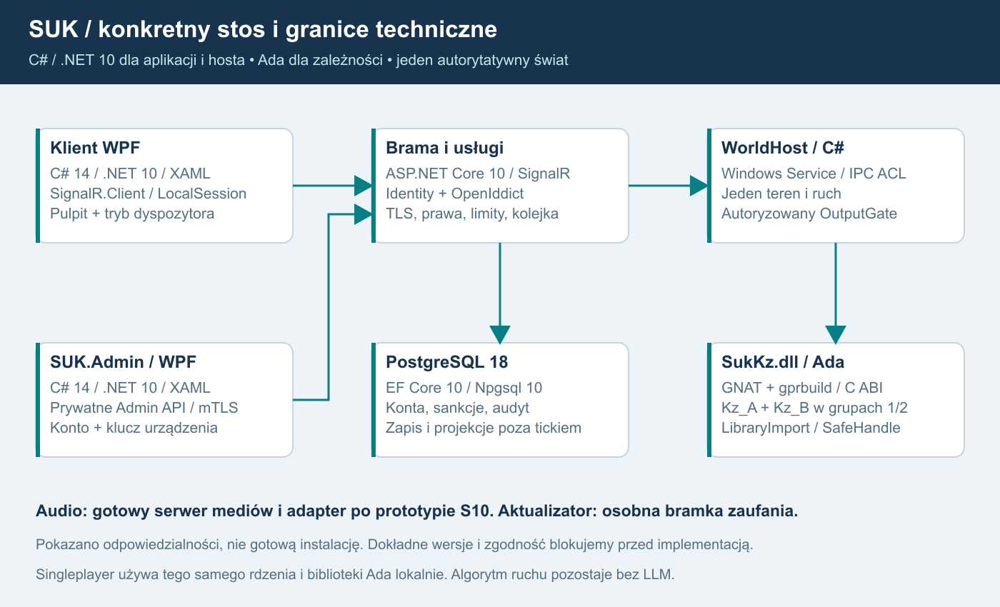

# 20. Konkretny stos technologiczny SUK
Plan 1.8 | 17.10.2026 | dokumentacja poza Git.

**USTALONE:** komputery zależności przepisujemy na Ada; pozostałe części pozostają w C#/.NET na Windows. Dwie niezależnie opracowane implementacje KZ A/B są kanałami wewnątrz każdej grupy 1/2, a nie zamiennikami gorącej rezerwy. **REKOMENDACJA:** poniższy zestaw bibliotek i granic jest punktem docelowym do wykonania etapami. Nie oznacza instalacji, zgodnego buildu ani wdrożenia.

## Zestaw docelowy
| Komponent | Język / framework | Konkretne biblioteki lub narzędzia | Granica odpowiedzialności | Status |
|---|---|---|---|---|
| Pulpit dyżurnego | C# 14, .NET 10 LTS, WPF, XAML | istniejące ILcsSession/Indication, Microsoft.AspNetCore.SignalR.Client 10.x | rysuje zobrazowanie i wysyła intencje; nie rozstrzyga zależności MP | rekomendacja, rozwijamy obecny klient |
| Brama gry | C# 14, ASP.NET Core 10, Kestrel | SignalR, System.Text.Json, System.Threading.Channels | uwierzytelnienie, limity, kolejki, projekcje; bez fizycznego SetState | rekomendacja |
| Host świata | C# 14, .NET 10 Worker Service | Microsoft.Extensions.Hosting.WindowsServices 10.x, Stopwatch, Channels | jeden zegar, harmonogram, teren/ruch i sekwencja skutków | rekomendacja |
| Logiczne KZ posterunków | Ada 2022 | GNAT, gprbuild; pakiety Kz_A, Kz_B i koordynator w SukKz.dll | osobne stany kanałów A/B w grupach 1/2; propozycje rozkazów, nie kopie pociągów | Ada i niezależne A/B ustalone; toolchain do dowodu |
| Most .NET-Ada | C# + nagłówek C ABI + Ada | LibraryImport, SafeHandle, System.Runtime.InteropServices | wersjonowane struktury/bufory i uchwyty; tylko wewnątrz hosta | rekomendacja do prototypu |
| Lokalny IPC brama-świat | C#/.NET | System.IO.Pipes, System.IO.Pipes.AccessControl, NamedPipeServerStreamAcl | lokalne konta usług, ACL, długości ramek i ograniczone kolejki | rekomendacja |
| Konta i OIDC | C# / ASP.NET Core | Identity 10.x, OpenIddict 7.x, OpenIddict.EntityFrameworkCore | hasła, sesje, PKCE i tokeny; bieżące prawa sprawdza dodatkowo SUK | rekomendacja, zgodność frameworków potwierdzona |
| Dane trwałe | PostgreSQL 18 | EF Core 10.x, Npgsql.EntityFrameworkCore.PostgreSQL 10.x, zgodny Npgsql | konta, sankcje, audyt, projekcje; bez transakcji w każdym ticku | rekomendacja, wspierany major |
| Aplikacja administracyjna | C# 14 / .NET 10 / WPF-XAML | SUK.Admin, OIDC/PKCE, HttpClient, CNG/TPM | osobny EXE i indywidualny klucz, bez bazy i Ada | wymaganie właściciela; szczegóły do prototypu |
| Prywatne Admin API | C# / ASP.NET Core 10 / Kestrel | mTLS, OpenIddict token binding, wspólne moduły kont/sankcji | konto ORAZ klucz ORAZ kompetencja, VPN | rekomendacja |
| Ruchowy algorytm AI | C# 14/.NET 10 | własne automaty stanów, reguły, ograniczony planista na istniejącym Otoczenie/Rozklad | dane i meldunki → zwykła autoryzowana intencja; bez LLM | ustalone; S14-S16 |
| Głos | istniejący serwer mediów Windows | Mumble Server, prywatne API Ice i adapter SUK | transport audio oraz egzekwowanie praw rozmowy; poza tickiem | pierwszy kandydat S10 |
| Aktualizator klienta | C#/.NET + gotowy packager | Velopack i narzędzie vpk, podpisywanie wydania | pobranie/instalacja; osobno weryfikowane zaufanie metadanych | kandydat S12, bramka pozostaje |
| Diagnostyka | C#/.NET | ILogger, Meter, ActivitySource, OpenTelemetry, OTLP; Prometheus | ograniczona telemetria, bez sekretów i bez wpływu na tick | rekomendacja |
| Testy | C# i Ada | xUnit.net v3, AUnit/harness natywny, istniejące selftesty | regresja domeny, granice ABI, prawa, odzyskanie i obciążenie | rekomendacja; nie wykonano |

C# 14 odpowiada .NET 10; nie ustawiamy języka na zmienną wartość „latest”. .NET 10 jest LTS do 14.11.2028. .NET 8 kończy wsparcie 10.11.2026, więc nie jest celem nowej publicznej infrastruktury. Źródła: [wersjonowanie C#](https://learn.microsoft.com/dotnet/csharp/language-reference/language-versioning), [polityka .NET](https://dotnet.microsoft.com/en-us/platform/support/policy/dotnet-core).

PostgreSQL 18 ma wsparcie do 14.11.2030; oficjalna strona pobierania wskazuje instalator Windows testowany na Server 2025/2022. EF Core 10 wymaga .NET 10, a dostawca Npgsql EF 10 jest wydany. Wybieramy zgodną linię 10.x zamiast mieszania głównych wersji EF/dostawcy. Źródła: [PostgreSQL - wsparcie](https://www.postgresql.org/support/versioning/), [Windows](https://www.postgresql.org/download/windows/), [EF 10](https://learn.microsoft.com/en-us/ef/core/what-is-new/ef-core-10.0/whatsnew), [Npgsql EF 10](https://www.npgsql.org/efcore/release-notes/10.0.html).

## Ada, dwa kanały i dwa zestawy
Szczegóły normy języka, kompilatora, bindera, kontraktu C ABI i odbioru określa [23_KZ_ADA_I_INTEGRACJA.md](23_KZ_ADA_I_INTEGRACJA.md). Zalecany toolchain: GNAT i gprbuild dla Windows x64, pozyskane przez przypięty Alire albo utrzymywany pakiet GNAT z ustalonym wsparciem. Konkretnej wersji kompilatora nie zgadujemy.

Kz_A i Kz_B powstają w **dwóch odrębnych przyszłych czatach**, na wspólnej zatwierdzonej specyfikacji wejść/wyjść, bez wglądu w kod drugiej implementacji. Nie kopiujemy algorytmu A do B i nie używamy jednego algorytmu dwukrotnie jako pozornej niezależności. Dopiero osobny etap integruje wyniki. Sam podział czatów nie zapewnia niezależności organizacyjnej, różnorodności wszystkich błędów ani certyfikacji SIL.

Jedna SukKz.dll może zawierać obie implementacje i koordynator Ada. Każdy pełny KZ utrzymuje cztery prywatne konteksty: grupa1/kanałA, grupa1/kanałB, grupa2/kanałA, grupa2/kanałB. Nie wymaga to czterech procesów ani dwóch różnych kopii runtime GNAT. Współdzielone definicje są niemutowalne; algorytmy A/B i ich stan są odrębne. Teren, urządzenia i pociągi występują raz.

C# zarządza cyklem świata, autoryzacją i transportem; Ada realizuje KZ oraz kontrakt koordynatora/wyjść z rozdziału 23. Żadna grupa ani kanał nie mutuje bezpośrednio C#-owego terenu. Jeden zatwierdzony skutek, wspólne effectId i watermark chronią także ZeroLO, książkę, telegramy oraz statystyki.

Przy starcie hosta po osiągnięciu gotowości wybór zasadniczej grupy 1/2 każdego posterunku odbywa się w C#: RandomNumberGenerator.GetInt32(2) + 1. Wybrana wartość staje się jawnym zdarzeniem/wejściem do Ada i dziennika odtworzenia. Replay korzysta z zapisanego wyboru, nie losuje ponownie. Losowość inicjalizacji jest zewnętrznym wejściem; obliczenia przy ustalonych wejściach zachowują odtwarzalność. To wybór roli grupy, nie kanału A/B. [Dokumentacja GetInt32](https://learn.microsoft.com/en-us/dotnet/api/system.security.cryptography.randomnumbergenerator.getint32?view=net-10.0).

Most preferuje LibraryImport i SafeHandle dla natywnych kontekstów. Funkcje eksportowane mają konwencję C, jawne szerokości pól, długości buforów i kody błędów; wyjątki Ada nie przekraczają ABI. Inicjalizacja/finalizacja biblioteki jest kontrolowana raz na proces zgodnie z binderem. Nie przekazujemy obiektów CLR ani referencji do mutable świata. Ładowanie biblioteki odbywa się ze sprawdzonej ścieżki wydania, nie z katalogu projektu użytkownika. [Zalecenia .NET interop](https://learn.microsoft.com/en-us/dotnet/standard/native-interop/best-practices), [biblioteki gprbuild](https://docs.adacore.com/gprbuild-docs/html/gprbuild_ug/gnat_project_manager.html).

Singleplayer ładuje ten sam most i SukKz.dll dla pełnych KZ wybranego obszaru. MP może dostarczać klientowi ten kod dla offline, ale nie ufa jego wynikom. C#-owy stary KZ pozostaje kontrolowanym materiałem odniesienia migracji; **nie jest zapasowym wykonawcą produkcyjnym**. Awaria natywna może zatrzymać WorldHost i wszystkie jego KZ; proces izoluje bramę, nie daje HA VPS.

## Projekty i kierunek referencji
To proponowany podział logiczny, bez obowiązku natychmiastowego przemianowania obecnych katalogów.

| Projekt / moduł | Referencje i zakaz przecieków |
|---|---|
| SUK.Contracts | neutralne DTO i kody; bez WPF, EF, GNAT i logiki zależności |
| SUK.Client, istniejący pulpit | Contracts, klient SignalR; tryb lokalny przez adapter sesji |
| SUK.Server | Contracts, moduły kont/praw/persistencji; brak bezpośredniego wywoływania Ada |
| SUK.Admin | WPF, Contracts, OIDC/PKCE, HttpClient z certyfikatem; bez EF/GNAT |
| SUK.AdminApi | prywatny ASP.NET Core host; istniejące moduły kont/sankcji/audytu i zapisu |
| SUK.WorldHost | wspólny ruch/urządzenia/rozkład/AI oraz SUK.Interlocking.Ada; prywatny IPC |
| SUK.Interlocking.Ada | jedyne deklaracje P/Invoke i SafeHandle; referencje do wersjonowanego kontraktu ABI |
| SukKz.gpr / SukKz.dll | Ada Kz_A, Kz_B i koordynator; bez HTTP, WPF, EF i sekretów kont |
| SUK.Persistence | EF Core/Npgsql i migracje; nie jest zależnością funkcji kroku KZ |
| SUK.Tests / natywne testy Ada | kontrakty, scenariusze i testowy adapter; nie tworzą alternatywnego serwera gry |

GPRbuild buduje bibliotekę oddzielnym krokiem PowerShell, potem przygotowanie wydania dołącza zgodną DLL i jej udokumentowane zależności. Sam ProjectReference w C# nie oznacza zbudowania projektu Ada. Narzędzia kompilacji nie są wymaganiem komputera gracza.

## Administracja i uwierzytelnienie
USTALONE 1.6: osobny SUK.Admin.exe C#/WPF zastępuje rekomendację Razor Pages. Prywatny SUK.AdminApi korzysta z istniejących usług i bazy kont. Lokalne generowanie indywidualnego klucza zostało zatwierdzone przez właściciela 17.10.2026: preferowany niewyeksportowalny CNG/TPM, serwer zatwierdza klucz publiczny i wydaje certyfikat. Nie planujemy serwerowego wydawania klucza prywatnego. Kontrolowany enrollment opisuje rozdział 21. Dyżurny nadal używa własnego pulpitu.

Identity zarządza kontami, OpenIddict 7.x protokołem OIDC. Serwer korzysta z integracji ASP.NET Core i EF, a desktop z OpenIddict.Client.SystemIntegration: Authorization Code + PKCE, systemowa przeglądarka, bez sekretu w EXE. Biblioteki nie zastępują serwerowego sprawdzania sankcji i bieżących praw. [OpenIddict - zgodność ASP.NET Core 10](https://documentation.openiddict.com/integrations/aspnet-core), [integracja Windows/WPF](https://documentation.openiddict.com/integrations/operating-systems).

Admin API wymaga jednocześnie zarejestrowanego certyfikatu mTLS, tokenu właściwego konta/audience z powiązaniem do certyfikatu i aktualnych kompetencji. Przeglądarkowe strony logowania nadal mają cookies/CSRF. Gotowe wsparcie token binding RFC 8705 w OpenIddict musi przejść prototyp z przypiętymi bibliotekami. Nie zastępuje go lista schematów Certificate,Bearer. Szczegóły bootstrapu, revoke i odzyskania: rozdział 21. [OpenIddict mTLS](https://documentation.openiddict.com/configuration/mutual-tls-authentication).

## Dane, Windows i wdrożenie
Punkt referencyjny: Windows Server 2025 x64; zgodny test także na Server 2022. Klient: wspierana wersja Windows 11 x64. Dodatkowe systemy wymagają macierzy rzeczywistych prób, szczególnie natywnego toolchainu. 4 vCPU/8 GiB pozostaje środowiskiem pomiaru, nie obietnicą wydajności.

SUK.Server i SUK.WorldHost to osobne Windows Services przez Microsoft.Extensions.Hosting.WindowsServices, na oddzielnych kontach. Prywatne Named Pipes dostają ACL dla tych kont; nie ma publicznego portu C ABI ani osobnego serwera dla każdego KZ. Kestrel obsługuje HTTPS/WSS z produkcyjnym certyfikatem i ograniczeniami; certyfikat deweloperski nie jest konfiguracją wydania. Baza i API administracyjne mediów pozostają lokalne/prywatne. [Windows Service](https://learn.microsoft.com/en-us/aspnet/core/host-and-deploy/windows-service?view=aspnetcore-10.0), [Named Pipes ACL](https://learn.microsoft.com/en-us/dotnet/api/system.io.pipes.namedpipeserverstreamacl?view=net-10.0).

PostgreSQL działa jako osobna usługa Windows. Konto aplikacji nie jest superuserem; migracje wykonuje osobna tożsamość po backupie, poza cyklem gry. Profile świata, tablice zależności i zobrazowanie nadal projektuje człowiek. Obecny station.json jest tylko odczytywany adapterem. C# waliduje i normalizuje dane do kontraktu Ada; KZ nie dostaje parsera dowolnego JSON ani połączenia do bazy.

Konta/sankcje/audyt trafiają do PostgreSQL, zatwierdzone projekty do wersjonowanych pakietów, a checkpoint świata ma własny spójny format obu grup/kanałów, selektora i terenu. Dane i logi są poza wymienianym katalogiem binariów. Runtime Ada, DLL i dane algorytmu mają identyfikatory zgodności i sumy; nie podmienia się ich pojedynczo w aktywnym świecie.

Serwer zalecamy publikować z przypiętym zestawem runtime .NET/ASP.NET Core zarządzanym operacyjnie; klient jako self-contained win-x64 z biblioteką Ada i aktualizatorem. To rekomendacja do sprawdzenia na czystej maszynie. Self-contained wymaga ponownego wydania przy poprawce dostarczanego runtime. Zatrzymanie/usługa, aktualizacja, migracja, start i próba działania są odrębnymi krokami. Brak obowiązku Docker Desktop, Linux VM, Kubernetes, Redis i brokera dla pierwszych 20-40 osób.

## Głos i instalowanie aktualizacji
Mumble Server ma oficjalną binarkę Windows. S10 musi udowodnić adapter WPF, jednoczesny telefon/radio/PTT, tożsamość kont i ACL, odcięcie starego połączenia oraz ponownego wejścia po banie. API Ice administruje serwerem; **nie jest gotowym SDK audio WPF**. Ewentualny wrapper usługi Windows, np. WinSW, jest osobnym gotowym narzędziem do sprawdzenia. [Mumble Windows](https://www.mumble.info/downloads/), [Ice](https://www.mumble.info/documentation/mumble-server/scripting/).

LiveKit pozostaje alternatywą po osobnym dowodzie integracji Windows/WPF, zasobów, TURN i skutecznego cofania praw. Nie zakładamy, że SDK C# Unity jest biblioteką WPF. Sama dostępność Windows DLL/serwera nie kończy prototypu. Szczegóły ograniczeń i testów w 07 oraz S10/S11.

Velopack pakujący klienta i vpk są konkretnymi kandydatami S12. Podpis aplikacji/instalatora nie wystarcza do zabezpieczenia całego feedu: wymagane uwierzytelnione metadane, hash/długość, ochrona rollback/freeze i rotacja kluczy. Nie deklarujemy istniejącej gotowej integracji TUF. Jeśli bramka 09 nie jest spełniona, wybór nie jest produkcyjnie odebrany. Brak restartu podczas służby i nadpisywania danych właściciela. [Velopack - podpisy](https://docs.velopack.io/packaging/signing).

## Lekka obserwowalność
Kod używa ILogger, System.Diagnostics.Metrics.Meter i ActivitySource. Proponowany adapter plikowy: Serilog.Extensions.Hosting 10.x oraz Serilog.Sinks.File, z rotacją, retencją i limitem dysku; nie wymaga osobnej usługi logowej. Zdarzenia audytu nadal mają osobny trwały zapis. [Serilog Hosting](https://github.com/serilog/serilog-extensions-hosting).

OpenTelemetry.Extensions.Hosting, OpenTelemetry.Instrumentation.AspNetCore, OpenTelemetry.Instrumentation.Http i OpenTelemetry.Exporter.OpenTelemetryProtocol zbierają podstawowe metryki oraz próbkowane ślady. Liczba etykiet jest ograniczona; token, pełna komenda, accountId i trainId nie stają się etykietami metryk. Wywołanie Ada dostaje correlationId i pomiar czasu z hosta, bez osobnego stosu telemetrii w każdym kanale.

Minimalny magazyn prób: jeden lokalny Prometheus dla Windows z odbiornikiem OTLP i ograniczoną retencją, prywatnym interfejsem oraz limitem zasobów. Grafana i Collector nie są obowiązkowe. Wybieramy stabilny OTLP; dokumentacja OTel nadal ostrzega, że bezpośredni exporter Prometheus.AspNetCore jest rozwijany jako prerelease. [OTel - eksportery](https://opentelemetry.io/docs/languages/dotnet/exporters/), [Prometheus Windows](https://prometheus.io/download/).

## Testy, wersje i licencje
xUnit.net v3 w stabilnym wydaniu obejmuje protokół, prawa, kolejki, bazę i most Ada. AUnit lub mały natywny harness z rozdziału 23 sprawdza Ada bez WPF. Test integracyjny .NET wywołuje rzeczywistą SukKz.dll i porównuje jawne rezultaty. Testy A/B nie polegają tylko na wzajemnej zgodności - oba mogą mieć błąd wobec specyfikacji. Istniejący selftest na kopii danych, scenariusze i regresja edytora pozostają obowiązujące; wyniku 25/26 i 4/4 nie poprawia się sztucznie. [xUnit v3](https://xunit.net/docs/getting-started/v3/cmdline), [AUnit](https://docs.adacore.com/aunit-docs/html/aunit_cb/aunit_cb.html).

S00 zapisuje dokładne wersje SDK w global.json, NuGet w Directory.Packages.props/packages.lock.json, narzędzi w lokalnym manifeście dotnet-tools, a GNAT/gprbuild/Alire i zależności runtime w manifeście toolchainu. Restore w trybie locked, bez pływających wersji i bez bezrefleksyjnego kopiowania prerelease z przykładów dokumentacji. Lock nie zwalnia z aktualizacji bezpieczeństwa: zmiana ma własne testy zgodności, ABI, migracji i odzyskania.

Rejestr licencji obejmuje wydanie i zależności przechodnie: .NET/EF oraz Velopack - MIT; OpenIddict i OpenTelemetry - Apache-2.0; Npgsql/dostawca EF - PostgreSQL License. Dla Mumble uwzględnia również Qt/kodeki i sposób dystrybucji, dla GNAT warunki wybranej dystrybucji/runtime z 23. Nie wywodzić licencji całej aplikacji z licencji jednego repozytorium. Windows i certyfikat podpisujący są oddzielnymi kosztami; nie podajemy niezweryfikowanej ceny. Źródła: [OpenIddict](https://github.com/openiddict/openiddict-core), [Npgsql EF - licencja](https://github.com/npgsql/efcore.pg/blob/main/LICENSE), [OpenTelemetry](https://github.com/open-telemetry/opentelemetry-dotnet), [Velopack](https://github.com/velopack/velopack).

## Kolejność wdrażania stosu
S00 ustala wersje, źródła i toolchain; S01/S02 zachowują bazę C# i granice hosta. **S02A1** dowodzi ABI i kontraktu, **S02A2** realizuje niezależne Ada A, **S02A3** niezależne Ada B, **S02A4** integruje je; dopiero potem S02B-S02D realizują grupy, synchronizację i diagnostykę. S04 nie wyprzedza tej bramki. S03/S08 wprowadzają tożsamość i dane, S10/S11 głos, S12 podpisane aktualizacje, S13 odbiera zmierzoną infrastrukturę. S14-S16 rozwijają własny algorytm ruchowy C# bez LLM.

Nazwa biblioteki, język ani dwa czaty nie stanowią dowodu realizmu lub bezpieczeństwa. Dowód to zgodny kontrakt, rzeczywiste obliczenia obu grup i kanałów, pojedynczy skutek oraz scenariusze odzyskania i uprawnień. Publiczny pilot pozostaje zależny od wymaganych testów; w tym rozdziale żadnego nie wykonano.

## Schemat i opis dla AI

Klient pulpitu WPF i SUK.Admin WPF używają usług C# przez odrębne wejścia. Administracja ma prywatne API oraz jednoczesną kontrolę konta i klucza. Brama przekazuje uporządkowane intencje do hosta, a host wywołuje Ada przez C ABI. Baza i telemetria nie uczestniczą synchronicznie w cyklu zależności. Głos ma osobny transport.

## Wykorzystanie nowszej aplikacji - 1.7
Aktualny produkt nadal jest na C#/.NET 8/WPF; .NET 10 pozostaje celem migracji, nie stanem zainstalowanego serwera. Istniejące Sim/Kz, Sim/Pulpit, karty i zasilanie są bazą adapterów; nie wdrażamy ich ponownie pod nowymi nazwami. app/Lcs.Komputerownia to osobna aplikacja WPF, bez ProjectReference do silnika, z widokami diagnostyki i usterek. Można wykorzystać ich model widoków/projekcji, lecz dotychczasowy TCP wymaga zastąpienia lub zabezpieczenia, wraz z rozdzieleniem uprawnień podglądu i instruktora. SUK.Admin pozostaje osobnym, zatwierdzonym projektem; istniejąca Komputerownia nie dowodzi jego implementacji.

## Logowanie i zadania czatów - 1.8
Wspólny kontrakt logów wykorzystuje Microsoft.Extensions.Logging/ILogger oraz gotowy sink z rozdziału25; domena nie zależy od plikowego providera. Wyjście Ada jest pasywne i bounded. Każdy moduł otrzymuje zakres i katalog eventId oraz test limitów/redakcji. Konkretną konfigurację pakietów przypina S00/S01, bez własnego loggera plikowego w każdym module. Rozdziały26/27 określają wejścia nowych czatów i izolację A/B.
