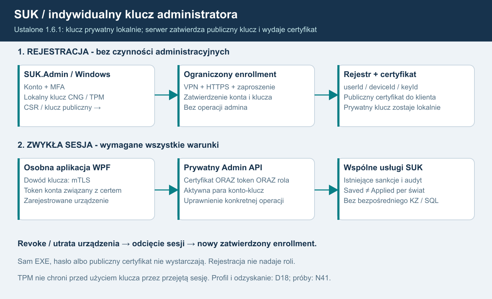
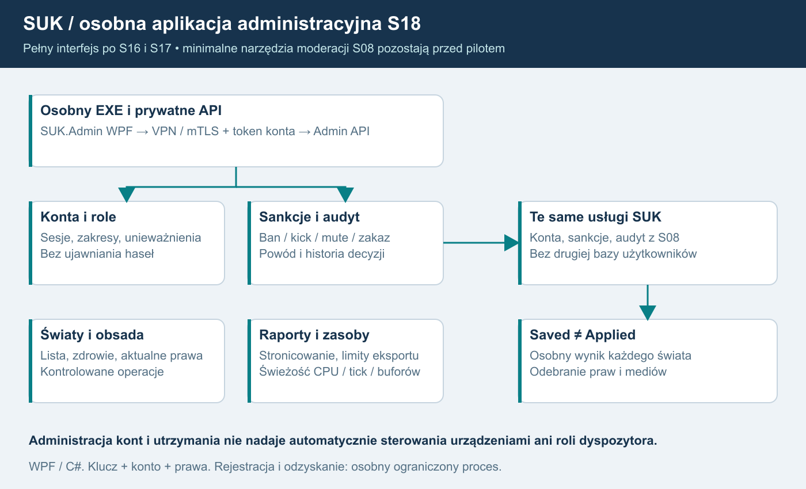

# 21. Osobna aplikacja administracyjna SUK.Admin

Plan 1.8, 17.10.2026. **WYMAGANIE WŁAŚCICIELA:** osobna aplikacja administracyjna, login/hasło i indywidualny klucz. Pełny interfejs pozostaje końcowym **S18 po S16/S17**, przed dyspozytorem S19. Zastępuje rekomendację Razor Pages z planu 1.5.

**ZATWIERDZONE przez właściciela 17.10.2026:** prywatny klucz powstaje lokalnie na komputerze administratora, preferencyjnie jako niewyeksportowalny klucz chroniony przez CNG/TPM. Serwer otrzymuje klucz publiczny i wydaje certyfikat. Nie tworzy, nie przekazuje i nie przechowuje prywatnego klucza administratora. Zastępuje to wcześniejszą propozycję serwerowego tworzenia i wydawania klucza.

Zdobycie EXE lub poznanie protokołu nie daje dostępu. Podpis wydawcy potwierdza pochodzenie pakietu, nie tożsamość administratora. Ochronę stanowią konto, dowód posiadania klucza i bieżące kompetencje sprawdzane przez serwer.

## Cel i komplet funkcji

Panel daje administracji spójny interfejs do istniejących usług SUK:

| Obszar | Pełny zakres S18 |
|---|---|
| Konta i dostęp | Wyszukiwanie kont, historia sesji, role i ich zakresy, dezaktywacja, unieważnianie sesji i delegacji, obsługa istniejącego procesu odzyskiwania dostępu bez ujawniania hasła. |
| Sankcje | Kick, mute tekstu/głosu, ban konta/świata, zakaz posterunku/obszaru, czas obowiązywania, powód, materiał dowodowy, odwołanie oraz postęp egzekwowania. |
| Światy i obsada | Lista światów, przydziały, aktywne stanowiska, podgląd konfiguracji i zatwierdzonych wersji pakietów; kontrolowane operacje utrzymaniowe z historią wykonania. |
| Stan usługi | Świeżość świata, kolejki, tick, CPU/RAM, opóźnienia, egress, błędy, certyfikaty i miejsce na dysku; diagnostyka posterunków, KZ i obu grup jako odczyt. |
| Audyt i statystyki | Filtrowanie według konta, świata, posterunku, czasu i correlationId, historia zmian ról/sankcji, wersje projekcji, dozwolone eksporty i raporty. |
| Utrzymanie | Status kopii i prób odtworzenia, zgodność wersji, kanały aktualizacji, operacje serwisowe oraz ich wynik. Panel nie zastępuje procedury zatwierdzania wydania. |

Konfiguracja, restart lub zatrzymanie świata wymagają osobnej kompetencji i jawnego zakresu działania. Nie mogą być ukrytym sposobem kasowania przebiegów albo sankcji. Właściciel zatwierdza dostępne operacje, warunki ich użycia i politykę odzyskania. Panel nie wykonuje ich podczas samego oglądania ekranu.

## Technologia i granica API

**Rekomendacja: SUK.Admin.exe, C# 14 / .NET 10 LTS / WPF / XAML**, osobny proces i podpisany pakiet. Prywatny **SUK.AdminApi**, ASP.NET Core 10/Kestrel, wykorzystuje istniejące moduły kont, sankcji, zapisu i audytu. Nie powstaje druga baza kont ani mechanizm haseł. Klient nie zawiera Ada, sterownika bazy, hasła usługi ani konsoli SQL/shell.

Operacyjny Admin API ma osobny prywatny listener wymagający mTLS dla całego wejścia, VPN/firewall i ograniczone konto usługi. Publiczna brama gry nie oferuje tych operacji. Certyfikat negocjuje TLS przed HTTP; warunek samej ścieżki /admin nie ustanawia mTLS. Na początek TLS kończy się w Kestrel. Przyszłe proxy wymaga zaufanego przekazywania certyfikatu, bez przyjmowania nagłówków podszytych przez klienta. [ASP.NET Core - certyfikaty i proxy](https://learn.microsoft.com/en-us/aspnet/core/security/authentication/certauth?view=aspnetcore-10.0).

Tożsamość konta pochodzi z istniejących Identity/OpenIddict: **Authorization Code + PKCE przez systemową przeglądarkę**, bez wspólnego sekretu w EXE. WPF nie wprowadza osobnego formularza przechwytującego hasło. Przeglądarka służy logowaniu, natomiast interfejs administracyjny jest natywny. Cookies/CSRF pozostają potrzebne stronom logowania. [RFC 8252](https://www.rfc-editor.org/rfc/rfc8252.html), [OpenIddict desktop](https://documentation.openiddict.com/integrations/operating-systems).

## Pierwsze logowanie i rejestracja klucza

1. Uprawniony właściciel tworzy krótkotrwałe zaproszenie związane z konkretnym kontem. Publiczna rejestracja i pierwsze poprawne hasło nie nadają roli administratora. Pierwszego właściciela ustanawia zaufany operator serwera w kontrolowanym procesie lokalnym; nie działa zasada „pierwszy zalogowany zostaje administratorem”.
2. Odrębna, ograniczona ścieżka enrollmentu jest dostępna za VPN przez HTTPS, bez istniejącego certyfikatu klienta. Wymaga konta, MFA, zaproszenia i limitów prób. Nie udostępnia czynności administracyjnych.
3. Zgodnie z zatwierdzonym ustaleniem SUK.Admin tworzy lokalny klucz i przesyła publiczny klucz/CSR z dowodem posiadania w standardowej procedurze certyfikacyjnej. Rejestracja jest związana z kontem, żądaniem i konkretnym kluczem; podmiana wymaga nowego zatwierdzenia.
4. Uprawniona osoba potwierdza tożsamość i konkretny klucz/urządzenie. Zaproszenie zużywa się atomowo również przy równoczesnych próbach. Serwer rejestruje issuer/sub konta, userId, keyId/deviceId i certyfikat. Do klienta wraca publiczny certyfikat i łańcuch; prywatny klucz pozostaje lokalnie.
5. Dopiero wpis Active, prawidłowe mTLS i token właściwego konta umożliwiają operacje w granicach roli. Przerwana/odrzucona rejestracja nie otwiera dostępu.

Stan: Invited → PendingApproval → Active → Revoked/Expired. Każdy administrator i każde jego zatwierdzone urządzenie mają osobny klucz. Nie kopiujemy wspólnego pliku pomiędzy administratorami lub komputerami. Audyt zawiera zatwierdzającego, daty, identyfikatory i historię.

Dla AI: diagram oddziela rejestrację bez operacji administracyjnych od zwykłej sesji wymagającej jednocześnie konta i dowodu posiadania klucza. Cofnięcie wpisu odcina nowe żądania i istniejące kanały.

## Windows, TPM i cykl życia

Zatwierdzony kierunek to lokalne generowanie klucza. Preferowany profil: Windows CNG, Microsoft Platform Crypto Provider, niewyeksportowalny klucz TPM i certyfikat w magazynie właściwego użytkownika Windows. CNG ma również dostawcę programowego, więc nazwa CNG nie dowodzi użycia TPM. Brak TPM nie powoduje cichego przejścia na eksportowalny plik; D18 określa dopuszczalne urządzenia i ewentualny jawnie słabszy profil. Prototyp ma sprawdzić algorytm, TPM, Schannel i HttpClient; kandydatem jest ECDSA P-256, inny profil wymaga testów. [Dostawcy CNG](https://learn.microsoft.com/en-us/windows/win32/seccertenroll/cng-key-storage-providers).

CSR nie dowodzi sprzętowego pochodzenia klucza. Jeśli serwer ma wymagać gwarancji TPM, potrzebna jest zweryfikowana atestacja i polityka zaufania. Niewyeksportowalność utrudnia kradzież, lecz przejęta sesja Windows może próbować używać klucza na tym komputerze. Nie deklarujemy wdrożenia atestacji. [Atestacja TPM](https://learn.microsoft.com/en-us/windows-server/identity/ad-ds/manage/component-updates/tpm-key-attestation).

Serwer przechowuje publiczne dane klucza administratora, statusy i audyt. Jego własny **prywatny klucz wystawcy certyfikatów jest innym kluczem**: chronionym osobno od bazy i publicznej bramy, z ograniczonym dostępem, kontrolowaną rotacją/backupem. Nie trafia do SUK.Admin. Certyfikaty klienta mają ograniczoną ważność, odpowiednie użycie klucza i EKU Client Authentication; sam dowolny poprawny certyfikat nie wystarcza.

Utrata komputera/reset TPM/reinstalacja/podejrzenie przejęcia: revoke keyId, unieważnienie związanych sesji/tokenów i nowa zatwierdzona rejestracja. Serwer nie odtwarza starego prywatnego klucza. Utrata wszystkich urządzeń wymaga udokumentowanego odzyskania przez zaufanego operatora/uprawnioną drugą osobę z audytem; nie powstaje publiczne obejście samym hasłem.

Wcześniejszą propozycję serwerowego generowania/eksportu prywatnego klucza zastąpiono zatwierdzonym generowaniem lokalnym. Nie jest otwartym wariantem D18 ani instrukcją implementacyjną; stan poprzedniej propozycji zachowano w archiwum/v1.6. Ewentualny profil bez TPM nadal wymaga klucza lokalnego i nie może osłabić kontroli konta/klucza przez cichy fallback.

## Konto ORAZ klucz ORAZ kompetencja

Rekomendujemy standardowy **token binding RFC 8705** zamiast własnych podpisów komend. Bieżąca dokumentacja OpenIddict opisuje UseClientCertificateBoundAccessTokens, UseClientCertificateBoundRefreshTokens oraz TokenBindingCertificate dla klientów publicznych. Prototyp musi potwierdzić dostępność w przypiętej wersji 7.x oraz Windows/CNG/TPM; strona dokumentacji nie dowodzi zgodności wybranych paczek. Brak wsparcia blokuje bramkę albo wymaga jawnej zgodnej aktualizacji, bez cichego bearer fallback. [OpenIddict mTLS](https://documentation.openiddict.com/configuration/mutual-tls-authentication), [RFC 8705](https://www.rfc-editor.org/rfc/rfc8705.html).

Każde żądanie wymaga poprawnego TLS/certyfikatu, ważnego access tokenu z właściwym issuer/audience i powiązaniem cnf do tego certyfikatu, zgodności issuer/sub z aktywnym wpisem konto-klucz, aktywnej sesji i kompetencji operacji. Token gry lub certyfikat A z kontem B są odrzucane. Publiczny certyfikat przesłany w wiadomości albo samo keyId nie dowodzą posiadania prywatnego klucza.

Lista schematów Certificate,Bearer w ASP.NET Core sama nie wymusza obu naraz. Potrzebna jest polityka AND sprawdzająca oba dowody i powiązanie; nie ufamy przypadkowo połączonym claims różnych tożsamości. [Microsoft - schematy autoryzacji](https://learn.microsoft.com/en-us/aspnet/core/security/authorization/authorize-with-a-specific-scheme?view=aspnetcore-10.0).

Daty/łańcuch certyfikatu nie zastępują bieżącego statusu keyId/konta/sesji/roli. OpenIddict domyślnie nie sprawdza wpisu access tokenu przy każdym żądaniu: rekomendujemy EnableTokenEntryValidation przy wspólnym magazynie lub introspekcję dla oddzielnej usługi. Brak wiarygodnego statusu oznacza odmowę nowej operacji. Cache walidacji kryptograficznej nie utrwala cofniętych kompetencji. [OpenIddict - unieważnianie](https://documentation.openiddict.com/configuration/token-storage.html).

Revoke odcina istniejące kanały, nowe żądania i odświeżanie; oczekująca operacja ponownie sprawdza bieżące prawa/epokę przed skutkiem. Odbiór mierzy czas odcięcia. Audyt używa userId/keyId/sessionId/requestId, bez hasła, tokenu i prywatnego klucza.

## Wspólne usługi, wydajność i skutek

Listy/raporty mają read modele poza tickiem, stronicowanie, limity eksportu i czas aktualizacji. Zmiana podaje oczekiwaną wersję i requestId; trafia do istniejących usług i uporządkowanej kolejki świata, bez mutowania pamięci świata lub Ada przez klienta/API.

Interfejs rozróżnia **Saved** - zapis trwały - i **Applied** - potwierdzone zastosowanie w każdym wymaganym świecie/mediach. Częściowe wykonanie nie jest globalnym sukcesem. Niedostępny świat synchronizuje sankcje przed komendami; odwołanie tworzy historię.

Administrator nie dostaje domyślnie ControlLease, poleceń KZ ani roli dyspozytora. Odebranie praw przez interwencję nie ustanawia go dyżurnym. Brak konsoli SQL/shell, uploadu kodu i obejścia selektora KZ.

## Etapy, D18 i odbiór

S03 przygotowuje kontrakt tożsamości/kluczy; S08 daje minimalne prywatne narzędzie moderacji i prototyp ochrony kontem oraz kluczem **przed pilotem S13**. Nie wymaga pełnego GUI S18. S18 rozwija te same usługi w kompletną aplikację WPF i cykl utrzymania. Zależności etapów nie zmieniają się.

D18 doprecyzowuje zatwierdzanie/odzyskanie, profil TPM/atestacji, rotację certyfikatów, ochronę wystawcy i działania krytyczne. Osobna aplikacja, indywidualny dodatkowy klucz oraz jego generowanie lokalne są ustalone. Nie pytamy ponownie o miejsce generowania i nie przenosimy prywatnego klucza administratora na serwer.

N41A przed pilotem: dwa konta/urządzenia, rzeczywiste mTLS/token binding, kontrolowany enrollment, odmowa pojedynczego dowodu i niezgodnej pary A/B, revoke podczas sesji, odmowa nowych i oczekujących operacji przy braku wiarygodnego statusu klucza/konta/tokenu oraz brak obejścia publiczną bramą. N41B/S18: dodatkowo rotacja, utrata/reset TPM, odzyskanie po utracie wszystkich kluczy, regresja awarii statusu i sfałszowane nagłówki proxy. N38/O17 nadal obejmują role, audyt, idempotencję i Saved/Applied. O19 jest scenariuszem kluczy. **Prób funkcjonalnych nie wykonano.**

## Opis funkcji dla AI

SUK.Admin WPF → prywatne Admin API → wspólne usługi kont/sankcji/audytu i kolejki. Wymagane jednocześnie konto, zatwierdzony klucz i uprawnienie. Ograniczony enrollment nie jest bocznym wejściem do operacji administracji.

## Istniejąca Komputerownia - 1.7
Obecna aplikacja serwisowa ma widoki kart/KZ i możliwość usterek, ale jej stary protokół nie realizuje zatwierdzonej ochrony konta i lokalnego klucza. Użyć wartościowych projekcji i ergonomii po oddzieleniu kompetencji. Zabezpieczyć również stare listenery: publiczne wejście gry nie może obchodzić nowego Admin API przez t=serwis. Diagnostyka nie nadaje uprawnień instruktora ani ControlLease; N42/O20 należy do wcześniejszej infrastruktury.
