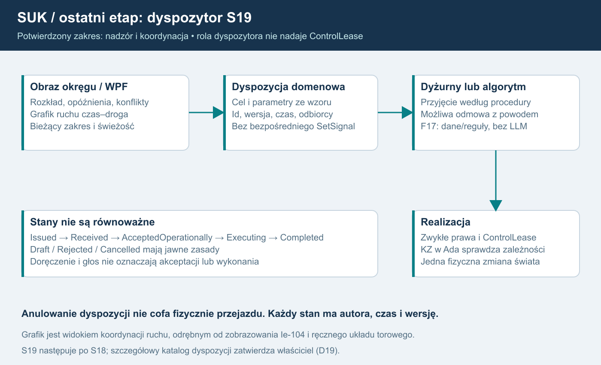

# 22. Tryb dyspozytora - nadzór i koordynacja

**POTWIERDZONE PRZEZ WŁAŚCICIELA:** dyspozytor zajmuje się wyłącznie nadzorem i koordynacją ruchu. Pełny tryb powstaje jako **S19, po S18**, na samym końcu planu. Jądro KZ jest w Ada; interfejs i pozostałe usługi pozostają C#/.NET. Nie jest to nowy pulpit nastawczy ani dodatkowy komputer zależności.

S19 ma zawierać pełne opisane funkcje. **D19** doprecyzowuje procedury, kompetencje i parametry, nie pozostawia otwartej decyzji, czy tryb w ogóle powstanie. Poniższy sposób realizacji jest rekomendacją. Nie przedstawia nieudokumentowanej organizacji rzeczywistej dyspozytury jako przepisu kolejowego.

## Interfejs w istniejącym kliencie WPF

| Widok | Funkcja |
|---|---|
| Przegląd obszaru | Posterunki, szlaki, obsada ludzi/algorytmu, ważne zdarzenia, ograniczenia i aktualność danych w przydzielonym zakresie. |
| Grafik czas-droga | Planowany i rzeczywisty przebieg pociągów, odchylenia, prognozy i propozycje koordynacji z czytelnym rozróżnieniem źródła. |
| Rozkład i opóźnienia | Lista pociągów, postoje, przyjazdy/odjazdy, odchylenia, zatwierdzone uwagi i powiązania z historią zdarzeń. |
| Konflikty | Lista wykrytych lub zgłoszonych problemów, horyzont prognozy, dane wejściowe, niepewność i proponowane działania. |
| Dyspozycje | Przygotowanie, wydanie, odbiór, akceptacja, realizacja, odrzucenie/anulowanie i historia konkretnej dyspozycji. |
| Łączność | Dozwolone urządzenia i rozmowy z odcinkowymi/posterunkami, zgodnie z istniejącym modelem uprawnień. |

Grafik czas-droga jest osobnym narzędziem analizy. Nie zastępuje zobrazowania urządzeń ani ZG, nie przerabia automatycznie obrazów projektanta i nie staje się powierzchnią wydawania komend KZ. Kliknięcie linii pociągu może otworzyć jego dane lub projekt dyspozycji, nie nastawić przebieg.

Prognoza lub konflikt planistyczny nie jest dowodem naruszenia zależności srk. Rezerwacja planisty nie utwierdza toru ani zwrotnicy. Trzeba odróżnić stan zaobserwowany, przewidywanie i decyzję operatora. Program nie przypisuje automatycznie winy dyżurnemu na podstawie samego opóźnienia.

## Widoczność nie jest sterowaniem

Dyspozytor otrzymuje **ViewGrant** dla wskazanego świata i obszaru, bez **ControlLease**. Może nadzorować i przekazywać zatwierdzone dyspozycje do właściwych odbiorców. Nie wydaje poleceń nastawczych, nie zwalnia utwierdzeń, nie przestawia urządzeń i nie omija KZ. Uprawnienia do komunikacji oraz dyspozycji są sprawdzane osobno od podglądu.

Rola administracyjna nie daje roli dyspozytora; rola dyspozytora nie daje uprawnień administracyjnych. Połączenie ról wymaga jawnego nadania, bez automatycznych praw wynikających z nazwy konta. Podgląd zachowany po oddaniu posterunku również nie przywraca sterowania.

Projekcje są przygotowywane poza tickiem, filtrowane po stronie serwera i ograniczone do dozwolonych danych. Ukrycie cudzej stacji w UI nie wystarcza. Widok pokazuje serverTick, czas symulacji i świeżość. Nieaktualny lub częściowy zakres jest oznaczony; nie obiecujemy pełnej oceny konfliktów poza nim. Po zmianie praw/reconnect następuje synchronizacja, bez zachowania nieautoryzowanych subskrypcji.

## Dyspozycja jako obiekt domenowy

REKOMENDACJA: dyspozycja ma dispositionId, worldId, autora nadanego przez serwer, zakres, odbiorców, pociągi, typ z zatwierdzonego katalogu, parametry, czas/ważność, wersję kontekstu, correlationId i historię. Zakres obejmujący cudzy obszar wymaga właściwej kompetencji lub jest odrzucany; serwer nie rozszerza go milcząco.

| Stan | Znaczenie |
|---|---|
| Draft | Projekt niewydany; nie wiąże odbiorców ani algorytmu. |
| Issued | Serwer przyjął prawidłowo wydaną dyspozycję; wysłanie nie dowodzi odbioru. |
| Received | Uprawniony odbiorca otrzymał dane; nie oznacza zgody ani wykonania. |
| AcceptedOperationally | Uprawniony człowiek lub algorytm przyjął dyspozycję według zatwierdzonej procedury. |
| Executing | Rozpoczęto jej dozwoloną realizację; nie jest to nazwa transportowego ACK. |
| Completed | Zrealizowano cel według zatwierdzonego kryterium i dowodów. |
| Rejected | Odrzucono z powodem i źródłem decyzji. |
| Cancelled | Uprawniona osoba wycofała dyspozycję zgodnie z jej regułami. |

Received nigdy nie przechodzi automatycznie w wykonanie tylko dlatego, że wiadomość dotarła. Akceptacja operacyjna nie oznacza nastawienia przebiegu. Każda zmiana stanu ma autora, czas i wersję; dozwolone przejścia, wygaśnięcia i przypadki wielu odbiorców ustala D19. Serwer odrzuca nieaktualne lub niedozwolone przejście. Ponowienia zdarzeń są idempotentne.

Anulowanie nie cofa fizycznie przejazdu ani wcześniej wykonanej komendy. Po rozpoczęciu realizacji konieczne działania i ich potwierdzenia określa zatwierdzona procedura, bez uniwersalnego przycisku „cofnij ruch”. Rozmowa głosowa lub zwykły czat nie tworzą automatycznie dyspozycji; wymagane jest jawne zdarzenie domenowe.

## Człowiek i algorytm F17

Dyspozycję odbiera operator człowiek lub autorski algorytm danych/reguł **F17**, bez LLM. Obaj korzystają z zatwierdzonego katalogu i uprawnień. Algorytm może odmówić, zgłosić konflikt albo przyjąć w granicach zaakceptowanych reguł; nie otrzymuje ad hoc zmiany polityki od dowolnej wiadomości dyspozytora.

Realizujący czynności sterowania potrzebuje właściwego lease i zwykłego pipeline poleceń. Serwer sprawdza je ponownie przy wykonaniu. Przyjęta dyspozycja nie nadaje prawa do cudzych urządzeń. KZ w Ada nadal rozstrzyga wykonalność każdej czynności; dyspozytor nie wysyła override ani SetSignal.

Planista może przeliczyć propozycję po zmianie sytuacji, lecz nie uruchamia automatycznie niezatwierdzonego wariantu. Zmiana obsady człowiek/algorytm przenosi historię rozmowy i dyspozycji, bez dwóch jednoczesnych właścicieli sterowania. Odrębne KZ posterunków, ich dwie obliczające grupy i pojedynczy selektor wyjścia pozostają częścią tego samego rdzenia; tryb dyspozytora ich nie zastępuje ani nie daje prawa przełączania grup.

## D19 i przyszły odbiór

Właściciel zatwierdza katalog dyspozycji, wzory/parametry, obowiązki odbiorców, ważność, odwoływanie, miary konfliktów i zakończenia oraz granice działania F17. Materiały lokalne z [audytu źródeł](19_AUDYT_ZRODEL_I_ZALEZNOSCI.md) nie są pełną instrukcją dyspozytury. Nie dopisujemy nakazów ani procedur z pamięci.

Odbiór S19 obejmuje pełny przebieg dyspozycji do człowieka i F17, zatrzymanie na Received bez akceptacji, odrzucenie/anulowanie, utratę łącza, nieaktualny grafik, częściowe prawa i powtórzenia komunikatów. Musi dowieść odmowy komend KZ z samej roli dyspozytora, braku wzajemnego dziedziczenia ról admin/dyspozytor oraz braku podwójnego skutku obu grup KZ. Zrzuty mają pokazywać grafik i stany wraz ze świeżością; dziennik serwera potwierdza skutki. **Scenariusze te są zaplanowane, jeszcze niewykonane.**

## Schemat i opis dla AI

Dyspozytor obserwuje zakres okręgu i wydaje typowaną dyspozycję. Odbiór, akceptacja i wykonanie są osobne. Dyżurny lub algorytm wykonuje czynności tylko ze zwykłymi prawami i kontrolą KZ; rola nadzoru nie nadaje sterowania.
