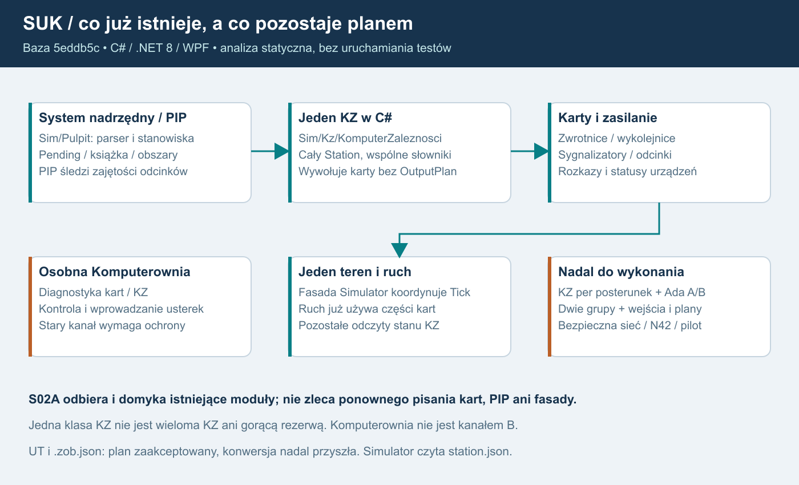

# 24. Porównanie z nową wersją programu — plan 1.8

Stan odczytu: 17.10.2026. To aktualizacja podstaw planowania, bez implementacji i bez nowych wyników testów.

## 1. Baza i zakres porównania

Pierwotny odczyt planu dotyczył `4869fc185a70e6f390bf2bf1ad07680fdb5c32ff`, a uzupełnienie 1.3 — `2120ab0bcbedbc503a4a859eda26a7823644d0b7`. Obecnie potwierdzony HEAD to **`5eddb5c5d58eccd5af6467f7ca2373a2daed6568`**. Pomiędzy drugą a trzecią bazą są **25 commitów, 123 zmienione pliki, 10 466 dodanych i 1 111 usuniętych linii**. Są to istniejące zmiany programu, odczytane w tej pracy; nie są commitami dokumentacji multiplayera.

Sprawdzono instrukcje i dokumenty projektu, historię zmian, nowe dane sygnałów oraz istotne miejsca kodu Komputerowni, fasady i PIP. Nie uruchamiano buildów, symulacji, serwera ani testów. Nie zmieniano repozytorium ani indeksu Git. Zastany nieśledzony plik `D:\Projects\SUK\SUK_plan_multiplayer.pdf` pozostał nietknięty.

Dokumenty projektu wskazano względem `D:\Projects\SUK`. Ścieżki kodu `Sim/`, `Net/`, `Data/` oraz `Simulator.cs` odnoszą się do `app/LcsWidzew/`; numery linii dotyczą bieżącego HEAD. „Zrobione” oznacza obecność implementacji i taki status w dokumentacji projektu, a nie odbiór działania przez ten audyt.

## 2. Co już istnieje i co wykorzystać

| Zmiana w programie | Co wykorzystuje plan 1.7 | Czego jeszcze nie uznajemy za gotowe |
|---|---|---|
| Kroki podziału 5, 6, 6a, 7, 9 i 10 oznaczono jako wykonane; 8 odłożono. Dowód: `PODZIAL_MODULOW.md:3`, `ROZWOJ.md:188–195`. | Istniejące karty, zasilanie, system nadrzędny i fasadę. S02A odbiera oraz domyka ich granice przed grupami. | Wielu niezależnych KZ, dwóch grup i kanałów Ada. Obecność klas nie zalicza tych wymagań. |
| Karty zwrotnicy i wykolejnicy mają rozkaz, teren, czas przekładania i status. Rozprucie rozstrzyga KZ. Dowód: `PODZIAL_MODULOW.md:193–213`. | Rozdzielenie KZ od fizycznego stanu; zachować zaakceptowane opóźnienie cyklu i model usterek. | Pełnej izolacji wyjść replik ani transportu pętli; wymagają dalszych kontraktów i odbioru. |
| Karta sygnalizatora rozdziela sygnał zlecony i wyświetlany; istnieje tabela Ie-1 oraz dobór prędkość × następny semafor. Dowód: `PODZIAL_MODULOW.md:240–267`, `Sim/Sygnaly.cs:40–73`. | Aktualną bazę zachowania, dane i scenariusze do specyfikacji KZ. | Pełnej obsługi prędkości z sygnału przez ruch; kroku 8, kart Os/Sp ani rozstrzygnięcia wariantu linii ≤100 km/h. |
| `Sim/Urzadzenia/Zasilanie.cs` oddziela fizyczne zasilanie od kopii statusu w KZ. Dowód: `PODZIAL_MODULOW.md:288–304`. | Istniejące rozkazy/statusy NN, UPS i agregatu. | Modelu rozładowania UPS i zużycia paliwa; dokumentacja pozostawia to do ustalenia. Nie dodajemy tych reguł podczas migracji. |
| `SystemNadrzedny` zawiera parser, potwierdzanie, stanowiska, obszary i książkę. PIP śledzi zajętości zamiast listy pociągów. Dowód: `PODZIAL_MODULOW.md:306–336`, `Sim/Pulpit/Pip.cs:5–11,51–68`. | Jeden system nadrzędny i istniejący mechanizm numeracji. `display.pip` jest opcją posterunku. | Ręcznych korekt numerów, migania i czerwonego numeru na wolnym torze. Dokumentacja odnotowuje też opóźnienia przejścia numeru przy wjeździe na zajęty odcinek. |
| KZ wydzielono do `Sim/Kz/`, a `Simulator` koordynuje moduły. Dowód: `PODZIAL_MODULOW.md:338–352`. | Aktualne ścieżki i granice do dalszej migracji. | Odrębnego KZ każdego posterunku: `Simulator.cs:43` tworzy jeden KZ, a `Sim/Kz/Fasada.cs:12–21` udostępnia jego wspólne słowniki. |
| Osobna Komputerownia WPF pokazuje karty, przebiegi, utwierdzenia, komunikację, polecenia i kontrolę niezmienników; wprowadza również usterki. Dowód: `README.md:292–307`, `PODZIAL_MODULOW.md:269–286`. | Projekcje diagnostyczne, dziennik i istniejące narzędzia odbioru; aplikacja ma własny projekt bez referencji do kodu symulatora. | Bezpiecznej administracji publicznej ani niezależnego kanału B. Kontrola niezmienników nie jest drugą implementacją algorytmów zależnościowych. |

Nowa ścieżka serwisowa wymaga uwzględnienia w bezpieczeństwie. `Net/LcsNet.cs:137–154` przyjmuje deklarację klienta `serwis`, po której obsługuje także `usterka` → `Instruktor.ApplyFault`. W tym miejscu nie ma sprawdzenia konta ani uprawnienia. Domyślny nasłuch jest na `IPAddress.Any` (`:63–67`), a `README.md:307` dopuszcza Komputerownię przez port stanowisk 47120. Osobny port 127.0.0.1:47121 nie ogranicza tej samej funkcji na 47120. Plan obejmuje więc osobne uprawnienia podglądu i usterek, wiarygodną tożsamość, audyt, limity i prywatny dostęp serwisowy. To ustalenie z kodu, bez próby wykorzystania luki.

## 3. Edytory: wykonanie i zaakceptowany plan

Edytor UT ma status wykonanych etapów 0–7. Doszły m.in. wyposażenie, odcinki, profil NMT, kontrola, eksport w skali, narzędzia dopasowania łuków, wykres krzywizny, podział toru i zaznaczanie wielu elementów. Szczegóły przeniesiono do `HISTORIA_EDYTOR_UT.md`; skrót jest w `ROZWOJ.md:115–133`. **Dane UT nadal nie trafiają do symulatora** (`README.md:7`). Symulator czyta dotychczasowy `station.json`.

Właściciel zaakceptował plan edytora zobrazowania 17.10.2026 (`PLAN_EDYTOR_ZOBRAZOWANIA.md:3,164–172`). Ustalenia obejmują osobny `*.zob.json`, obrazy 1920 × 1080 przy siatce 8, szlaki i blokady definiowane w UT, ręczne ustawianie przerw i osobno rysowany obraz poglądowy. Jeden obiekt UT może występować na dwóch obrazach, a prawa wynikają z jego posterunku. Dawne obrazy mają być narysowane od nowa; mogą służyć jako podkład.

| Przyszły etap | Zakres zaakceptowanego planu |
|---|---|
| Z0 | Funkcja semafora, posterunki i szlaki w UT. |
| Z1–Z2 | Osobna aplikacja/model/pliki oraz ręczne rysowanie torów przypiętych do obiektów UT. |
| Z3–Z4 | Urządzenia, opisy, granice odcinków, perony, przejazdy i blokady. |
| Z5 | Wiele obrazów, osobny poglądowy, kontrola zgodności i eksport. |
| Z6 | Podgląd przez rysowanie pulpitu; wymaga części przekształcenia UT + obraz → model symulatora. |

Żadnego Z0–Z6 nie zaliczamy samą akceptacją dokumentu. Podstawa: `PLAN_EDYTOR_ZOBRAZOWANIA.md:117–129`. Pełne przekazywanie danych do symulatora pozostaje odrębnym etapem 9. Starsze skróty kolejności w `PLAN_EDYTOR_UT.md:5` i `ROZWOJ.md:135` nie zastępują szczegółowych zależności nowego planu. Ustalenia o kartach każdego urządzenia, funkcji semafora, posterunkach i opcjonalnym PIP są w `PLAN_EDYTOR_UT.md:173–184`; nie dowodzą gotowego importu.

## 4. Źródła i bramka przyszłych testów

Plik `Data/sygnaly_ie1.json:2–3` wskazuje Ie-1 §4 ust.13, §8 ust.4 i 6 oraz załącznik 1; jawnie opisuje zakres zestawienia dla linii powyżej 100 km/h. Wskazanego w `ROZWOJ.md:49` PDF `Zrodla/Ie-1_obowiazuje_od_2026-01-17__uz_1041_25__WCAG.pdf` nie znaleziono w bieżącym katalogu źródeł. Potwierdzono tabelę i jej użycie w kodzie, **nie wykonano weryfikacji z tym PDF**. Źródło należy udostępnić przed normatywnym odbiorem lub zmianą reguł; nie odtwarzamy treści z domysłu.

AGENTS i CLAUDE są już zgodne: aktualny test edytora to `EdytorUT.exe --test`, a stare `--edtest`, `fuzz` i `dfuzz` pozostają historyczne (`AGENTS.md:11–14`). Rozbieżność opisana w planie 1.6.1 jest zamknięta. Dokumentacja wymienia następujące oczekiwania (`ROZWOJ.md:88–90`): selftest 25/26 i kontrola zależności 4/4, ochrona boczna 4/4, karty zwrotnic 8/8, sygnały 9/9, zasilanie 8/8, PIP 1526/1526, brak naruszeń kontroli KZ i wykrycie celowych naruszeń 2/2. Kod wypisuje nowe kontrole w `Sim/SelfTest.cs:122–141,204,236,328`.

To bramka do ponownego wykonania w S00, nie wynik tego audytu. Należy zachować dzienniki i scenariusze, a przy zmianach właściwych aplikacji także ich testy. Test Komputerowni wymaga działającego symulatora i aktywnego przebiegu (`README.md:329`, `PODZIAL_MODULOW.md:301–302`). Zastane ograniczenia nadal obowiązują: brak testu dwóch komputerów przez Radmin (`ROZWOJ.md:210`) oraz brak sprawdzenia prawdziwą myszą i drukarką (`HISTORIA_EDYTOR_UT.md:150`).

## 5. Skutek dla planu multiplayera

W rozdziałach 02, 11, 14 i 19 oraz S00/S02A zaktualizowano bazę, ścieżki, numery linii i statusy. Kroki 5/6/7/9/10 mają być wykorzystane i sprawdzone, zamiast ponownie pisane. S02A zachowuje odbiór izolacji skutków przed grupami. Krok 8 pozostaje odłożony: ruch nadal ma odwołania do KZ, utwierdzeń i przebiegów (`Sim/Trains.cs:83–84,155–172,248,364`). Cienka fasada nie oznacza prywatnych kontekstów ani granicy bezpieczeństwa.

Nowe zmiany programu nie odwołują ustaleń właściciela planu multiplayera: **Windows; własny KZ każdego posterunku; dwa niezależne warianty Ada A/B i dwie grupy; wspólny pojedynczy teren/ruch; algorytm ruchu bez LLM; podgląd po oddaniu bez sterowania; administracja z lokalnym kluczem urządzenia i odrębnymi prawami**. Są to wymagania docelowe, nie funkcje zaliczone przez obecny HEAD. Nie dodajemy nowych reguł srk, czasów przełączenia ani automatycznie projektowanych zależności.

## 6. Mapa obecnej implementacji

Opis dla AI: system nadrzędny i PIP przekazują intencje do obecnego pojedynczego KZ w C#. KZ wywołuje karty urządzeń i zasilanie; nie ma jeszcze pasywnych planów wyjść prywatnych replik. Simulator koordynuje jeden teren i ruch, które nadal częściowo odczytują stan KZ. Osobna Komputerownia daje diagnostykę i wprowadzanie usterek przez istniejący kanał wymagający ochrony N42. Prawa część dolnego rzędu jest zakresem przyszłej pracy: KZ każdego posterunku, Ada A/B w dwóch grupach, granica wejść i wyjść oraz bezpieczna sieć. S02A wykorzystuje istniejące moduły i odbiera brakujące granice. Grafika nie przedstawia gotowej architektury docelowej.

## Zakres późniejszej kopii1.8
Właściciel wskazał D:\Projects\SUK jako miejsce końcowej dokumentacji. To upoważnia do zastąpienia tam PDF po zachowaniu kopii i zapisania pakietu planu. Nie zmienia kodu ani wcześniejszych ustaleń analizy statycznej i nie obejmuje Git.
