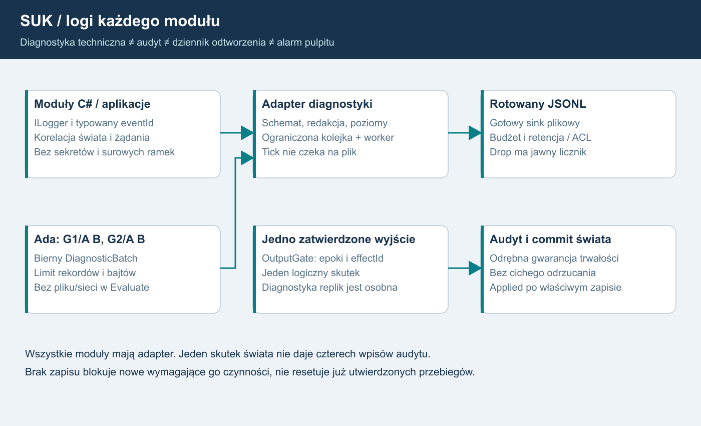

# 25. Logowanie i diagnostyka wszystkich modułów
Plan 1.8 | 17.10.2026 | specyfikacja do wdrożenia, bez zmian programu.

**USTALONE:** SUK tworzy logi. Każdy istniejący moduł objęty migracją oraz każdy nowy moduł otrzymuje adapter logowania i sprawdzony katalog zdarzeń. Logi działają na serwerze oraz lokalnie w singleplayerze. Samo okno „Zdarzenia”, alarm na pulpicie lub końcowy plik testu nie zalicza tego wymagania.

**REKOMENDACJA TECHNICZNA:** C# używa Microsoft.Extensions.Logging (MEL), typowanych zdarzeń i ograniczonego zapisu asynchronicznego do JSONL. Ada oddaje bierną diagnostykę przez ABI; host zapisuje ją tą samą drogą. Trwały audyt i dziennik odtworzenia mają osobne gwarancje. Poniższe limity są proponowanymi profilami do pomiaru, nie wynikiem testów ani obietnicą wydajności.

## 1. Co istnieje, a czego jeszcze nie ma
Przegląd statyczny dotyczy kodu na 5eddb5c5d58eccd5af6467f7ca2373a2daed6568. Ścieżki w tabeli są względne wobec repozytorium.

| Źródło | Potwierdzony stan | Sposób wykorzystania |
|---|---|---|
| app/LcsWidzew/Sim/Rejestrator.cs:18–20,52–75 | Events, Alarms i Remarks są listami w RAM; czas symulacji, operator, sygnały UI i potwierdzenia alarmów | Zachować semantykę dziennika pulpitu i dołączyć adapter trwałego eksportu wybranych zdarzeń |
| app/LcsWidzew/Sim/Urzadzenia/KzPodglad.cs:10–25 | Dziennik rozkazów/statusów kart ogranicza listę po przekroczeniu 2000 wpisów, usuwając 500; wpisy statusu dotyczą zmian | Wykorzystać identyfikatory i zdarzenia; bufor podglądu nie zastępuje archiwum ani audytu skutków |
| app/LcsWidzew/App.xaml.cs:21–24 | App.LogError synchronicznie dopisuje wyjątek do bledy.log; niepowodzenie zapisu jest ignorowane | Docelowo zastąpić wspólnym adapterem, kontrolą stanu zapisu i bezpiecznym formatowaniem |
| app/Lcs.EdytorUT/Program.cs:14–22 | Podobny bledy.log obok programu, lokalny czas i pełny wyjątek, pusty catch | Włączyć edytor do tego samego kontraktu, zapisywać poza binariami |
| app/LcsWidzew/Net/LcsNet.cs:113–117,271–275 | Część błędów trafia do App.LogError, inne są pomijane; publikacja zdarzeń do klienta nie jest trwałym zapisem | Typowane odmowy/błędy transportu, liczniki i limity zamiast pełnych nieufnych ramek |
| app/LcsWidzew/Sim/SelfTest.cs:334 | Eksport pełnego dziennika scenariusza do pliku .zdarzenia | Zachować jako dowód regresji; to eksport testowy, nie infrastruktura logowania każdej aplikacji |

Nie uruchamiano programu, buildów, testów ani prób przeciążenia. Obecne deklarowane wyniki regresji pozostają źródłami do ponownego pomiaru S00.

## 2. Cztery oddzielne strumienie
| Strumień | Przeznaczenie i właściciel | Gwarancja |
|---|---|---|
| Dziennik domenowy i alarmy | Rejestrator/system nadrzędny; wydarzenia widoczne dyżurnemu | Jedno logiczne zdarzenie i właściwy odbiorca; nie cztery alarmy od czterech obliczeń KZ |
| Diagnostyka techniczna | Każda aplikacja i moduł: uruchomienie, błędy, kolejki, stan połączenia, czasy | Ograniczony zapis, jawna liczba utraconych rekordów, brak blokowania ticku |
| Audyt bezpieczeństwa i czynności | Usługi kont, praw, administracji i WorldHost | Trwałe powiązanie aktora, celu, decyzji i wyniku; bez cichego zgubienia wymaganych wpisów |
| Dziennik odtworzenia świata | Jeden autorytatywny WorldHost, checkpoint i uporządkowane wejścia/rozstrzygnięcia | Spójność komendy, skutku, wersji i odtwarzanego stanu według bramki S06 |

Diagnostyczny JSONL może zawierać kopię zdarzenia audytu dla wygodnego wyszukiwania. Kopia nie staje się źródłem prawdy i jej utrata nie usuwa trwałego audytu. Zwykły sink plikowy, ustawienie „Critical” ani sam zapis tekstu „Executed” nie dowodzą trwałości skutku.

Metryki Meter i próbkowane ślady ActivitySource uzupełniają logi. Nie zastępują audytu, dziennika świata ani wydarzeń pulpitu. Algorytm ruchowy pozostaje regułowy; ani tworzenie logów, ani ich analiza podczas gry nie wymagają modelu LLM.

## 3. Gotowe mechanizmy i granice modułów
1. Moduły C# dostają ILogger<T> lub wąski adapter oparty na MEL. Katalog zdarzeń używa EventId, stałych kodów i typowanych parametrów; w gorących ścieżkach LoggerMessage/source generation. Kontener hosta tworzy loggery. Nie powstaje własna biblioteka zastępująca MEL. Takie API i generowanie wspiera [dokumentacja .NET](https://learn.microsoft.com/en-us/dotnet/core/extensions/logging/overview), [wydajne logowanie .NET](https://learn.microsoft.com/en-us/dotnet/core/extensions/logging/high-performance-logging).
2. Integracja hosta: Serilog.Extensions.Hosting, zgodna z docelową linią .NET; dokładne wersje i licencje zamraża S00. Moduły nie znają Serilog, ścieżek, formatu pliku ani usług sieciowych. [Oficjalna integracja z hostem](https://github.com/serilog/serilog-extensions-hosting).
3. Zapis diagnostyki: gotowy Serilog.Sinks.File i Serilog.Formatting.Compact, CompactJsonFormatter. Jedna linia UTF-8 jest jednym obiektem JSON; właściwości SUK są strukturalne. Rotacja według czasu i rozmiaru, jawne limity liczby/wieku plików. [Sink plikowy](https://github.com/serilog/serilog-sinks-file), [format Compact JSON](https://github.com/serilog/serilog-formatting-compact).
4. Pomiędzy producentem a plikiem jest jeden ograniczony adapter kolejkowy hosta, oparty na System.Threading.Channels. Logger zarejestrowany przez Serilog.Extensions.Hosting ma jako jedyne wyjście gorącej ścieżki ten adapter pamięciowy. Worker posiada osobny prywatny logger z gotowym sinkiem File/Compact i nie odsyła wpisów do kolejki wejściowej; nie wolno skonfigurować równoległej bezpośredniej gałęzi plikowej. Na wątku ticku logger tylko sprawdza poziom i wykonuje ograniczone TryWrite; plik obsługuje osobny worker. Wariant bez pomiaru granic kolejki nie przechodzi odbioru. [Kanały .NET](https://learn.microsoft.com/en-us/dotnet/core/extensions/channels).
5. Wywołanie MEL/Serilog domyślnie nie dowodzi asynchroniczności. Nie podłączać bezpośredniego sinku plikowego, sieciowego eksportera ani Windows EventLog do gorącego loggera WorldHost. Również fallback nie wykonuje I/O z ticku.
6. Nie stosować domyślnych ustawień sinku jako polityki SUK. W szczególności jawnie włączyć rollOnFileSizeLimit i powiązać limity z nadzorem wolnego miejsca. Nie używać jednego pliku współdzielonego przez wiele procesów.

Schemat przepływu: moduł → typowane zdarzenie + kontekst → walidacja/redakcja → ograniczona kolejka → worker → rotowany JSONL. Osobna droga: działanie wymagające audytu/odtwarzalności → kontrola dostępności trwałego rejestru → zatwierdzona granica zapisu → wykonanie i uzgodniony wynik. Ta druga droga nie przechodzi przez odrzucalną kolejkę diagnostyczną.

## 4. Kontrakt rekordu v1
Katalog zdarzeń i JSON Schema są wspólnym, wersjonowanym artefaktem SUK.Contracts/diagnostyki. Zmiana znaczenia pola wymaga nowej wersji głównej; nowe opcjonalne pola są zmianą zgodną. Odbiorca toleruje nieznane opcjonalne pola, zachowuje schemaVersion i odrzuca błędny typ. Wewnętrznych struktur obiektów nie serializujemy automatycznie.

| Pola | Typ i reguła |
|---|---|
| schemaVersion, stream | Liczba całkowita 1 oraz zamknięta kategoria strumienia; diagnostyka/audyt/replay nie są wybierane przez klienta |
| @t, monoElapsedUs, processRunId, recordSeq | UTC ISO 8601, monotoniczny czas od startu procesu w µs, UUID uruchomienia i rosnący licznik producenta; @t pochodzi z gotowego formatu |
| eventCode, eventId, severity, moduleId, moduleVersion | Stabilny kod i EventId, poziom, moduł oraz wersja; @l formatu Compact odwzorowuje severity, brak @l oznacza Information |
| worldId, worldRunId, serverTick, simulationTimeMs | Opcjonalne dla modułów poza światem; identyfikatory świata/epoki oraz całkowity tick i czas symulacji, również przy pauzie |
| postId, kzId, kzEpoch, groupId, channelId, groupRunId, selectionEpoch | Tylko gdy dotyczą; groupId: 1 albo 2, channelId: A albo B; brak wartości jest jawny, nie oznacza „grupa główna” |
| requestId, correlationId, effectId, effectState | Powiązanie żądania i skutku; plan, commit i potwierdzone wykonanie urządzenia to różne stany |
| controlLeaseId, controlEpoch, authorizationVersion, actorRef, targetId, reasonCode | Obowiązkowe tam, gdzie uzasadniają decyzję; actorRef to pseudonimowy identyfikator konta nadany przez serwer |
| outcome, durationUs, counters, @mt | Typowany wynik, czas, dozwolone liczniki, szablon komunikatu; komunikaty dla człowieka po polsku |

UTC służy do korelacji maszyn, nie wyznacza wieku poleceń. Czas monotoniczny porównujemy tylko wewnątrz tego samego processRunId; kolejność świata określają epoka, tick i pozycja dziennika. Korekta NTP nie cofa licznika monotonicznego ani czasu ważności. Emitent bez zegara świata pomija te pola. Oryginalne eventId/eventCode nie zależą od przetłumaczonego tekstu.

Identyfikatory korelacji klienta są nieufne i mają limity formatu/długości. Serwer nadaje własne correlationId i autorytatywny kontekst. Znaczenie rekordu wynika z miejsca emisji, nie przesłanego przez klienta moduleId lub actorRef.

### Przykładowe bezpieczne rekordy
Przykłady są ilustracją kontraktu, nie wynikiem uruchomienia. Każdy obiekt poniżej jest osobną linią JSONL; użyto umownych identyfikatorów bez danych osób.

~~~json
{"@t":"2026-10-17T12:00:00.000Z","@mt":"Odmowa polecenia: {reasonCode}","@l":"Warning","schemaVersion":1,"stream":"diagnostic","eventCode":"AUTH.COMMAND_REJECTED","eventId":2101,"severity":"Warning","moduleId":"WorldHost.Authorization","moduleVersion":"example","processRunId":"11000000-0000-4000-8000-000000000001","recordSeq":71,"monoElapsedUs":12001000,"worldId":"world-example","worldRunId":"22000000-0000-4000-8000-000000000002","serverTick":120,"simulationTimeMs":12000,"postId":"post-example","kzId":"kz-example","requestId":"req-example","correlationId":"corr-example","actorRef":"account-ref-example","controlLeaseId":"lease-old-example","controlEpoch":8,"authorizationVersion":19,"targetId":"target-example","outcome":"Rejected","reasonCode":"CONTROL_EPOCH_STALE"}
{"@t":"2026-10-17T12:00:01.000Z","@mt":"Rozkaz urządzenia zatwierdzony","schemaVersion":1,"stream":"diagnostic","eventCode":"WORLD.EFFECT_COMMITTED","eventId":3101,"severity":"Information","moduleId":"WorldHost.OutputGate","moduleVersion":"example","processRunId":"11000000-0000-4000-8000-000000000001","recordSeq":72,"monoElapsedUs":13001000,"worldId":"world-example","worldRunId":"22000000-0000-4000-8000-000000000002","serverTick":130,"simulationTimeMs":13000,"kzId":"kz-example","groupId":2,"selectionEpoch":3,"requestId":"req-other-example","correlationId":"corr-other-example","effectId":"effect-example","effectState":"Committed","outcome":"Committed"}
{"@t":"2026-10-17T12:00:02.000Z","@mt":"Pominięto diagnostykę: {droppedCount}","@l":"Warning","schemaVersion":1,"stream":"diagnostic","eventCode":"LOG.DIAGNOSTICS_DROPPED","eventId":9101,"severity":"Warning","moduleId":"Diagnostics.Writer","moduleVersion":"example","processRunId":"11000000-0000-4000-8000-000000000001","recordSeq":73,"monoElapsedUs":14001000,"droppedCount":52,"windowMs":1000,"reasonCode":"QUEUE_FULL","outcome":"Degraded"}
~~~

Wpis WORLD.EFFECT_COMMITTED powstaje z istniejącego zatwierdzonego rozstrzygnięcia. Nie zmienia stanu i nie zastępuje rekordu commit. Słowo „Committed” nie dowodzi otrzymania statusu od karty.

## 5. Ada i cztery konteksty KZ
- Kz_A/Kz_B w grupach 1/2 nie otwierają pliku, konsoli, gniazda, bazy ani loggera WPF. Wynik kroku zawiera ograniczony DiagnosticBatch: kod zdarzenia, lokalną kolejność, obiekt, poziom, dane liczbowe z katalogu i liczbę pominiętych szczegółów.
- Proponowany limit ABI do dowodu: maksymalnie 8 rekordów i 4 KiB diagnostyki na kontekst i wywołanie kroku; przekroczenie daje licznik. Kwalifikacja, błąd krytyczny oraz powód odrzucenia wyniku są obowiązkowymi polami rezultatu, niezależnymi od miejsca w diagnostyce. Pełny bufor nie może ukryć niezgodności kanałów ani zmienić kwalifikacji.
- C# adapter przypisuje post/kz/group/channel/epoki z posiadanego uchwytu, nie z dowolnego tekstu Ada. Mapuje do MEL poza funkcją obliczającą i nie interpretuje tekstu jako komendy. Kopiowanie ponowionego wyniku BufferTooSmall nie oblicza ponownie ani nie emituje nowego logicznego zdarzenia; batchId/seq pozwalają deduplikować eksport.
- Cztery prywatne wyniki mogą dać cztery diagnostyki obliczenia. **Jeden** OutputGate emituje jeden logiczny commit/skutek/audyt. Rezerwa i drugi kanał nie tworzą dodatkowej książki, punktów, alarmu operatora ani drugiego rozkazu. DiagnosticCandidate i EffectCommitted mają różne eventCode.
- Zapisujemy StartupSelection, kwalifikację grup, zmianę selectionEpoch, restart groupRunId, niezgodność A/B, lukę historii, rebuild i odmowę starego effectId. Wynik losowania grupy zasadniczej jest utrwalonym wejściem świata przed otwarciem wyjść, bez ponownego losowania przy reconnect lub restartach pojedynczej grupy.
- Domyślnie rejestrujemy przejścia i podsumowania, nie status każdej karty w każdym cyklu. Rozszerzony ślad danego KZ ma limit czasu, objętości i uprawnienia; nadal nie blokuje ticku.

Wymaganie wchodzi do neutralnej specyfikacji S02A1 i obu niezależnych promptów A/B. Pakiety dzielą katalog kontraktowych kodów, ale nie implementację algorytmu ani prywatny stan. Diagnostyka nie jest wejściem sterującym ani źródłem decyzji LLM.

## 6. Kolejki, dysk i trwałość
Proponowany profil pilotażowy 20–40 osób wymaga pomiaru w S13. W kolejce wolno przechowywać wyłącznie ograniczone, niemutowalne pola, bez referencji do całego świata lub wyjątku z dowolnym grafem obiektów. Limit bajtów obejmuje konserwatywnie policzony rozmiar danych; rzeczywisty narzut obiektów CLR jest osobno mierzony. Własna implementacja ograniczonego bufora i redakcji pozostaje małym adapterem do gotowego MEL, nie zastępuje silnika logowania:

| Granica | Propozycja do pomiaru |
|---|---|
| Rekord diagnostyczny | 8 KiB po serializacji; string 512 znaków, wyjątek po redakcji do 4 KiB; ograniczona liczba właściwości |
| Kolejka diagnostyczna procesu świata/bramy | 4096 rekordów i 8 MiB łącznie, obowiązuje wcześniejszy limit; brak kolejek per obiekt/kanał |
| Kolejka klienta/edytora | 1024 rekordy i 2 MiB łącznie |
| Normalny flush diagnostyki | Co najwyżej 1 s grupowania; poprawne zamknięcie ma limit 5 s na opróżnienie |
| Cel kosztu emitowania w ticku | p99 poniżej 100 µs na typowe zdarzenie i narzut diagnostyki poniżej 1% czasu pracy ticku; pomiar alokacji i ogona opóźnień |
| Logi techniczne serwera | Plik do 64 MiB; do 16 plików/proces i do 7 dni, nadrzędny łączny budżet 2 GiB na host |
| Logi lokalnej aplikacji | Plik do 32 MiB; do 8 plików i do 7 dni; wspólny nadzór miejsca dla wszystkich aplikacji |
| Rezerwa i progi miejsca | Ostrzeżenie poniżej 15% wolnego; ograniczenie diagnostyki poniżej 10%; próg audytu wynika też z bezwzględnej rezerwy, a nie samego procentu |
| Audyt i dziennik świata | Odrębna kwota, monitorowany backlog i rezerwa; rozmiar z modelu zdarzeń oraz RPO/retencji S06, bez kasowania wymaganej historii przez rotator diagnostyki |

Po przepełnieniu kolejki diagnostyki TryWrite nie czeka. Rośnie licznik odrzuceń według modułu i powodu; pierwszy możliwy zapis daje zbiorczy LOG.DIAGNOSTICS_DROPPED. Liczniki i stan zdrowia są dostępne niezależnie od działającego pliku. Poważne błędy mają wydzielony mały budżet i alarm nadzorcy; przy wyczerpaniu także jawny licznik. Nie obiecujemy nieutracalności diagnostyki podczas awarii procesu. Awaria workera/sinku nie może rekurencyjnie logować do własnej przepełnionej kolejki.

**Audyt obowiązkowy i commit log nie korzystają z odrzucania.** Przed dopuszczeniem nowego działania wymagającego trwałości host musi mieć rezerwację i sprawdzoną drogę trwałego zapisu. Przeciążenie/brak zapisu powoduje odrzucenie albo jawny ograniczony stan oczekiwania przed nowym skutkiem. Operacja nie dostaje Executed na podstawie obecności w buforze RAM lub samym logu tekstowym.

S06 dowodzi wspólnego punktu trwałości komendy, jej wyniku i odtwarzanego skutku. Zapis audytu w bazie i zmiana świata w RAM nie są automatyczną transakcją. Potrzebny jest spójny checkpoint/dziennik i protokół uzgadniania, z deduplikacją trwałej projekcji audytu. Odnośniki do tego samego event/effectId łączą rejestry. Nawet sink AuditTo.File nie rozwiązuje tego problemu sam.

Nie wykonywać fsync/transakcji DB na wątku ticku. Oczekiwanie na trwałość jest jawnym stanem pipeline'u; bieżące prawa są sprawdzane przy faktycznym dopuszczeniu nowej intencji do skutku. Bramka odbioru mierzy zachowanie przy wolnym dysku, zamiast deklarować jednocześnie dowolny czas zapisu i zerowe opóźnienie.

Awaria zapisu **nie przerywa autonomicznego dozorowania wcześniej zatwierdzonych przebiegów**, nie resetuje sygnałów i nie odbiera ochrony dlatego, że zniknął lease dawnego operatora. Host blokuje nowe działania wymagające niedostępnej trwałości, zgłasza degradację i stosuje zatwierdzoną procedurę odzyskania. Jeśli dalszych autonomicznych zmian nie da się utrwalać, jawnie oznacza przerwę odtwarzalności; nie reklamuje tego okresu jako pełnego replay. Wznowienie nowych działań wymaga ponownej gotowości rejestru oraz uzgodnienia stanu według S06 i decyzji domenowych.

Odmowy uwierzytelnionych komend, administracja i zmiany praw mają wymagany audyt. Nieufne przedlogowaniowe śmieci, odrzucone przed admission limitów, można agregować w jawnych oknach z dokładnym licznikiem i przyczyną; brak próbkowania znikań bez licznika. Zalew nie wymusza dowolnej liczby zapisów ani nie otwiera sterowania w razie braku miejsca. Każda dozwolona czynność administracyjna pozostaje osobno identyfikowalna.

## 7. Bezpieczeństwo, prywatność i eksploatacja
- Lista dozwolonych pól przed kolejką i sinkiem. Nigdy hasła, tokenu, cookie, nagłówka Authorization, sekretu SMTP/DB, prywatnego klucza administratora, zawartości TPM, kodu recovery/enrollment ani pełnej nieufnej ramki. Wyjątek i stos też podlegają redakcji; bez zrzutu pamięci i pełnej konfiguracji jako domyślnego „diagnostic dump”.
- Publiczne dane certyfikatu ograniczyć do identyfikatora/odcisku niezbędnego do audytu. Prywatny klucz pozostaje lokalny CNG/TPM zgodnie z 21; logging nie jest kanałem jego eksportu.
- Bez domyślnego nagrywania głosu, zawartości rozmów, treści prywatnego czatu ani transkrypcji. Media logują metadane połączenia, ACL, stan urządzenia, przyczyny odmów i zbiorcze metryki. Osobna przyszła funkcja nagrań wymaga odrębnego projektu, uprawnień i retencji.
- Pseudonimowe accountRef/actorRef nadal mogą identyfikować osobę. Pełny adres IP i nazwa konta nie trafiają do szeroko dostępnej diagnostyki. Jeśli są konieczne do kontroli nadużyć, trafiają do ograniczonego strumienia bezpieczeństwa z określonym celem i krótką retencją. Dowolny tekst od użytkownika nie staje się szablonem ani nazwą pliku.
- Serwer: katalogi pod %ProgramData%\SUK\Logs poza binariami i projektami. Osobny podkatalog z ACL konta usługi; brak prawa zapisu dla graczy i brak publicznego endpointu „pobierz wszystkie logi”. Nie zapisywać po ścieżce dostarczonej przez klienta.
- Klient/edytory: %LocalAppData%\SUK\<aplikacja>\Logs. Tryb offline zapisuje lokalnie i nie potrzebuje konta, Internetu ani zewnętrznego kolektora. Pakiet pomocy użytkownik przegląda i eksportuje świadomie, z tą samą redakcją.
- Audyt i kopie mają ograniczony dostęp, szyfrowanie wolumenu/kopii, kopię poza hostem, test odtworzenia i ewidencję odczytu/eksportu. Zdalny transport logów, jeżeli wprowadzony, jest prywatny i uwierzytelniony. Hash-chain sam nie chroni przed administratorem mogącym zmienić cały plik; nie nazywać go niepodrabialnością.
- Propozycja organizacyjna: diagnostyka 7 dni, audyt operacyjny 30 dni; zakres danych i docelowe okresy zatwierdzić przed pilotem. Dziennik świata usuwać dopiero po potwierdzeniu spójnego checkpointu i uzgodnionej polityce odzyskania. „30 dni” nie jest twierdzeniem o wymaganiu prawnym.
- Zmiana poziomu Debug/Trace jest ograniczona kompetencją, czasem i wolumenem oraz audytowana; brak wyłączenia obowiązkowego audytu suwakiem poziomu. Kopia zapasowa logów nie uzasadnia nieskończonej retencji.

## 8. Obowiązek każdego modułu
| Moduły | Minimalny katalog zdarzeń |
|---|---|
| WorldHost, karty, ruch, rozkład, instruktor, KZ/selektor | Start/stop, wersje/hash, zmiany gotowości, błędy, odrzucone intencje, effectId i uzgodnienia; instruktor z prawami i audytem |
| Brama, protokół, IPC, konta i autoryzacja | Handshake, niezgodna wersja, resync, limity, przyczyny odmów, utrata sesji, zmiany praw i sankcje |
| Pulpit klienta i lokalny singleplayer | Start/wersja, ładowanie pakietu, utrata świeżości, nieznany wynik komendy, reconnect, błędy renderowania/zasobów; lokalne logi nie są dowodem serwerowych punktów |
| Algorytm ruchowy bez LLM | Wersja reguł/danych, decyzja i reasonCode, wyczerpanie ograniczonego planowania, przyczyna braku decyzji, requestId normalnej komendy |
| Łączność tekst/głos i adapter mediów | Zmiana prawa rozmowy, dozwolone metadane zestawienia/zerwania, PTT/stan urządzenia w profilu diagnostyki, odcięcie po banie; bez nagrania/treści |
| Aktualizator i instalowanie | Wybrany kanał/wersja, wynik hash/podpisu/metadanych, przyczyna odmowy rollback/freeze, pobranie/przełączenie/wycofanie; bez prywatnego klucza podpisu |
| Edytor UT, zobrazowania, konwersja, kalkulator, Komputerownia | Wersja i format, walidacja/wczytanie/zapis, kontrolowany kod błędu importu, dostęp serwisowy; bez śledzenia każdego ruchu myszy i zawartości całego projektu |
| SUK.Admin, prywatne AdminApi, dyspozytor | Uwierzytelnienie/klucz/certyfikat, uprawnienia, kontrolowane eksporty, dyspozycje, działania administracyjne i odmowy; serwer potwierdza Applied odrębnie od żądania |

Każda karta etapu, która tworzy lub zmienia moduł, wymienia jego logger/adapter, eventCode, kontekst, ograniczenia, redakcję, testy i odsyłacz do tego rozdziału. Moduł bez tych artefaktów nie spełnia „gotowe”. Logger nie nadaje kompetencji administracyjnej i nie ujawnia prywatnych stanów KZ klientowi.

## 9. Odbiór i kolejność prac
Poniższe próby są planowane. Lokalna numeracja L01–L10 jest stabilna wewnątrz tego rozdziału; nie zastępuje N01–N42 ani O01–O20.

| ID | Próba | Wymagany dowód |
|---|---|---|
| L01 | Uruchomienie i kontrolowany błąd każdego modułu | JSONL poprawny według schematu, moduleId/wersja/kod i komplet właściwego kontekstu; działa także offline |
| L02 | Przepełnienie obu limitów kolejki i zalew wyjątków | Tick/UI nie czeka na dysk; pamięć ograniczona; dokładny licznik utraty i późniejsze podsumowanie; brak rekurencji |
| L03 | Rotacja czasu/rozmiaru, retencja i brak ACL | Brak nieograniczonego wzrostu, utrata gotowości widoczna; istniejące projekty/station.json nie są dotykane |
| L04 | Disk-full, wolny dysk, brak bazy, awaria workera | Brak fałszywego Executed, nowy chroniony skutek nie omija audytu; trwające dozorowanie zachowane; jawna przerwa replay |
| L05 | Sekrety i CR/LF w polach, wyjątkach i payloadzie | Znaczniki testowych sekretów nie pojawiają się w plikach, eksporcie, konsoli i fallbacku; jedna poprawna linia JSON |
| L06 | Cztery konteksty KZ, failover i 1000 powtórzeń effectId | Oddzielna diagnostyka A/B/1/2, jeden logiczny commit/książka/statystyka; brak potrójnych „odmów operatora” od nieaktywnych replik |
| L07 | Cofnięcie UTC, pauza, restore i restart grupy | Kolejność nie zależy od UTC; odróżnione czasy/epoki; StartupSelection replay bez ponownego losowania |
| L08 | Crash przed/po trwałym zapisie i przed/po skutku | Zgodny dziennik/checkpoint/wynik, brak podwójnego skutku, wykryty ucięty ostatni rekord i jawny stan niepewny |
| L09 | Ban/oddanie sterowania w trakcie oczekiwania na zapis | Ponowna weryfikacja praw dla nowej intencji; żadna stara lease nie wykonuje nowej komendy; autonomiczne dozorowanie trwa |
| L10 | 40 klientów/8 h, próba zapasu 80 i offline | Rzeczywisty wolumen, p99 emitowania/ticku, alokacje, RAM, backlog, dropy, dysk/retencja i brak zależności od zewnętrznego kolektora |

**S00** ustala stan bieżących logów, katalog oraz schemat i profil pomiarowy. **S01**, przed kolejnymi modułami, dostarcza wspólny adapter i działający lokalny JSONL z L01–L05 w zakresie fundamentu; **S02/S02A1** wiążą kontekst świata i ABI. Autorzy **S02A2/A3** mają już kontrakt DiagnosticBatch, **S02A4–S02D** dowodzą L06/L07. **S06** domyka trwałość i odzyskanie L04/L08/L09; **S08** odbiera projekcję audytu bazy, a **S13** cały profil L01–L10 dla pilota. Każdy późniejszy moduł, także **S18/S19**, ponownie przechodzi właściwe próby.

Podział na osobne czaty nie odkłada logowania do końca: pakiet wejściowy każdego czatu zawiera wersję schematu, właściwy katalog eventCode, politykę danych i dowody poprzednika. Ten dokument nie stwierdza implementacji nowego loggera, trwałego audytu ani zaliczenia którejkolwiek próby.

## Przepływ dla człowieka i AI

Opis dla AI: moduły C# emitują typowane zdarzenia; cztery konteksty Ada oddają ograniczoną bierną diagnostykę. Adapter nadaje zaufany kontekst, redaguje i przekazuje do bounded queue. Osobny worker zapisuje rotowany JSONL. Straty diagnostyki są liczone. Jedno OutputGate daje jeden logiczny skutek i odrębny wymagany trwały audyt/commit, którego nie wolno odrzucać jak diagnostyki. Awaria rejestru blokuje nowe wymagające go działania, bez resetowania autonomicznego dozoru wcześniej zatwierdzonego stanu.
