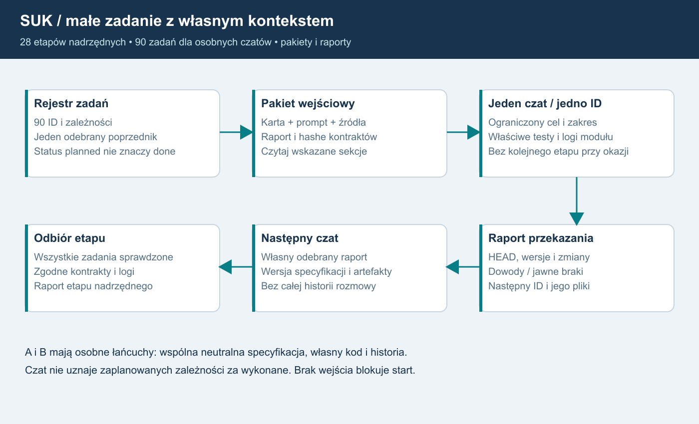

# 26. Jedno małe zadanie na osobny czat
Plan 1.8 | 90 zadań w28 etapach nadrzędnych | wszystkie zaplanowane.

## Pakiet startowy
Wybierz jedno ID z tabeli i skopiuj jego gotowy prompt. Czat otrzymuje własną kartę,
AI_START, odpowiednią kartę nadrzędną, wyłącznie wskazane dokumenty/sekcje oraz
raporty i artefakty zależności. Nie potrzebuje historii rozmowy ani całego PDF.
Pliki czaty/ opisują wejścia, aktualne źródła i kryteria; prompty_czatow/ zawierają
tekst gotowy do wklejenia. Minimalny zestaw mieści się zwykle w5–6 dokumentach,
czytanych w sekcjach właściwych zadaniu. Przy dużym pliku czytaj wymienioną
klasę/kontrakt, nie cały katalog. Zależności planned nie są gotowe.

## Zależności i odbiór
Pierwsze zadanie etapu zależy od końcowych zadań etapów nadrzędnych; następne
od odebranego poprzednika. S02A2 i S02A3 tworzą niezależne łańcuchy od tego samego
S02A1.04, bez połączenia A↔B; integrator czeka na oba. S03 może rozwijać się
równolegle po swoich zależnościach, S18/S19 pozostają finałem.
Czat kończy po swoim ID. Gdy zakres okaże się większy niż kontekst, zapisuje
częściowy raport z dokładnym miejscem i dowodami, a nie uznaje całości za gotową.
Kontynuacja zachowuje ten sam ID, dopóki kryteria nie zostaną odebrane.
Nie zależymy od niegotowych modułów downstream w testach wczesnych kontraktów:
jawny stub/harness nie zalicza realnego urządzenia lub kanału.

## Rejestr zadań
| ID/karta | Jedyny cel | Wymagane zadania | Prompt |
|---|---|---|---|
| [S00.01](czaty/S00.01.md) | Inwentaryzacja i źródła | brak | [start](prompty_czatow/S00.01.md) |
| [S00.02](czaty/S00.02.md) | Pomiar odniesienia | S00.01 | [start](prompty_czatow/S00.02.md) |
| [S00.03](czaty/S00.03.md) | Kontrakty i profile | S00.02 | [start](prompty_czatow/S00.03.md) |
| [S01.01](czaty/S01.01.md) | Fundament logów | S00.03 | [start](prompty_czatow/S01.01.md) |
| [S01.02](czaty/S01.02.md) | Rdzeń bez WPF | S01.01 | [start](prompty_czatow/S01.02.md) |
| [S01.03](czaty/S01.03.md) | Migracja runtime | S01.02 | [start](prompty_czatow/S01.03.md) |
| [S02.01](czaty/S02.01.md) | Host świata | S01.03 | [start](prompty_czatow/S02.01.md) |
| [S02.02](czaty/S02.02.md) | Adapter singleplayer | S02.01 | [start](prompty_czatow/S02.02.md) |
| [S02.03](czaty/S02.03.md) | Tryb usługi i ograniczenia | S02.02 | [start](prompty_czatow/S02.03.md) |
| [S02A.01](czaty/S02A.01.md) | Mapa własności | S02.03 | [start](prompty_czatow/S02A.01.md) |
| [S02A.02](czaty/S02A.02.md) | Zamrożone wejście cyklu | S02A.01 | [start](prompty_czatow/S02A.02.md) |
| [S02A.03](czaty/S02A.03.md) | Bierny plan i pojedyncze wyjście | S02A.02 | [start](prompty_czatow/S02A.03.md) |
| [S02A.04](czaty/S02A.04.md) | Kontekst operatora i adapter ruchu | S02A.03 | [start](prompty_czatow/S02A.04.md) |
| [S02A1.01](czaty/S02A1.01.md) | Neutralna specyfikacja źródeł | S02A.04 | [start](prompty_czatow/S02A1.01.md) |
| [S02A1.02](czaty/S02A1.02.md) | Kontrakt danych i ABI | S02A1.01 | [start](prompty_czatow/S02A1.02.md) |
| [S02A1.03](czaty/S02A1.03.md) | Katalog przypadków | S02A1.02 | [start](prompty_czatow/S02A1.03.md) |
| [S02A1.04](czaty/S02A1.04.md) | Stub i zamrożenie pakietu | S02A1.03 | [start](prompty_czatow/S02A1.04.md) |
| [S02A2.01](czaty/S02A2.01.md) | Własny kontekst i cykl życia | S02A1.04 | [start](prompty_czatow/S02A2.01.md) |
| [S02A2.02](czaty/S02A2.02.md) | Statusy i polecenia urządzeń | S02A2.01 | [start](prompty_czatow/S02A2.02.md) |
| [S02A2.03](czaty/S02A2.03.md) | Przebiegi i utwierdzenia | S02A2.02 | [start](prompty_czatow/S02A2.03.md) |
| [S02A2.04](czaty/S02A2.04.md) | Blokady, timery i sąsiad | S02A2.03 | [start](prompty_czatow/S02A2.04.md) |
| [S02A2.05](czaty/S02A2.05.md) | Odbiór i zamrożenie wariantu | S02A2.04 | [start](prompty_czatow/S02A2.05.md) |
| [S02A3.01](czaty/S02A3.01.md) | Własny kontekst i cykl życia | S02A1.04 | [start](prompty_czatow/S02A3.01.md) |
| [S02A3.02](czaty/S02A3.02.md) | Statusy i polecenia urządzeń | S02A3.01 | [start](prompty_czatow/S02A3.02.md) |
| [S02A3.03](czaty/S02A3.03.md) | Przebiegi i utwierdzenia | S02A3.02 | [start](prompty_czatow/S02A3.03.md) |
| [S02A3.04](czaty/S02A3.04.md) | Blokady, timery i sąsiad | S02A3.03 | [start](prompty_czatow/S02A3.04.md) |
| [S02A3.05](czaty/S02A3.05.md) | Odbiór i zamrożenie wariantu | S02A3.04 | [start](prompty_czatow/S02A3.05.md) |
| [S02A4.01](czaty/S02A4.01.md) | Zamrożenie wejść integracji | S02A2.05, S02A3.05 | [start](prompty_czatow/S02A4.01.md) |
| [S02A4.02](czaty/S02A4.02.md) | Porównanie i adapter | S02A4.01 | [start](prompty_czatow/S02A4.02.md) |
| [S02A4.03](czaty/S02A4.03.md) | Migracja i zamknięcie | S02A4.02 | [start](prompty_czatow/S02A4.03.md) |
| [S02B.01](czaty/S02B.01.md) | Konteksty grup | S02A4.03 | [start](prompty_czatow/S02B.01.md) |
| [S02B.02](czaty/S02B.02.md) | Kwalifikacja kanałów | S02B.01 | [start](prompty_czatow/S02B.02.md) |
| [S02B.03](czaty/S02B.03.md) | Dystrybucja i odbiór | S02B.02 | [start](prompty_czatow/S02B.03.md) |
| [S02C.01](czaty/S02C.01.md) | Synchronizacja i rebuild | S02B.03 | [start](prompty_czatow/S02C.01.md) |
| [S02C.02](czaty/S02C.02.md) | Losowanie i selektor | S02C.01 | [start](prompty_czatow/S02C.02.md) |
| [S02C.03](czaty/S02C.03.md) | Przełączenie i fencing | S02C.02 | [start](prompty_czatow/S02C.03.md) |
| [S02D.01](czaty/S02D.01.md) | Ręczny profil transmisji | S02C.03 | [start](prompty_czatow/S02D.01.md) |
| [S02D.02](czaty/S02D.02.md) | Usterki i diagnoza | S02D.01 | [start](prompty_czatow/S02D.02.md) |
| [S02D.03](czaty/S02D.03.md) | Odbiór profilu | S02D.02 | [start](prompty_czatow/S02D.03.md) |
| [S03.01](czaty/S03.01.md) | Konto i trwały model | S00.03, S01.03 | [start](prompty_czatow/S03.01.md) |
| [S03.02](czaty/S03.02.md) | Logowanie desktopowe | S03.01 | [start](prompty_czatow/S03.02.md) |
| [S03.03](czaty/S03.03.md) | Klucz administratora | S03.02 | [start](prompty_czatow/S03.03.md) |
| [S04.01](czaty/S04.01.md) | TLS i wersja sesji | S02D.03, S03.03 | [start](prompty_czatow/S04.01.md) |
| [S04.02](czaty/S04.02.md) | Typowane komendy | S04.01 | [start](prompty_czatow/S04.02.md) |
| [S04.03](czaty/S04.03.md) | Pełne migawki | S04.02 | [start](prompty_czatow/S04.03.md) |
| [S05.01](czaty/S05.01.md) | Prawa i zakresy | S04.03 | [start](prompty_czatow/S05.01.md) |
| [S05.02](czaty/S05.02.md) | Delegacja LCS | S05.01 | [start](prompty_czatow/S05.02.md) |
| [S05.03](czaty/S05.03.md) | Obejścia i odbiór | S05.02 | [start](prompty_czatow/S05.03.md) |
| [S06.01](czaty/S06.01.md) | Przekazanie i reconnect | S05.03 | [start](prompty_czatow/S06.01.md) |
| [S06.02](czaty/S06.02.md) | Dziennik i granica trwałości | S06.01 | [start](prompty_czatow/S06.02.md) |
| [S06.03](czaty/S06.03.md) | Restore i duplikaty | S06.02 | [start](prompty_czatow/S06.03.md) |
| [S07.01](czaty/S07.01.md) | Zakres subskrypcji | S06.03 | [start](prompty_czatow/S07.01.md) |
| [S07.02](czaty/S07.02.md) | Delty i baza | S07.01 | [start](prompty_czatow/S07.02.md) |
| [S07.03](czaty/S07.03.md) | Wolny klient i budżety | S07.02 | [start](prompty_czatow/S07.03.md) |
| [S08.01](czaty/S08.01.md) | Sankcje i ich zakres | S05.03, S06.03 | [start](prompty_czatow/S08.01.md) |
| [S08.02](czaty/S08.02.md) | Prywatne minimum operacyjne | S08.01 | [start](prompty_czatow/S08.02.md) |
| [S08.03](czaty/S08.03.md) | Statystyki i audyt | S08.02 | [start](prompty_czatow/S08.03.md) |
| [S09.01](czaty/S09.01.md) | Model urządzeń | S05.03, S08.03 | [start](prompty_czatow/S09.01.md) |
| [S09.02](czaty/S09.02.md) | Tekst przez urządzenie | S09.01 | [start](prompty_czatow/S09.02.md) |
| [S09.03](czaty/S09.03.md) | Obsługa odmów i przerw | S09.02 | [start](prompty_czatow/S09.03.md) |
| [S10.01](czaty/S10.01.md) | Prototyp istniejącego audio | S03.03, S09.03 | [start](prompty_czatow/S10.01.md) |
| [S10.02](czaty/S10.02.md) | Prawa i klient obcy | S10.01 | [start](prompty_czatow/S10.02.md) |
| [S10.03](czaty/S10.03.md) | Wybór i budżet | S10.02 | [start](prompty_czatow/S10.03.md) |
| [S11.01](czaty/S11.01.md) | Połączenie urządzenia i audio | S10.03, S06.03 | [start](prompty_czatow/S11.01.md) |
| [S11.02](czaty/S11.02.md) | Cofnięcie praw mediów | S11.01 | [start](prompty_czatow/S11.02.md) |
| [S11.03](czaty/S11.03.md) | Odbiór łączności | S11.02 | [start](prompty_czatow/S11.03.md) |
| [S12.01](czaty/S12.01.md) | Zaufanie i zgodność | S04.03, S03.03 | [start](prompty_czatow/S12.01.md) |
| [S12.02](czaty/S12.02.md) | Pobieranie i instalacja | S12.01 | [start](prompty_czatow/S12.02.md) |
| [S12.03](czaty/S12.03.md) | Odzyskanie wydania | S12.02 | [start](prompty_czatow/S12.03.md) |
| [S13.01](czaty/S13.01.md) | Przegląd bramek | S07.03, S08.03, S09.03, S11.03, S12.03 | [start](prompty_czatow/S13.01.md) |
| [S13.02](czaty/S13.02.md) | Obciążenie i degradacja | S13.01 | [start](prompty_czatow/S13.02.md) |
| [S13.03](czaty/S13.03.md) | Odbiór pilota | S13.02 | [start](prompty_czatow/S13.03.md) |
| [S14.01](czaty/S14.01.md) | Dane operatora algorytmicznego | S13.03 | [start](prompty_czatow/S14.01.md) |
| [S14.02](czaty/S14.02.md) | Regułowy sąsiad | S14.01 | [start](prompty_czatow/S14.02.md) |
| [S14.03](czaty/S14.03.md) | Powtarzalność i brak danych | S14.02 | [start](prompty_czatow/S14.03.md) |
| [S15.01](czaty/S15.01.md) | Zmiana człowiek–algorytm | S14.03, S06.03 | [start](prompty_czatow/S15.01.md) |
| [S15.02](czaty/S15.02.md) | Styczne singleplayera | S15.01 | [start](prompty_czatow/S15.02.md) |
| [S15.03](czaty/S15.03.md) | Odbiór obsady | S15.02 | [start](prompty_czatow/S15.03.md) |
| [S16.01](czaty/S16.01.md) | Scenariusze planisty | S15.03 | [start](prompty_czatow/S16.01.md) |
| [S16.02](czaty/S16.02.md) | Ograniczony planista | S16.01 | [start](prompty_czatow/S16.02.md) |
| [S16.03](czaty/S16.03.md) | Odbiór decyzji | S16.02 | [start](prompty_czatow/S16.03.md) |
| [S17.01](czaty/S17.01.md) | Granice wielu światów | S13.03 | [start](prompty_czatow/S17.01.md) |
| [S17.02](czaty/S17.02.md) | Usługi współdzielone | S17.01 | [start](prompty_czatow/S17.02.md) |
| [S17.03](czaty/S17.03.md) | Pomiar wzrostu | S17.02 | [start](prompty_czatow/S17.03.md) |
| [S18.01](czaty/S18.01.md) | API i kontrakty panelu | S16.03, S17.03 | [start](prompty_czatow/S18.01.md) |
| [S18.02](czaty/S18.02.md) | Aplikacja i klucz urządzenia | S18.01 | [start](prompty_czatow/S18.02.md) |
| [S18.03](czaty/S18.03.md) | Cykl życia i odbiór | S18.02 | [start](prompty_czatow/S18.03.md) |
| [S19.01](czaty/S19.01.md) | Model nadzoru okręgu | S18.03 | [start](prompty_czatow/S19.01.md) |
| [S19.02](czaty/S19.02.md) | Koordynacja | S19.01 | [start](prompty_czatow/S19.02.md) |
| [S19.03](czaty/S19.03.md) | Odbiór finału | S19.02 | [start](prompty_czatow/S19.03.md) |

## Raport jako wejście następnego czatu
Użyj SZABLON_PRZEKAZANIA. Dołącz HEAD przed/po, zakres autoryzacji, wersję planu,
hash spec/ABI/danych, odebrane zależności, listę własnych zmian, logi i ścieżki
wyników/braków. Build, testy, Git i wdrożenie są osobnymi polami. Nazwij następne
ID i jego minimalne wejścia. Nie zastępuj dowodów opisem „działa”.
F24 obowiązuje w każdym nowym module; fundament jest S01.01, a trwałość
audytu/commit dojrzewa w S06.02. A/B mają dodatkowe prompty i izolację27.

## Mapa kontekstu

Opis dla AI: rejestr90 zadań prowadzi do karty i promptu jednego ID. Czat czyta wskazane źródła, odebrane raporty i kontrakty, wykonuje ograniczony zakres oraz testy/logi. Raport z hashami, dowodami i brakami jest wejściem następcy. Cały etap nadrzędny odbiera się po wszystkich jego zadaniach. A/B używają osobnych łańcuchów, bez wymiany algorytmów.

## Mały manifest jednego zadania
pakiety_czatow/ID.json zawiera tylko jedno zadanie, wspólne inwarianty, bezpośrednie zależności i hashe plików kontekstu. Nie wymaga wczytania całego manifest.json. Pliki raporty/ są przyszłymi wejściami i nie są pozornie tworzone jako ukończone.
