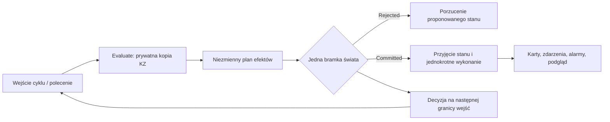

# S02A.03 — Bierny plan i pojedyncze wyjście

Data prac: **28–30.10.2026**. Plan **1.8**. JobId **S02A.03**, etap nadrzędny **S02A**.

**Status: UKOŃCZONY.** Końcowa regresja z 30.10.2026 została zaliczona; dokumentację i odbiór zamknięto 1.11.2026. Testy hosta **317/317**, scenariusze **24/24**, porównania z pełną kolejnością i czasami zdarzeń **36/36**.

## Zakres autoryzacji

Zlecenie właściciela: „S02A.03 — Bierny plan i pojedyncze wyjście. — kontynuj przerwany etap”, następnie „continue”. Wykonano kod, dokumentację, lokalne buildy i testy tej karty. Bez `git add/commit/push`, instalacji usług, publikacji i wdrożenia. Nie zmieniano chronionego `app/LcsWidzew/Data/station.json` ani danych projektowych właściciela. Nie wykonywano S02A.04, Ada, grup A/B, selektora epok ani praw/lease.

Zależność S02A.02 potwierdzono raportem, kodem i manifestem: 36 plików, wszystkie SHA-256 po normalizacji LF zgodne. Status poprzednika `passed=true`, commit `71ed996`. Migawki `planned` w pakietach planu nie są stanem wykonania.

## Stan i zmiany

HEAD przed i po: **`71ed996e217f1c698289bb915dd8708f0ec3ae4d`**, gałąź `main`; zmiany pozostają w katalogu roboczym. SDK **10.0.402**, runtime **10.0.13**. Pełna lista zmienionych plików, wersje bibliotek i sumy znajdują się w `artifacts/2026-10-30-S02A.03/manifest.json`.

1. **`PlanWyjscia.cs`**: niezmienny plan i efekty wyłącznie jako wartości, bez kart, KZ, terenu, delegatów i proponowanego mutable stanu. Warunek alarmu ma typ oraz identyfikator obiektu/przebiegu/żądania. `ContentHash` obejmuje kanoniczne metadane, wynik i efekty; nie jest skrótem całego prywatnego stanu.
2. **`Obliczanie.cs`, `KopiaStanu.cs`**: `Evaluate` wykonuje istniejący algorytm na prywatnej kopii stanu. Odrzucenie porzuca także utwierdzenia, `Moving`, cache sygnału, flagi alarmów i numery przebiegów. Zatwierdzenie kopiuje wartości do istniejących obiektów świata. Pula ponownie używa wyłącznie prywatnych kontenerów kart; nie przekazuje ich światu. Słownik aktywnych przebiegów powstaje na nowo, a kopiowane zbiory mają resetowaną historię usunięć: samo zachowanie aktywnych kluczy nie gwarantuje kolejności po kolejnym dodaniu. Statusy mają prywatną deltę, a memo topologii osobne kontenery. Tabela sygnałów jest ładowana przed dopuszczeniem Evaluate.
3. **`BramkaWyjsc.cs`**: jedna bramka rezerwuje numer planu przed skutkami i callbackami. Powtórzenie tego samego wydanego planu, także z wnętrza zdarzenia, nie wykonuje go ponownie. Przechowuje 256 ostatnich potwierdzeń; starsze numery nadal odrzuca znacznik numeracji. Konflikt treści/obiektu i obcy świat są odrzucane. Po częściowym błędzie wykonania jest fail-stop, również gdy callback przechwycił wyjątek planu zagnieżdżonego.
4. **Istniejące KZ**: zwrotnice, wykolejnice, sygnały, NN/oNN, AGR, ZeroLO, zdarzenia, alarmy, uwagi do oceny i podgląd komunikacji tworzą efekty. Odpowiedzi sąsiada liczą się na kopii (`SasiadObliczenia.cs`), bez mutowania świata z obliczenia. Parser, dwuetapowość poleceń, książka i statystyka pozostają jednokrotne w systemie nadrzędnym.
5. **Wejścia**: decyzje `Committed`/`Rejected` trafiają w kolejności świata do opcjonalnego pola `rozstrzygniecia` następnego regularnego `WejscieCyklu`. Ponowienie planu nie dodaje drugiej decyzji. Testowi odbiorcy dostają ten sam obiekt wejścia. To wstępny kontrakt C#, nie implementacja przyszłych grup.
6. **Kolejność i koszt**: `Station.ParseCore` utrwala kolejność kart w odczytanym projekcie. `PorzadekProjektu` zachowuje bazową kolejność równoczesnych wpisów i uniezależnia ją od późniejszej rejestracji słowników. Pula kopii, delta znanych statusów i SHA-256 z bufora ograniczają alokacje bez zmiany kanonicznych bajtów. Zwykłe pośrednie statusy jednego obiektu pozostają w kolejności.
7. **Zagnieżdżone statusy**: wersja ostatniego zatwierdzonego statusu jest osobna dla każdego obiektu. Starszy zaległy wpis podglądu nie nadpisuje nowszego statusu tego obiektu; inne obiekty i pośrednie przejścia partii nie są przez to pomijane. Pominięcia liczy `supersededStatuses`.
8. **Komputerownia**: po usterce czeka na zakończenie już trwającego odświeżenia i pobiera nowy widok. Poprzednio zakończona odpowiedź sprzed usterki mogła chwilowo pokazać stary stan, co ujawniła pełna regresja UI. Nie zmieniono reguł srk ani formatów UT/zobrazowania.

Kontrakty: nowy `kontrakty/kz/plan_wyjscia_v1.schema.json`, przykład oraz addytywne `rozstrzygniecia` w `wejscie_cyklu_v1.schema.json`; katalog kontraktów i sumy LF zaktualizowane. Kontrakty są **wstępne**; zamrożenie Ada/ABI należy do S02A1. Nie ma importu JSON planu do sterowania.



## Kryteria i dowody

Dowody końcowe: **`artifacts/2026-10-30-S02A.03/`**. Baza: czysty eksport `71ed996` w `artifacts/2026-10-28-S02A.03/baza-repo/`, odebrane wyniki `weryfikacja/baza-20261028-154107/`. Wcześniejsze próby, błędy i przerwana regresja pozostają zachowane w katalogu z 28.10; nie są zaliczane jako końcowy odbiór.

| Kontrola | Wynik | Dowód |
|---|---|---|
| Restore i Release całego rozwiązania, 15 projektów | **0 błędów**, jedno istniejące ostrzeżenie CS0465 | `restore.txt`, `build-kolejnosc.txt`, `build-status.json` |
| Host, rdzeń, granice wejść/wyjść i pula kopii | **317/317**, 0 błędów/pominięć | `testy-hosta-kolejnosc.txt`, `testy-hosta-kolejnosc.xml` |
| Tabor | **20/20** | `tabor-testy.txt`, `tabor.trx` |
| Logi | **58 zaliczonych**, 2 pominięte próby chmod dla Linuksa; 0 błędów | `logi-testy.txt`, `logi.trx` |
| Edytor taboru | **0 błędów**, zrzuty obejmują okna i wykresy | `edytor-taboru.txt`, `edytor-taboru*.png` |
| Schematy, sumy kontraktów i logi hosta | **0 błędów**, 26 JSONL / 629 rekordów | `kontrakty-logi-kolejnosc.txt` |
| Rzeczywisty plan, decyzje i wejście | zgodne ze schematami i SHA-256; 5 przypadków błędnych odrzuconych | `plany-status.json`, `testy-hosta-kolejnosc/S02A03-plan-przyklad/` |
| CLI wejść cyklu | 3 KZ, 240 cykli, odbiorcy zgodni | `wejscia-kolejnosc-console.txt`, `wejscia-kolejnosc/raport.json` |
| Rzeczywisty proces WorldHost | Ready, 20 kroków, poprawne zatrzymanie, 0 strat diagnostyki | `host-cli-kolejnosc/console.txt`, `host-cli-kolejnosc/host.json`, `host-cli-kolejnosc/logi.txt` |
| 12 prób rdzenia + 12 pulpitu, 36 porównań i UI All | **24/24**, **36/36**, UI bez błędów | `regresja-parallel-20261030-005608/status.json` |
| Pełne logi końcowych scenariuszy | **0 błędów**, 4 JSONL / 216 580 rekordów | `kontrakty-final-console.txt` |

Pełna regresja UI: UT **718/0**, zobrazowanie **387/0**, Przechyłka **10/0**, Komputerownia **16/0**, połączenie rzeczywistego serwera i klienta zaliczone. Selftest: **25 z 26**, zależności **5 z 5** zgodnie z bieżącą bazą (zmiana poprzedzająca ten etap). Wersje Release obu wymaganych aplikacji są gotowe do uruchomienia. Obejrzany zrzut: [pulpit](../../artifacts/2026-10-30-S02A.03/regresja-parallel-20261030-005608/ui/pulpit.png). Szczegóły: `raport-regresji.md`, końcowe potwierdzenie `status-odbior.json`, sumy i pakiet źródeł `manifest.json`, `zmienione-pliki.zip`.

Wcześniejszy przebieg dał **32/36** zgodnych porównań: ponowne użycie słownika przebiegów zachowywało inną historię wolnych slotów, zmieniając kolejność równoczesnych wpisów w ic08/ic15. Usunięto ponowne użycie tego słownika i resetowano historię kopiowanych zbiorów. Celowane **4/4** oraz końcowe **36/36** potwierdziły naprawę bez sortowania dzienników. Rdzeń i pulpit uruchomiono równolegle; ich czasów nie traktuje się jako ścisłego porównania wydajności z sekwencyjną bazą.

Testy obejmują bierność całego świata podczas Evaluate, przyjęcie/odrzucenie stanu, 1000 ponowień, ZeroLO po pierwszym przejeździe, NN/oNN/AGR, karty zwrotnic/wykolejnic/sygnałów, zdarzenia/alarmy/ocenę, brak efektu po wyparciu starego potwierdzenia, blokowanie mutacji przy oczekującej propozycji, uporządkowany feedback, podwójnych odbiorców, błąd częściowego wykonania i przechwycony błąd zagnieżdżony. Testy puli sprawdzają każde pole stanu, brak wspólnych kontenerów, zmianę kolejności kluczy, odrzucanie, wpływ wolnych slotów Dictionary/HashSet na późniejsze dodawanie oraz bajty/hash JSON (także surogaty na granicy fragmentów).

Przykładowe polecenia odbioru:

```powershell
.tools/dotnet/dotnet.exe restore app/Lcs.slnx --locked-mode -m:1
.tools/dotnet/dotnet.exe build app/Lcs.slnx -c Release --no-restore -m:1
app/Lcs.WorldHost.Testy/bin/Release/net10.0/Lcs.WorldHost.Testy.exe -result-xml wynik.xml
pwsh -File artifacts/2026-10-30-S02A.03/regresja-skrypty/run-final-probes.ps1 -OutputDirectory NOWY_KATALOG
python kontrakty/testy/sprawdz_kontrakty.py --jsonl KATALOG_LOGOW --wejscia KATALOG_WEJSC
```

Dokładne środowisko i katalog testów ACL znajdują się w skryptach/dowodach. Testy ACL korzystały z odizolowanych podkatalogów istniejącego `D:/SUK-S02.03-Test-01a15b25`; nie instalowano usługi. Wersje uruchamiane przez właściciela w `app/LcsWidzew/bin/Release/net10.0-windows` i `app/Lcs.EdytorUT/bin/Release/net10.0-windows` zbudowano w tym samym pełnym buildzie.

## Koszt i ograniczenia

Pomiar `pomiar/` porównuje ten sam driver z bazowym i końcowym `Lcs.Core.dll`: 500 kroków rozgrzewki i 5000 mierzonych kroków po 0,1 s, scenariusz `podstawowy`, 5 pociągów, bez automatycznego dyżurnego/nastawionych przebiegów. Baza → koniec: mediana **0,110 → 0,338 ms**, p99 **0,354 → 1,776 ms**, alokacje **84 617 → 112 564 B/krok**. Narzut jest rzeczywisty; pomiar nie odbiera grup ani obciążenia multiplayer. Odbywał się podczas równoległej regresji. Proces WorldHost z CLI miał maksymalny krok 44,226 ms przy starcie i 0 zatrzymań budżetu. Nie zalicza to zaległego B05 ani całego budżetu S13.

**Jawna zmiana obserwacji:** stan całej partii jest przyjmowany przed publikacją jej efektów. Callback alarmu widzi już przyjęty stan tej partii. Bazowy przebieg normalnych scenariuszy jest porównywany osobno wraz z kolejnością i czasami wpisów; nie deklarujemy zachowania wszystkich dawnych przeplotów dowolnego callbacku sterującego światem. Zagnieżdżona późniejsza zmiana nie jest nadpisywana przez kończący plan nadrzędny.

`Committed` oznacza przyjęcie obliczenia; odmowa srk pozostaje osobnym `Wynik.Ok == false`. `Executed` oznacza zakończenie wykonawcy planu, a stan karty potwierdza jej późniejszy status. Deduplikacja jest lokalna w RAM żyjącego świata. Trwałość, restart, checkpoint i replay należą do S02C/S06. Publiczna fasada i karty nadal są zaufanym API jednego procesu, nie pełną izolacją prywatnych kontekstów S02B.

Niezależne przeglądy i zamknięte usterki opisuje `audyt-koncowy.md` (wraz z hashami przeglądanych źródeł). Pozostałe stare metody `Otoczenie.Blok*` są nieużywane; aktywna ścieżka jest bierna. Nie przebudowywano reguł Ie-1/Ie-20 ani D03.

Nie przeprowadzono długiej ręcznej sesji użytkownika, instalacji/SCM, rebootu ani wdrożenia. Nie są one zaliczane przez automatyczną regresję tego etapu.

## F24 i ochrona danych

Moduł `LcsWidzew.PlanWyjscia`, zdarzenia **4121–4125**: start, zatwierdzenie, odmowa, fail-stop, podsumowanie. Limit 16 szczegółów zatwierdzeń na świat i 16 odmów na przyczynę; liczniki oraz końcowe podsumowanie obejmują pominięcia, duplikaty, wykonane efekty i wyparte statusy. Wyjątek redaguje istniejący ograniczony adapter MEL/JSONL. W logach tej granicy nie zapisuje się tekstu polecenia, planu ani danych operatora. Diagnostyka nie zastępuje trwałego audytu/commit journal.

SHA-256 chronionego `station.json` przed i po: **`85760930b4a3d33eb10147d1baa3ce9c1f4e45e2c74d4e317970589238ab8f3d`**. Testy używały `--station` i kopii testowych. Nie projektowano automatycznie zależności ani zobrazowania.

## Kontynuacja

Następny job: **S02A.04 — Kontekst operatora i adapter ruchu**. Nie rozpoczęto go w tej pracy. Minimalny kontekst: AGENTS, ROZWOJ, karta/pakiet S02A.04, ten raport, raport S02A.02 oraz `Obliczanie.cs`, `PlanWyjscia.cs`, `BramkaWyjsc.cs`, `Sim/Pulpit/*`, `Trains.cs`, `Fasada.cs` i kontrakty wejścia/wyjścia. Nadal otwarte decyzje mapy własności i domen zasilania z S02A.01 nie są tu rozstrzygane. Nie czytano ani nie tworzono implementacji Ada A/B.
