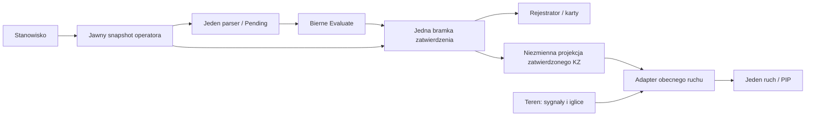

# S02A.04 — Kontekst operatora i adapter ruchu

Data: **2.11.2026**. Plan **1.8**, JobId **S02A.04**, etap nadrzędny **S02A**.

**Status: UKOŃCZONY.** Końcowy build Release i pełna regresja zaliczone; testy hosta **359/359**, porównania **36/36**.

## Zakres autoryzacji

Zlecenie właściciela: „S02A.04 wykonaj etap”. Kod, dokumentacja, lokalne buildy i testy tej karty. Bez operacji indeksu/commit/push, publikacji, instalacji usługi i wdrożenia. Nie zmieniano `app/LcsWidzew/Data/station.json` ani projektów właściciela. Nie wykonywano Ada, grup A/B, selektora epok, praw/lease ani odłożonego kroku 8.

Zależność S02A.03 ma raport i odebrany pakiet. Bieżące scalenie `2730fcd` utraciło część jej integracji. Porównano trzy strony: bazę `71ed996`, odebrany ZIP i początkowy HEAD. Przywrócono wyłącznie brakujące fragmenty w `Simulator.cs` i `KomputerZaleznosci.cs`, zachowując nowsze EDR/RJ i W5/W24. Nowe memo pierwszego odstępu dostało prywatne kontenery kopiowania. Dwa nowsze wywołania SelfTest przechodzą przez publiczne Evaluate/bramkę. Szczegóły: `artifacts/2026-11-02-S02A.04/prereq-naprawa.md` i `prereq-merge/`.

## Stan i zmiany

HEAD przed: `2730fcd` (pełny hash w `inputs.json`); HEAD po: `2730fcdcaafbed0bce33a2cc55467a9f0a51c10e` (bez zmiany). Gałąź `main`, początkowo czysty katalog roboczy. SDK **10.0.402**, runtime **10.0.13**. Pełne wersje, pliki i SHA-256: końcowy `manifest.json`.

1. **`KontekstOperatora`** jest niezmiennym rekordem samych wartości stanowiska, obrazu, nazwy, roli i obecności użytkownika. Snapshot powstaje przed callbackami. `SystemNadrzedny` przekazuje go jawnie przez jeden parser, adresowanie, wybór końca blokady, kontrolę obszaru i Pending. Usunięto `As<T>` i `CurDesk`; polecenie innego stanowiska nie podmienia globalnego użytkownika ani obrazu. Zwykłe wrappery pozostają zaufanym API lokalnym/testowym; `DeskId=null` zachowuje ich dotychczasową semantykę. Nie są nową autoryzacją sieciową S04/S05.
2. **Rejestrator i bramka** przyjmują snapshot jawnie dla zdarzeń, alarmów i uwag. Jeden commit wykonuje efekty z właściwym operatorem także po zagnieżdżonym poleceniu lub mutacji Desk/User w callbacku. PII nie trafia do biernego planu, jego skrótu ani logów technicznych granicy. Stanowiska, książka, telefon, logowanie, parser, statystyki i PIP pozostają pojedyncze.
3. **Powiadomienie specjalne** niesie `deskId` jawnie w `SpecialExecutedForDesk`. LocalSession i serwer wybierają adresata z tego ID; serwer wyszukuje klienta pod blokadą listy. Stare zdarzenie `SpecialExecuted` pozostaje dla zgodności. Jeden wspólny Pending i właściciel potwierdzenia/anulowania są zachowani; nie implementowano lease ani confirmationId przyszłych etapów.
4. **`ProjekcjaRuchu` i `AdapterRuchu`** zawierają wartości zatwierdzonych sygnałów, utwierdzeń, początków manewrów, limitów przebiegów i zajętości. Bez Route/SigState/SecState, kart, KZ i mutable list. Przyjęcie stanu unieważnia projekcję przed pierwszym callbackiem efektów; powstaje leniwie najwyżej raz między zatwierdzeniami. Evaluate, odrzucenie i powtórzenie planu nie publikują proponowanego stanu. Testowy przyszły dostawca podaje wyłącznie wartości.
5. **Ruch** czyta historyczne zależności przez adapter, a fizyczne sygnały i iglice nadal z terenu. Zachowano różnicę NoData między Permits a fallbackiem Sz, brak filtrowania State/Rel przy VSet, dawny warunek zmiany kierunku oraz `SecOcc = TrainOcc || Fault != null` przy podstawieniu. Nie zmieniano reguł jazdy/manewrów/prędkości. Syntetyczne fixtures W17 odświeżają projekcję jawnie po ręcznym ustawieniu utwierdzenia.
6. **F24**: moduł `LcsWidzew.Granice`, zdarzenia **4130–4133** (`KZ.BOUNDARY_READY`, `KZ.COMMAND_CONTEXT`, `KZ.TRAFFIC_PROJECTION`, `KZ.BOUNDARY_SUMMARY`). Do 16 szczegółów każdego rodzaju na świat, dokładne liczniki pominięć, podsumowanie co 3000 cykli i na końcu hosta/Singleplayer/selftestu. W logach tylko hostowe korelacje, czas/cykl i liczniki. Bez nazw operatorów/stanowisk, obrazu, treści poleceń i planu. Istniejąca ograniczona kolejka MEL/JSONL; błąd loggera nie zmienia świata. Katalog logów rozszerzono addytywnie, schemat rekordu i kontrakty planu/wejścia bez zmian.



## Kryteria i dowody

Wszystkie wyniki w `artifacts/2026-11-02-S02A.04/`. Baza porównawcza to izolowany eksport początkowego HEAD z opisanymi naprawami integracji poprzednika; nie niebudowalny HEAD ani historyczne dzienniki innego checkoutu. Źródła i binaria bazy pozostają w `baseline-src/`, wejścia w `dane/`. Próby używają kopii `station_test.json` i jawnego `--station`.

| Kontrola | Wynik | Dowód |
|---|---|---|
| Release całego rozwiązania (16 projektów) | 0 błędów; 1 zastane CS0465 `Station.Finalize` | `build-release-final.txt` |
| Host, granice, adaptery, proces, ACL i Named Pipes | **359/359**, 0 pominiętych | `host-tests-odbior.xml`, `testy-hosta-odbior/` |
| Nowe przypadki S02A.04 | **42/42** (13 operator, 20 ruch, 4 logi, 3 zgodność Pending, 2 memo) | te same testy hosta |
| Biblioteka logów | **58/58**, 2 próby chmod pominięte na Windows | `logi-tests.xml` |
| Fizyka taboru | **20/20** | `tabor-tests.xml` |
| Baza i końcowe scenariusze | **24/24 + 24/24** | `baza-rdzen/`, `baza-pulpit/`, `odbior-rdzen/`, `odbior-pulpit/` |
| Baza→rdzeń, baza→pulpit, pulpit↔rdzeń | **36/36**; pełna kolejność/czasy zdarzeń | `porownanie-*/status.json` |
| Edytor UT / zobrazowania | **786/0**, **387/0** | `ui-odbior/` |
| Komputerownia / Przechyłka | **16/0**, **10/0** | `ui-odbior/` |
| Rzeczywisty lokalny serwer i klient | zaliczone, porty testowe zamknięte | `ui-odbior/status-All.txt` |
| EDR / rozkład jazdy / edytor taboru | **136/136**, **15/15**, **42/0** | `dodatkowe-final/`, `dodatkowe/` |
| Kontrakty i rzeczywisty JSONL | **0 błędów**, 40 plików / 420506 rekordów | `kontrakty-odbior.txt` |
| Błąd launchera | kod niezerowy, bez uruchomienia starego programu | `launcher-status.json` |

Selftest: **25 z 26**, zależności **5 z 5**, PIP **1526 z 1526**, niezmienniki bez naruszeń. Obejrzany zrzut: [pulpit](../../artifacts/2026-11-02-S02A.04/ui-odbior/pulpit.png). Binaria nie zmieniły się podczas końcowego odbioru (88 sum w `binaria-przed-odbiorem.json`). Pełny stan: `status-odbior.json`; niezależny przegląd i zamknięte R1–R5: `audyt-koncowy-integracja.md`.

Zachowano nieudane próby: brak restore w początkowym checkout, odmowy sandboxa dla Named Pipes/portów oraz jeden timeout testu zalewu przy równoległym uruchamianiu klas. Końcowy zestaw wykonano z `-parallelMode none`: wszystkie **359** testów zaliczone; sam test zalewu nadal wykonuje 24 współbieżne zapytania. Nie zmieniano jego limitów ani asercji. Dwa finalne procesy scenariuszy i UI pracowały równolegle. Nie traktujemy ich czasu jako izolowanego benchmarku.

Powtarzalne polecenia (katalog repo; skrypty są kopiami z jawnymi parametrami):

```powershell
.tools/dotnet/dotnet.exe restore app/Lcs.slnx --locked-mode -m:1
.tools/dotnet/dotnet.exe build app/Lcs.slnx -c Release --no-restore -m:1
app/Lcs.WorldHost.Testy/bin/Release/net10.0/Lcs.WorldHost.Testy.exe -parallelMode none -result-xml wynik.xml
pwsh -File artifacts/2026-11-02-S02A.04/skrypty/run-simulation-final.ps1 -Executable PEŁNA_ŚCIEŻKA_EXE -OutputDirectory NOWY_KATALOG -DataDirectory artifacts/2026-11-02-S02A.04/dane -DotnetRoot D:/Projects/SUK/.tools/dotnet
pwsh -File artifacts/2026-11-02-S02A.04/skrypty/run-ui.ps1 -OutputDirectory NOWY_KATALOG -Part All
python kontrakty/testy/sprawdz_kontrakty.py --jsonl KATALOG_RZECZYWISTYCH_LOGÓW
```

Środowisko SDK: `DOTNET_ROOT=.tools/dotnet`, `DOTNET_CLI_HOME=.tools/cli-home`, `NUGET_PACKAGES=.tools/nuget/packages`. Walidator używa istniejącego `.tools/python-libs` (`jsonschema 4.23.0`). Pełne testy Windows wymagają dostępu do lokalnych kanałów poza sandboxem; fixture ACL powstają w losowych podkatalogach istniejącego `D:/SUK-S02.03-Test-01a15b25`, bez instalowania usługi. Logi walidacji obejmują tylko wskazane pliki aplikacji; syntetyczny plik retencji z testu logów nie jest logiem programu.


Nie zmniejszano kontroli NuGet: przywracanie `--locked-mode` wykonano z działającym audytem sieciowym. Nie wyłączano testów ani walidacji ACL.

## Ograniczenia

To granica przejściowego jednego KZ C#, a nie dowód działania osobnych KZ, czterech kontekstów Ada, grup, przełączania, trwałości lub replay. Publiczna fasada i karty pozostają zaufanym API procesu. Adapter zachowuje odłożony krok 8 i nie zalicza jego docelowych reguł. Nie przeprowadzono długiej ręcznej sesji, testów dwóch komputerów, instalacji SCM/rebootu ani wdrożenia. Wyniki nie zaliczają B05 ani obciążenia S13.

SHA-256 chronionego `station.json` przed pracą: `85760930b4a3d33eb10147d1baa3ce9c1f4e45e2c74d4e317970589238ab8f3d`; końcowy hash jest identyczny (`status-odbior.json`).

## Kontynuacja

Następny job: **S02A1.01**, wyłącznie po osobnym zleceniu właściciela. Minimalny pakiet: karta/pakiet S02A1.01, ten raport, raporty S02A.01–.03, aktualne kontrakty wejścia/wyjścia i `KontekstOperatora.cs`, `SystemNadrzedny.cs`, `Obliczanie.cs`, `BramkaWyjsc.cs`, `ProjekcjaRuchu.cs`. Nie czytano ani nie tworzono kodu Ada A/B. Zawartość czystego pakietu i źródła Ie-1 odbiera kolejny etap; niniejszy raport ich nie zamraża.
