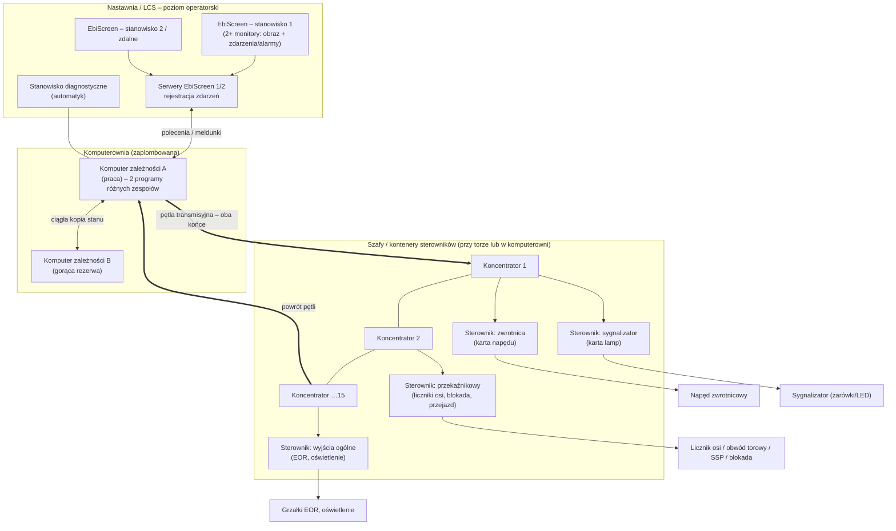
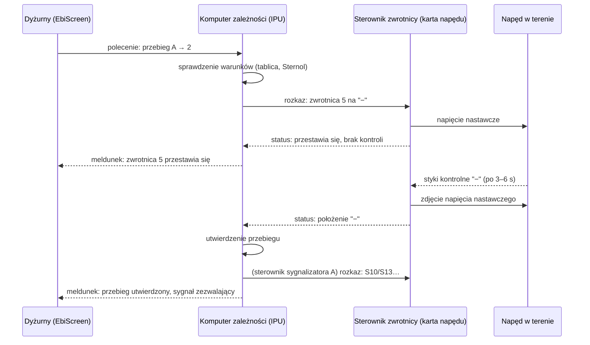
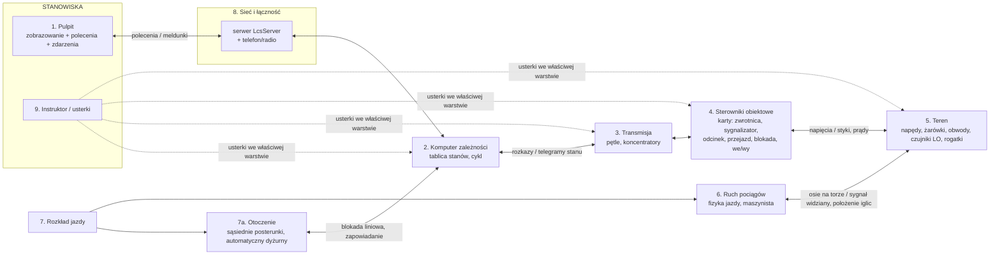

# EBILock 950 – komputerownia, sterowniki obiektowe i karty

Opracowanie: 2026-10-16. Cel: rzetelny opis, jak zbudowany jest komputer zależności klasy EBILock 950 (Bombardier, dziś Alstom) i jego komputerownia. Dokument ma być podstawą podziału symulatora na moduły (pulpit, komputer zależności, sterowniki obiektowe z kartami, teren, ruch pociągów, rozkład, otoczenie, sieć, instruktor).

## Jak czytać oznaczenia

| Znak | Znaczenie |
|---|---|
| **[PEWNE]** | Wprost w źródle pierwotnym: instrukcja PKP PLK (Ie-20, Ie-104), podręcznik UTK, dokumentacja lub podręcznik o EBILock, karta dopuszczenia. |
| **[WTÓRNE]** | Źródło wtórne (strona hobbystyczna, artykuł, materiał studencki) albo opis **rosyjskiej** odmiany Ebilock-950. Treść spójna z innymi źródłami, ale bez dokumentacji producenta. |
| **[DOMYSŁ]** | Mój wniosek z ogólnej wiedzy o srk i z logiki pozostałych faktów. Do potwierdzenia przez właściciela. |
| **❓** | Pytanie do właściciela (zebrane w rozdziale 9). |

Ważne zastrzeżenie: **dokumentacji producenta (DTR EBILock 950, opis kart) nie ma w otwartym dostępie.** Nazwy kart (CCM, LMP, MOT1, MOT2, SRC, OUT, COM) pochodzą z rosyjskich podręczników do odmiany Ebilock-950 eksploatowanej na kolejach RŻD. W Polsce EBILock 950 pracuje ze sterownikami rodziny **STC** (STC-1, STC-2) zaprojektowanymi w Bombardier ZWUS Katowice oraz z JZU 840. Ich budowa wewnętrzna może się różnić. Zasady działania (co sterownik kontroluje, jak reaguje na usterkę) są jednak wspólne dla całej rodziny.

## Źródła (skróty używane w tekście)

| Skrót | Źródło |
|---|---|
| **Ie-20** | PKP PLK, *Instrukcja obsługi komputerowych urządzeń srk Ie-20* – `Zrodla/Ie-20_WCAG.pdf` ([online](https://www.plk-sa.pl/files/public/user_upload/pdf/Akty_prawne_i_przepisy/Instrukcje/Wydruk/Ie/Ie-20_WCAG.pdf)), § 6, § 15–17, § 22–24 i załącznik ze stanami obiektów |
| **Ie-104** | PKP PLK, *Ie-104* (2025) – `Zrodla/Ie-104_2025_WCAG.pdf`: barwy i priorytety stanów |
| **UTK** | Podręcznik UTK, `Zrodla/Poradnik_dla_inspektorow_TOM_I_...pdf` (ta sama treść co `Zrodla/KOMPUTERY.pdf`), rozdz. 1.5.8, str. 123–126 (Ebilock 950), str. 140–143 (MOR-3, Tabela 23, Tabela 24) |
| **BSK** | Beskidzka Strona Kolejowa, [Urządzenia typu Ebilock 950](https://www.bsk.isdr.pl/srk_ebilock.php) – tekst prawie identyczny z UTK str. 124–126 |
| **Ashm** | Л. П. Ашмарина, *Микропроцессорные станционные системы. Тексты лекций*, wykład 1 „Ebilock-950”: [str. 2 (struktura)](https://studfile.net/preview/10432409/page:2/), [str. 3 (sprzęt, karty)](https://studfile.net/preview/10432409/page:3/), [str. 4 (АРМ)](https://studfile.net/preview/10432409/page:4/) |
| **OCS** | *Описание системы объектных контроллеров* (MPC Ebilock-950), [studizba.com](https://studizba.com/lectures/transport/mikroprocessornaja-centralizacija-ebilock-950/25688-opisanie-sistemy-obektnyh-kontrollerov.html) |
| **Skład** | *Назначение и состав МПЦ Ebilock-950*, [studizba.com](https://studizba.com/lectures/transport/mikroprocessornaja-centralizacija-ebilock-950/25686-naznachenie-i-sostav-mpc-ebilock-950.html) |
| **Gł8** | *Глава 8. Микропроцессорная централизация Ebilock-950*, [studfile.net str. 1](https://studfile.net/preview/10200702/), [str. 2](https://studfile.net/preview/10200702/page:2/) |
| **RT** | Railway Technology, [EBI Lock Computer-Based Interlocking Systems](https://www.railway-technology.com/products/ebi-lock-computer-based-interlocking-systems/) (opis producenta, EBI Lock 950 Compact) |
| **Lew** | A. Lewiński, T. Perzyński, [Nowoczesne systemy sterowania ruchem kolejowym](https://inzynierbudownictwa.pl/nowoczesne-systemy-sterowania-ruchem-kolejowym/), *Inżynier Budownictwa*, 2014 |
| **Marc** | J. Marciniak, M. Puchała, [Innowacyjne systemy sterowania ruchem kolejowym stosowane na sieci PKP – cz. II](https://ojs.ahe.lodz.pl/index.php/ziwgib/article/download/430/396/853), AHE Łódź, 2022 (opiera się na BSK) |
| **Pełka** | A. Pełka, [Diagnozowanie urządzeń sterowania ruchem kolejowym na przykładzie napędu zwrotnicowego](https://winntbg.bg.agh.edu.pl/rozprawy2/10163/full10163.pdf), rozprawa doktorska AGH, 2009 (powołuje się na DTR-2003/EBILOCK950) |
| **Mez** | Mezītis, Karevs, Freimane, *Object Controller of Electric Drive of Point Machine with Expanded Set of Diagnostic Tools*, Procedia Computer Science 104 (2017) 393–399, [doi:10.1016/j.procs.2017.01.151](https://doi.org/10.1016/j.procs.2017.01.151) – czytałem tylko streszczenie |
| **KK** | Katalog Kolejowy: [STC-1, świadectwo U/2002/0269](http://www.katalogkolejowy.pl/produkty_det/1893); [STC-1 z elektronicznym modułem zwrotnicy ECC-10204, U/2007/0134](http://www.katalogkolejowy.pl/produkty_det/7729) |
| **KKol** | Kurier Kolejowy, [Elementy systemu Bombardiera jadą na budowę PKM](https://kurier-kolejowy.pl/aktualnosci/21666/elementy-systemu-bombardiera-jada-na-budowe-pkm.html), 23.10.2014 |

---

## 1. Obraz całości

### 1.1 Warstwy

**[PEWNE]** Ie-20 § 6 ust. 1: komputerowe urządzenia srk składają się z:
- systemu nadrzędnego (interfejs operator–urządzenia, zobrazowanie),
- systemu zależnościowego,
- systemu sterowników obiektowych (sterowanie i kontrola zwrotnic, wykolejnic, sygnalizatorów, przejazdów, blokad liniowych),
- sieci połączeń,
- zasilania.

**[PEWNE]** Ie-20 § 6 ust. 5: *wszystkie* obiekty sterowane (odcinki torów, zwrotnice, wykolejnice, sygnalizatory, przejazdy, blokady) mają sterowniki, przez które system zależnościowy się z nimi komunikuje.

**[PEWNE]** Ie-20 § 6 ust. 4: system zależnościowy stoi w zamkniętej i zaplombowanej komputerowni. Odbiera polecenia od systemu nadrzędnego, bezpiecznie je przetwarza, realizuje przebiegi (nastawienie i zwolnienie) i dozoruje jazdę.

**[PEWNE]** UTK str. 123 (i BSK): EBILock 950 ma trzy warstwy:
1. sterowanie miejscowe, czyli poziom operatorski (EbiScreen);
2. przetwarzanie zależności (komputery zależnościowe);
3. sterowniki obiektowe, które sterują urządzeniami zewnętrznymi i je kontrolują.

**[WTÓRNE]** Ashm str. 2: rosyjski opis wyróżnia cztery poziomy:
- I – stanowiska dyżurnego, automatyka i pulpit rezerwowy;
- II – komputer centralny;
- III – pętle transmisyjne i koncentratory;
- IV – sterowniki obiektowe i obiekty.

### 1.2 Schemat

Schemat oddaje strukturę z UTK str. 124–126, Ashm i Gł8. Liczby pochodzą z rozdz. 3. Podział sterowników na typy: rozdz. 4.

---

## 2. Komputer zależności (poziom zależnościowy)

### 2.1 Budowa i nadmiarowość

- **[PEWNE]** UTK str. 126 / BSK:
  - Są dwa zestawy komputerowe o identycznym sprzęcie. Jeden pracuje jako zasadniczy, drugi jest **gorącą rezerwą**.
  - Dane przetwarzane są **dwukanałowo**, przez dwa programy napisane przez różne zespoły programistów.
  - Zgodność wyników kontroluje się w komputerze zależności **oraz w sterownikach obiektowych**.
  - Przy niezgodności funkcje nastawcze przejmuje komputer gorącej rezerwy.
  - Do poziomu zależnościowego podłączone jest stanowisko diagnostyczne.
- **[PEWNE]** UTK str. 126: programy pisze się w języku **Sternol** (stworzonym dla Ebilock). Jeden obieg programu:
  1. odczyt danych z pól tablicy;
  2. przetworzenie ich równaniami zależnościowymi;
  3. wpisanie nowych wartości do tablicy.

  Jest to więc **cykliczny automat na tablicy stanów**.
- **[WTÓRNE]** Ashm str. 2 i Gł8 str. 2:
  - Stan jest na bieżąco przekazywany z komputera podstawowego do rezerwowego.
  - Przełączenie na rezerwę następuje bez zatrzymania urządzeń, a pętle transmisyjne przełączają się samoczynnie.
  - Uszkodzony komputer restartuje się samoczynnie w ciągu około **1,5 min**. Potem następuje powrót, a jeśli komputer się nie podniesie, praca trwa na rezerwie aż do naprawy.
- **[WTÓRNE]** Skład: komputer centralny nazywa się **IPU 950** (*Interlocking Processing Unit*). To para komputerów (lewy i prawy). Składa się z:
  - sprzętu systemowego **ILC 951**;
  - oprogramowania OS950, SPU950, FSPU950;
  - modułu IOM950.
- **[WTÓRNE]** Skład / Gł8: pojemność jednego IPU to **150 obiektów logicznych i 1000 obiektów IPU** (zwrotnice, sygnalizatory, cewki i styki przekaźników). Odpowiada to stacji z około 40–60 zwrotnicami. Większy obszar wymaga kolejnych IPU.
- **[PEWNE]** RT (producent, wersja Compact):
  - W dużej konfiguracji jest komputer zależności i rezerwowy, do 3000 obiektów.
  - W małej i średniej konfiguracji komputer i sterowniki stoją w jednej szafie.
- **[PEWNE]** Lew: EBILock 950 ma podwójny komputer zależności i podwójny tor transmisji. Po wykryciu uszkodzenia przełącza się na sprawny komputer i powiadamia operatora.

### 2.2 Uwaga: „2z2 z komparatorem” to nie EBILock

Nasze `KOMPUTERY_notatki.md` mówią: *„Komputer zależności: układ 2z2. Dwa komputery z różnym kodem, a wyjścia porównuje bezpieczny komparator”*. **[PEWNE]** W UTK str. 140 ten opis dotyczy systemu **MOR-3 (Kombud)**, nie EBILock. Lew potwierdza, że:
- MOR-3 to „2z2” z bezpiecznym komparatorem;
- SIMIS-W (Siemens) to „2z3” z głosowaniem trzech komputerów.

EBILock 950 według UTK/BSK ma inną budowę:
- **jeden komputer pracujący z dwoma różnorodnymi programami** – porównanie wewnątrz komputera i w sterownikach;
- **plus gorąca rezerwa** – drugi taki sam komputer.

Skutek dla symulatora:
- przy niezgodności EBILock **przełącza się na rezerwę** i ruch trwa dalej;
- MOR-3 **przechodzi w stan bezpieczny** (zatrzymanie ruchu).

Etap 7 w `ROZWOJ.md` mówi o „komparatorze 2z2”. Warto to doprecyzować ❓(P1).

### 2.3 Co liczy komputer zależności

- **[PEWNE]** Ie-20 § 6 ust. 4 i Pełka str. 8:
  - przetwarza polecenia operatora na rozkazy do obiektów;
  - zamyka obiekty w przebiegu i zwalnia je po przejeździe;
  - dozoruje jazdę i rejestruje zdarzenia.
- **[WTÓRNE]** Ashm str. 2: zależności między obiektami (np. zwrotnica–sygnał) istnieją **tylko w programie komputera**. Między sterownikami nie ma połączeń fizycznych.
- **[PEWNE]** Ie-20 § 17 ust. 2 pkt 3: „Stój” na semaforze ustawia się samoczynnie, gdy pierwsza oś wjedzie na pierwszą sekcję kontroli niezajętości za semaforem. **[DOMYSŁ]** Decyzję podejmuje komputer zależności na podstawie meldunku z sterownika odcinka. Potem wysyła rozkaz „Stój” do sterownika sygnalizatora.
- **[PEWNE]** Ie-20 § 15 ust. 6: „logiczne zastopowanie” zwrotnicy to funkcja komputera zależności, bo zwrotnica nie przyjmuje rozkazu przestawienia. Odłączenie **napięcia nastawczego** (§ 15 ust. 5) działa fizycznie, na zasilaniu napędów.

**Komputer zależności nie prowadzi pociągów.** Zna tylko stany zgłoszone przez sterowniki: wolny/zajęty, położenie, wyświetlany sygnał. Czy pociąg istnieje, wie wyłącznie z zajętości odcinków. Numery pociągów należą do systemu nadrzędnego (PIP/EbiScreen), nie do zależności – **[DOMYSŁ]** zgodnie z UTK str. 138 (polecenia numerów pociągów w MOR-2zs).

---

## 3. Transmisja: pętle i koncentratory

- **[PEWNE]** UTK str. 126 / BSK:
  - Ze sterownikami łączą się **pętle transmisyjne**.
  - W pętlę włączone są **koncentratory transmisji** w szafach przytorowych.
  - Każdy koncentrator ma połączenie z komputerem z **dwóch stron**, więc przecięcie kabla w jednym miejscu nie przerywa pracy.
  - Koncentrator obsługuje kilka sterowników obiektowych.
  - System obsługuje do kilkunastu pętli, a każda ma do kilkunastu koncentratorów.
- **[WTÓRNE]** Liczby z rosyjskich źródeł:

  | Wielkość | Wartość |
  |---|---|
  | Pętle na jeden IPU | do **12** |
  | Koncentratory w pętli | do **15** |
  | Sterowniki na koncentrator | do **8** |
  | Sterowniki na pętlę | 32 (Gł8, Skład) albo 120 (Ashm, 15×8) |
  | Sterowniki w systemie | do 1440 (Ashm) |

  Różnica 32/120 wynika prawdopodobnie z różnych wersji.
- **[WTÓRNE]** Ashm str. 3: koncentrator **CCU** (*Communication Controller Unit*):
  - wymienia dane z komputerem centralnym przez pętlę oraz z komputerem diagnostycznym;
  - ma dwie karty **COM** (jedna w gorącej rezerwie) i moduł OST;
  - obsługuje do 8 sterowników.
- **[WTÓRNE]** Skład: pętla to modemy i kabel czterożyłowy (2×2) albo światłowód.
- **[PEWNE]** Lew: w Polsce EBILock 950 używa sieci μLAN, LAN i WAN.
- **[PEWNE]** UTK str. 124:
  - EbiScreen pokazuje stan pętli transmisyjnych, komputerów zależności i otwarcia drzwi kontenerów.
  - Przerwanie pętli transmisyjnej jest **alarmem**.
- **[PEWNE]** Ie-104 pkt 13 i Ie-20 (stany obiektów): „**brak aktualnych danych**” to symbol **biały ciągły**, o najwyższym priorytecie dla każdego typu obiektu. Tak wygląda na pulpicie utrata łączności ze sterownikiem.

**[DOMYSŁ]** Gdy pętla jest przerwana w **dwóch** miejscach, koncentratory między przerwami tracą łączność. Ich obiekty pokazują się na biało. Sterowniki tych obiektów same przechodzą w stan bezpieczny (patrz 4.7) ❓(P2).

---

## 4. Sterowniki obiektowe i karty

### 4.1 Rodziny sterowników

- **[PEWNE]** KK: STC-1 to „sterownik wykonawczy do systemu komputerowego urządzeń srk EBILOCK 950”. Producent: Bombardier Transportation (ZWUS) Polska, Katowice. Świadectwo U/2002/0269. Jest też STC-1 z elektronicznym modułem zwrotnicy ECC-10204 (U/2007/0134).
- **[PEWNE]** KKol: sterowniki obiektowe **STC-2** do EBILock 950 dostarczano w **kontenerze** na budowę PKM (2014).
- **[PEWNE]** Lew:
  - EBILock 950 (np. Częstochowa Stradom) opiera się na rodzinie sterowników **STC** z Bombardier ZWUS, co pozwala zgromadzić całą elektronikę w jednym miejscu.
  - Sterowniki działają według zasady fail-safe: uszkodzenie prowadzi do stanu bezpiecznego, np. sygnału „Stój”.
- **[WTÓRNE]** Według wyników wyszukiwania (Siergiejczyk, logistyka.net.pl; pełnej treści nie udało się otworzyć) EBILock 950 R4 współpracuje ze sterownikami STC-2, STC-1 i JZU 840. JZU 840 jest wspólny z EBILock 850.
- **[PEWNE]** Marc / BSK: sterowniki obiektowe stoją poza nastawnią, w szafach sterowniczych przy urządzeniach. **[PEWNE]** Lew: w rodzinie STC mogą też stać w jednym miejscu. Oba warianty występują.
- **[PEWNE]** UTK Tabela 24 (przykładowy LCS, każdy okręg nastawczy). Pozycja „**Karty**” zawiera:
  - napędy elektryczne trójfazowe (rozjazdy);
  - semafory i tarcze manewrowe;
  - liczniki osi UNI AS1.

  Obok niej są „Sterowniki do EOR” i „Interfejs przekaźnikowej blokady stacyjnej (szafa)”. Pojęcie **karty na rodzaj urządzenia** jest więc w polskim źródle wprost.

### 4.2 Typy sterowników i karty (wersja rosyjska – nazwy orientacyjne)

**[WTÓRNE]** Skład: są **cztery typy** sterowników obiektowych:
- sygnałowy,
- zwrotnicowy,
- przekaźnikowy do funkcji odpowiedzialnych (bezpiecznych),
- przekaźnikowy do funkcji nieodpowiedzialnych.

**[WTÓRNE]** Ashm str. 3 i OCS: sterownik jest modułowy, z kart na półce:

| Karta | Funkcja | Pojemność |
|---|---|---|
| **CCM** (*Controller and Contact Monitoring*) | „serce” sterownika: procesor. Bezpiecznie odczytuje styki przekaźników (np. przekaźnik torowy obwodu torowego). | 4 kanały bezpieczne, 6 wyjść i 2 wejścia nieodpowiedzialne |
| **LMP / LPM** (*Lamp Control*) | Sterowanie żarówkami sygnalizatora i wskaźników. Wyjścia na przekaźnikach półprzewodnikowych (SSR). | 2 wyjścia światła zabraniającego + 4 zezwalające. Jedna lub dwie karty na sterownik. |
| **MOT1 / MOT2** | Sterowanie silnikiem napędu zwrotnicowego prądu przemiennego (MOT1) albo stałego (MOT2). | do 2 napędów na sterownik (1 karta na napęd) |
| **SRC** (*Safety Relay Control*) | Bezpieczne sterowanie przekaźnikami I klasy, np. blokada samoczynna, sygnalizacja przejazdowa. | do 12 przekaźników |
| **OUT** | Wyjścia nieodpowiedzialne: ogrzewanie i przedmuch zwrotnic, oświetlenie. | do 78 wyjść |
| **COM** | Łączność sterownika z koncentratorem, rozprowadzenie zasilania na półce. | – |

**[WTÓRNE]** OCS, zasilacze:
- **PSU71**: elektronika, 24 V DC;
- **PSU51**: napędy, 3×330–450 V albo 3×190–260 V AC;
- **PSU61**: żarówki sygnalizatorów, 3×110–260 V AC.

Pamięć nieulotna pozwala sterownikowi wrócić do pracy po zaniku zasilania.

**[DOMYSŁ]** Polskie STC-1/STC-2 mają inne nazwy kart. Podział funkcji jest jednak ten sam: rdzeń z procesorem, karta napędu, karta lamp, karta wejść/wyjść przekaźnikowych, wyjścia nieodpowiedzialne, łączność. Tak wynika z Tabeli 24 UTK („Karty – napędy / semafory / liczniki osi”) ❓(P3).

### 4.3 Karta zwrotnicy (sterownik zwrotnicowy + napęd)

**Za co odpowiada.** **[WTÓRNE]** OCS: sterownik zwrotnicowy:
- określa położenie zwrotnicy: **plus, minus albo brak kontroli położenia**;
- steruje silnikiem na rozkaz komputera centralnego albo z lokalnego nastawnika;
- obsługuje silniki jednofazowe, trójfazowe i prądu stałego **bezpośrednio** (wyjście dużej mocy, bez przekaźników pośrednich).

**[PEWNE]** Mez (streszczenie): sterownik napędu w EBILock 950 ma wyjścia dużej mocy do trójfazowych silników napędów zwrotnicowych i diagnostykę elementów mocy.

**Stany i procesy w karcie:**

| Proces / stan | Opis | Pewność |
|---|---|---|
| Kontrola położenia | Styki kontrolne w napędzie (opcjonalnie kontroler iglic przez suwaki kontrolne) dają „+” albo „−”. Brak obu oznacza **brak kontroli**. | [PEWNE] Ie-20 str. 12; OCS |
| Napięcie kontrolne / nastawcze | Napięcie kontrolne jest podane **stale**. Napięcie nastawcze (230 V AC albo 3×400 V AC) tylko na czas przestawiania (3–6 s zależnie od napędu). | [PEWNE] Pełka str. 24 |
| Przestawianie | Rozkaz od komputera zależności: karta podaje napięcie nastawcze, położenie znika („brak kontroli przy przestawianiu”), po dojściu do krańca styki dają nowe położenie i karta zdejmuje napięcie. | [PEWNE] Pełka; Ie-104 (pole „Z”: „brak kontroli położenia w czasie przestawiania”) |
| Czas przestawiania | Przykłady: EEA-5 **5±1 s**, inne napędy 3–5 s (np. 3+0,5 albo 5+0,5 s). | [PEWNE] Pełka str. 33–50 |
| Nadzór czasu | Jeśli przestawienie nie skończy się w zadanym czasie, karta **wyłącza silnik**, żeby nie uszkodzić zwrotnicy. Wartości nie podano. | [WTÓRNE] OCS |
| Przekroczenie czasu na pulpicie | Ie-104: „nieoczekiwany brak kontroli … oraz **przekroczenie dopuszczalnego czasu przestawiania**” to symbol biały migający. Ie-20 § 24 ust. 6: dyżurny wydaje polecenie przestawienia z powrotem, kolejne próby są zabronione. | [PEWNE] |
| Prąd silnika | Prąd znamionowy EEA-5: maks. 2,5 A albo 4,8 A zależnie od wersji. Mez proponuje diagnostykę elementów mocy i napędu. Na pulpicie Ie-20 zał. pkt 21 przewiduje sygnalizację **„przepływ prądu nastawczego / brak przepływu”**. | [PEWNE] Pełka, Ie-20 |
| Wiele napędów | Jeden obiekt logiczny może mieć do 4 napędów. Położenie = **iloczyn (AND)** położeń napędów. Napędy startują kolejno z opóźnieniem. Jeśli jeden nie ruszy, karta wyłącza wszystkie. | [WTÓRNE] OCS |
| Doziemienie | Detektor upływu do ziemi. | [WTÓRNE] OCS |
| Rozprucie (mechanika) | Napęd rozpruwalny: koło najeżdżające z ostrza przesuwa iglice, a te przez pręt nastawczy otwierają styki kontrolne i częściowo przestawiają napęd. Napęd nierozpruwalny: może zostać uszkodzony. | [PEWNE] Ie-20 str. 12; Pełka str. 25 |
| Rozprucie (logika) | Stan „rozprucie” pojawia się, gdy: (1) pojazd rozpruje źle ułożoną zwrotnicę; (2) kontrola położenia zniknie przy **zajętym** obwodzie zwrotnicowym. | [PEWNE] Ie-20 § 22 ust. 1 |
| Kto decyduje „rozprucie / brak kontroli” | Sterownik zgłasza tylko „brak kontroli bez rozkazu”. Komputer zależności łączy to z zajętością odcinka: zajęty – rozprucie, wolny – niespodziewany brak kontroli. | **[DOMYSŁ]** z Ie-20 § 22 ❓(P4) |
| Kasowanie rozprucia | Polecenie specjalne dwuetapowe: inicjujące, potem potwierdzające w określonym czasie. Po inicjacji białe kwadratowe tło. | [PEWNE] UTK str. 125 |
| Przestawienie przy zajętym odcinku | Polecenie specjalne dwuetapowe (zielone tło po inicjacji). | [PEWNE] UTK str. 125 |
| Zastopowanie | Stan w komputerze zależności (logiczny), zwrotnica nie przyjmuje rozkazów. | [PEWNE] Ie-20 § 15 ust. 6 |
| Nastawianie lokalne | Zwrotnica przekazana do nastawiania lokalnego. Przestawia się ją nastawnikiem lokalnym, który według OCS jest wejściem sterownika. | [PEWNE] Ie-20 § 15, zał. pkt 7.16; [WTÓRNE] OCS |
| Korba | Na czas przestawiania korbą wyłącza się prąd nastawczy albo zastopowuje zwrotnicę. Przy korbie kontrola położenia na pulpicie wraca, gdy iglice dojdą do krańca. | [PEWNE] Ie-20 § 24 |
| Uszkodzenie układu sterującego | Ramka czerwona na symbolu zwrotnicy. | [PEWNE] Ie-104 |

**Wysyła do komputera zależności** **[WTÓRNE]** (OCS: telegramy stanu idą ciągle, dopóki system działa):
- położenie: + / − / brak;
- czy trwa przestawianie;
- stan przyjęcia rozkazu;
- diagnostykę: przekroczenie czasu, doziemienie, uszkodzenie karty, prąd, praca z nastawnika lokalnego.

**Przyjmuje od komputera zależności:** rozkaz „przestaw na +/−” (albo „utrzymaj”) i ewentualnie zezwolenie na obsługę lokalną. **[DOMYSŁ]** Utwierdzenie i zamknięcie w przebiegu nie są wysyłane do karty. Komputer po prostu nie wyśle rozkazu przestawienia.

### 4.4 Karta sygnalizatora

**[WTÓRNE]** OCS: sterownik sygnałowy steruje sygnałami na sygnalizatorach i wskaźnikach i jednocześnie kontroluje żarówki. Szczegóły:
- typ sygnalizatora (układ komór) ustawia się przełącznikami (bajt indywidualizacji);
- **kontrola każdej żarówki**: włączona, wyłączona, przerwa, zwarcie;
- **kontrola „zimnego” włókna**: przerwa wykrywana także na zgaszonej żarówce;
- żarówki **dwuwłóknowe** (włókno główne i rezerwowe);
- miganie ma zadane parametry i jest kontrolowane;
- napięcie przełącza się na wysokie albo niskie (dzień/noc);
- detektor doziemienia;
- **gdy nie da się zapalić żądanego sygnału, sterownik przechodzi na sygnał bardziej restrykcyjny**.

**[WTÓRNE]** Ashm: karta lamp ma 2 wyjścia na światła zabraniające i 4 na zezwalające. Duży semafor może więc potrzebować dwóch kart.

| Proces / stan | Opis | Pewność |
|---|---|---|
| Sygnały | Komputer zależności zleca sygnał (np. S1, S2, S5, S10, Ms2, Sz). Karta zapala odpowiednie komory, z miganiem. | [WTÓRNE] OCS |
| Kontrola włókna głównego „czerwonego” | Ie-104/Ie-20: „**uszkodzona żarówka główna światła zabraniającego** – czerwony migający” na symbolu sygnalizatora. | [PEWNE] |
| Przejście na włókno rezerwowe | Przy dwuwłóknowych żarówkach po przepaleniu głównego świeci rezerwowe, a na pulpicie pojawia się alarm z pozycji wyżej. | [DOMYSŁ] z OCS i Ie-104 ❓(P5) |
| Przepalenie światła zezwalającego | Sterownik przechodzi na sygnał bardziej restrykcyjny, np. S5 zamiast S2, a w skrajnym przypadku „Stój”. | [WTÓRNE] OCS ❓(P5) |
| Zgaśnięcie całego sygnalizatora | Sygnalizator ciemny traktuje się jak „Stój”. Czy pulpit pokazuje to osobno, nie wiadomo. Ie-104 zna tylko „uszkodzony układ sterujący sygnalizatorem” (ramka czerwona). | [DOMYSŁ] ❓(P5) |
| Zamknięcie, zastopowanie | Ramka żółta: ograniczona funkcjonalność, np. zastopowany (sygnał zastępczy nadal możliwy). | [PEWNE] Ie-104 |
| Sygnał zastępczy | Na czas określony w warstwie zależnościowej. Polecenie specjalne dwuetapowe (czerwone tło). | [PEWNE] Ie-20 § 17 ust. 7, UTK str. 125 |
| „Stój” po wjeździe | Pierwsza oś na pierwszej sekcji za semaforem: decyduje komputer zależności, karta gasi sygnał zezwalający. | [PEWNE] Ie-20 § 17; podział zadań [DOMYSŁ] |
| Tarcza ostrzegawcza / powtarzacz | Sygnał wynika z sygnału semafora, bez osobnej obsługi. | [PEWNE] Ie-20 § 17 ust. 6 |
| Sygnalizatory LED | Nowe sygnalizatory mają LED i własny układ kontroli (zamiast włókien). | [DOMYSŁ] ❓(P5) |

**Wysyła:**
- sygnał faktycznie wyświetlany (nie tylko zlecony);
- stan każdej komory: świeci, ciemna, przerwa w włóknie głównym lub rezerwowym, zwarcie;
- doziemienie;
- uszkodzenie karty.

**Przyjmuje:** zlecony sygnał (kod sygnału) i dzień/noc.

### 4.5 Karta kontroli niezajętości: obwód torowy albo licznik osi

**Obwód torowy.** **[WTÓRNE]** OCS:
- stan wolny/zajęty odczytuje się ze **styków przekaźnika torowego** przez bezpieczne wejścia karty rdzenia (CCM). Funkcję tę mają wszystkie sterowniki poza przekaźnikowym;
- stany przekaźnika torowego: zajęty, wolny, **przerwa, zwarcie** (w linii kontrolnej);
- opóźnienie zajęcia i zwolnienia jest nastawialne (krótkie obwody, szybki tabor);
- tłumienie drgań styków jest nastawialne.

**[PEWNE]** UTK (notatki): obwód torowy SBL ma zasilanie w środku i przekaźniki na obu końcach.

**Licznik osi.** **[PEWNE]** UTK Tabela 24: **licznik osi UNI AS1** jako „karta” w okręgu nastawczym. **[PEWNE]** UTK str. 141 (MOR-3): komputer zależności może współpracować z licznikami osi przez interfejs przekaźnikowy albo protokół cyfrowy. **[DOMYSŁ]** W EBILock licznik osi jest osobnym urządzeniem z własnym komputerem licznikowym i czujnikami na torze. Do sterownika obiektowego trafia przez bezpieczne wyjścia przekaźnikowe albo łączem cyfrowym. Sterownik sam osi nie liczy ❓(P6).

| Stan (pulpit, Ie-104 według priorytetu) | Skąd się bierze | Pewność |
|---|---|---|
| brak aktualnych danych – biały | brak łączności ze sterownikiem | [PEWNE] Ie-104 |
| uszkodzone urządzenie kontroli niezajętości – biały migający z czerwonym | przerwa lub zwarcie w linii przekaźnika, uszkodzenie licznika | [PEWNE] Ie-104; źródło stanu [WTÓRNE] OCS |
| wymagane potwierdzenie zerowania – czerwony migający z szarym | licznik osi po zerowaniu czeka na potwierdzenie | [PEWNE] Ie-104 |
| oczekiwanie na pierwszy przejazd – ciemnoczerwony | licznik po zerowaniu czeka na przejazd kontrolny | [PEWNE] Ie-104, Ie-20 |
| zajęty – czerwony | – | [PEWNE] |

**Wysyła:** wolny / zajęty / uszkodzony / (licznik) wymaga zerowania / oczekuje na pierwszy przejazd. **Przyjmuje:** dla licznika polecenie zerowania (ZeroLO po potwierdzeniu dyżurnego), dla obwodu torowego nic.

### 4.6 Przejazd, blokada liniowa, blokada stacyjna, wejścia/wyjścia ogólne

**[WTÓRNE]** OCS / Ashm: sterownik przekaźnikowy z kartą SRC:
- podaje i zdejmuje prąd przekaźników I klasy na rozkaz;
- ma bezpieczne wejścia (styki) do kontroli;
- zastosowania wymienione wprost: **liczniki osi, blokada samoczynna, sygnalizacja przejazdowa**;
- wyjścia nieodpowiedzialne (OUT): ogrzewanie i przedmuch zwrotnic;
- stany styku: wł. / wył. / przerwa / zwarcie.

**[WTÓRNE]** Ashm str. 2: z centralizacją dyspozytorską, blokadą samoczynną i SSP system łączy się przez **interfejs przekaźnikowy**.

- **Przejazd (rogatki obsługiwane):** stany na pulpicie według Ie-20 zał. pkt 11 **[PEWNE]**: brak danych, otwarty, pośredni, zamknięty i utwierdzony, zamknięty. **[PEWNE]** UTK str. 125: otwarty – fioletowy, zamknięty – szary, w trakcie zamykania lub otwierania – fioletowy migający.
- **SSP (samoczynna sygnalizacja przejazdowa):** Ie-20 pkt 12 **[PEWNE]**: gotowość, awaria SSP, wyłączone czujniki dla toru, ręczna aktywacja SSP, ręczne załączenie ostrzegania. **[DOMYSŁ]** SSP to osobne urządzenie z własną logiką. Sterownik przekazuje tylko zamknij/otwórz oraz kontrolę zamknięcia, gotowości i awarii.
- **Blokada liniowa:** Ie-20 pkt 14–17 **[PEWNE]** wymienia osobne zestawy stanów dla:
  - przekaźnikowej Eac/Ea: kierunek, żądanie, pozwolenie, zajętość odstępów, STOP, zwalnianie, awaryjna zmiana kierunku, nieprawidłowy stan, poza kontrolą, oczekiwanie na pierwszy przejazd;
  - elektronicznej samoczynnej;
  - półsamoczynnej Eap: kierunek, sygnał wyjazdowy, wykorzystany kierunek, dKo, ZPG, SKP, dSKP, oWbl;
  - typu C: Poz/Ko/Po.

  **[DOMYSŁ]** Blokada przekaźnikowa (Eac, Eap) łączy się przez sterownik przekaźnikowy, czyli przez wejścia i wyjścia bezpieczne. Blokady komputerowe (np. Eac komputerowa) mogą wymieniać dane bezpośrednio między komputerami zależności sąsiednich posterunków ❓(P7).
- **Blokada stacyjna:** **[PEWNE]** UTK Tabela 24: „Interfejs przekaźnikowej blokady stacyjnej (szafa)” oraz „Przekaźniki na stacji stycznej”. Stany Dn/Oz według Ie-20 pkt 18.
- **EOR, oświetlenie:** **[PEWNE]** UTK Tabela 24: „Sterowniki do EOR” i szafy przytorowe obsługujące EOR. **[WTÓRNE]** OCS: wyjścia nieodpowiedzialne (karta OUT). **[PEWNE]** Ie-20 pkt 22: lampki sygnalizacyjne wł. / wył.
- **Zasilanie i napięcie nastawcze:** **[PEWNE]** Ie-20 § 6 ust. 7 i § 23: UPS i agregat, sygnalizacja przerwy w zasilaniu. Ie-20 zał. pkt 21: napięcie nastawcze wł. / wył. oraz przepływ prądu nastawczego.

### 4.7 Wykrywanie usterek i stan bezpieczny w sterowniku

- **[WTÓRNE]** Ashm str. 3:
  - bezpieczeństwo zapewniają różnorodne programy, **zasada sprzężenia zwrotnego** (sterownik porównuje stan faktyczny z oczekiwanym i przy niezgodności zgłasza błąd) i bezpieczny sprzęt;
  - **samotest** przy włączeniu i ciągle w tle;
  - **przy uszkodzeniu, które uniemożliwia bezpieczną pracę, sterownik się zatrzymuje, a obiekty przechodzą w stan bezpieczny.**
- **[PEWNE]** Lew: zasada fail-safe – uszkodzenie prowadzi do stanu bezpiecznego, np. sygnału „Stój”.
- **[PEWNE]** UTK str. 126: zgodność wyników kontrolują także sterowniki obiektowe. **[DOMYSŁ]** Rozkaz musi przyjść poprawnie z obu kanałów (dwóch programów). Inaczej sterownik go nie wykona.
- **[DOMYSŁ]** Stan bezpieczny według typu obiektu:

  | Obiekt | Stan bezpieczny |
  |---|---|
  | Sygnalizator | „Stój” (albo zgaszony, co traktuje się jak „Stój”) |
  | Zwrotnica | Zostaje w miejscu bez napięcia nastawczego. Komputer zależności traci kontrolę i zwrotnica wypada z przebiegów. |
  | Odcinek | Komputer zależności traktuje go jako zajęty |
  | Przejazd | Pozostaje zamknięty albo w ostrzeganiu (zależnie od typu) |

  ❓(P2)
- **[DOMYSŁ]** Utrata łączności z komputerem zależności (brak telegramów przez zadany czas) sterownik traktuje jak usterkę: gasi sygnały zezwalające. Komputer zależności z kolei oznacza obiekt jako „brak aktualnych danych” i wyłącza go z zależności ❓(P2).

---

## 5. Poziom operatorski: EbiScreen

- **[PEWNE]** UTK str. 124–125 / BSK. Podsystem **EbiScreen** (Windows NT):
  - przyjmuje polecenia (mysz, klawiatura) i przekazuje je do komputera zależności;
  - pokazuje stan urządzeń (obraz sytuacji ruchowej, raporty);
  - **rejestruje zdarzenia** (np. wyświetlenie sygnału, przestawienie zwrotnicy, zajęcie odcinka) z eksportem do pliku;
  - pokazuje alarmy (np. przerwanie pętli);
  - może pełnić funkcję zdalnego sterowania;
  - pracuje zwykle na dwóch lub więcej monitorach: jeden na okno zdarzeń i alarmów, pozostałe na obraz układu z urządzeniami, pętlami, komputerami i drzwiami kontenerów.
- **[PEWNE]** UTK str. 125: polecenie to nazwa polecenia plus nazwy obiektów, rozdzielone spacjami. Przebieg wskazuje się lewym (początek) i prawym (koniec) przyciskiem myszy. Polecenia specjalne są **dwuetapowe** (inicjujące, potem potwierdzające w określonym czasie):
  - sygnał zastępczy,
  - kasowanie rozprucia,
  - przestawienie przy zajętym odcinku.
- **[PEWNE]** Ie-20 § 6 ust. 3: system nadrzędny przetwarza polecenia operatora na **systemowe, zrozumiałe dla systemu zależnościowego**. Pulpit nie liczy zależności.
- **[PEWNE]** `KOMPUTERY_notatki.md` (UTK, zrzuty Psary):
  - u dołu ekranu „SERWER EBISCREEN 1/2” i „Komputer zależnościowy”;
  - okno ZDARZENIA (Czas, Obszar, Stacja, Typ obiektu, Obiekt, Kategoria, Zdarzenie, Operator, Notatka, Źródło).
- **[WTÓRNE]** Ashm str. 4: obok stanowiska dyżurnego jest **stanowisko automatyka** z:
  - dziennikiem systemowym i dziennikiem bezpieczeństwa;
  - stanem obiektów;
  - stanem podłączonych systemów (stanowiska, sterowniki);
  - ładowaniem oprogramowania bezpiecznego.

  Diagnostyka wskazuje uszkodzenie z dokładnością do **karty** (Gł8/Skład).

---

## 6. Przepływ informacji – przykład przestawienia zwrotnicy w przebiegu

Kolejność według Ie-20 § 16–17 i UTK. Przekazywanie rozkazów i telegramów stanu: **[WTÓRNE]** OCS. Szczegóły: **[DOMYSŁ]**.

---

## 7. Co z tego wynika dla symulatora (propozycja)

### 7.1 Stan dzisiejszy (według `ROZWOJ.md` § 4 i kodu)

- Pulpit już jest oddzielony od reszty: `ILcsSession`, meldunki `Indication` w `Sim/Meldunki.cs`.
- Komputer zależności (`Simulator`, `Interlocking`, `Blocks`, `Commands`) trzyma stan obiektów w `S.Sws`, `S.Sigs`, `S.Secs`, czyli w tablicach w `Sim/State.cs`.
- **Ruch pociągów (`Sim/Trains.cs`) pisze wprost do stanu zależności.** Przykłady:
  - rozprucie: `w.Rozpr = true` przy najechaniu;
  - zajętość odcinków;
  - usterki `ApplyFault`, które ustawiają `NoCtrl`, `LampFault`, `NoData` bezpośrednio w stanie komputera zależności.

  Brakuje warstwy sterowników obiektowych i terenu.

### 7.2 Proponowane moduły

| Moduł | Odpowiada za | Czego **nie** robi |
|---|---|---|
| **1. Pulpit** (EbiScreen) | Zobrazowanie według Ie-104. Polecenia według Ie-104 (w tym dwuetapowe). Okno zdarzeń i alarmów. Podgląd pętli i komputerów. Numery pociągów (PIP) jako dane systemu nadrzędnego. | Nie liczy zależności. Nie zna fizyki. |
| **2. Komputer zależności** | Cykl: wejścia (telegramy ze sterowników + polecenia) → równania zależności → wyjścia (rozkazy + meldunki). Przebiegi, utwierdzenia, zwalnianie, zastopowania, czasy (Sz, zwalnianie czasowe), rozstrzyganie „rozprucie / brak kontroli”. Dwa programy i gorąca rezerwa jako stany usterek. | Nie zna pociągów, tylko zajętości. Nie przekłada iglic. Nie zapala żarówek. |
| **3. Transmisja** | Pętle i koncentratory jako graf. Przerwanie w 1 miejscu: alarm bez skutku. W 2 miejscach: obiekty między przerwami „bez danych”. Opóźnienie telegramów (cykl). | – |
| **4. Sterowniki obiektowe (karty)** | Każdy obiekt ma kartę z automatem stanów (rozdz. 4.3–4.6). Karta przyjmuje rozkaz, steruje terenem, odczytuje teren, nadzoruje czas, przechodzi na sygnał niższy, wysyła telegram stanu. Samotest i stan bezpieczny. | Nie zna przebiegów. |
| **5. Teren** | Fizyczny stan: położenie iglic (ciągłe, 0–100%), ruch silnika, przeszkoda w iglicach, rozprucie mechaniczne, żarówki (włókno główne i rezerwowe, przepalenie), obwód torowy lub czujniki licznika osi, rogatki. | Nie zna zależności. |
| **6. Ruch pociągów** | Jazda, hamowanie, maszynista reagujący na **sygnał faktycznie wyświetlany w terenie**. Najechanie na iglice (teren rozstrzyga rozprucie). Osie zajmujące tor. | **Nie czyta stanu komputera zależności.** |
| **7. Rozkład jazdy** | Pociągi z GTFS (`RealTimetable.cs`), wejście na granicach obszaru, numery dla PIP. | – |
| **7a. Otoczenie** | Sąsiednie posterunki: druga strona blokady liniowej (Wbl/Pzk, Po/Ko), zapowiadanie, automatyczny dyżurny dla niezajętych obszarów. | – |
| **8. Sieć i łączność** | Serwer przy komputerze zależności. Stanowiska jako klienci (już jest `Net/LcsNet.cs`). Przejęcie obszaru (Ie-20 pkt 20). Łączność głosowa i rozkazy pisemne. | – |
| **9. Instruktor / usterki** | Wstrzykiwanie usterek **w miejscu, gdzie powstają w rzeczywistości** (tabela 7.4). Obserwacja wszystkich stanowisk. | – |

### 7.3 Komunikaty między modułami

| Kierunek | Komunikat | Zawartość (propozycja) |
|---|---|---|
| Pulpit → KZ | `Polecenie` | tekst Ie-104, np. `E S1 Pociąg`, `5 +`, `KRZ 5` (inicjacja) + `KRZ 5 P` (potwierdzenie), operator, stanowisko |
| KZ → Pulpit | `Meldunek` (dziś `Indication`) | stany według priorytetów Ie-104 dla każdego obiektu + zdarzenia i alarmy (Czas, Obszar, Stacja, Typ, Obiekt, Kategoria, Zdarzenie, Operator, Źródło) |
| KZ → sterownik | `Rozkaz` | zwrotnica: `{cel: +/−}`; sygnalizator: `{sygnał: S1…S13, Ms1/Ms2, Sz, dzień/noc}`; licznik osi: `{zeruj}`; przekaźnik: `{wyjście n: wł./wył.}`; numer cyklu i suma z 2 kanałów |
| Sterownik → KZ | `Status` (co cykl) | zwrotnica: `{poz: +/−/brak, ruch, przekroczony_czas, prąd, doziemienie, lokalnie, uszk_karty}`; sygnalizator: `{wyświetlany, komory[ ]: ok/włókno_rez/przerwa/zwarcie, uszk}`; odcinek: `{wolny/zajęty/uszk/wymaga_zerowania/oczekuje}`; we/wy: stany styków |
| Sterownik ↔ Teren | wywołania fizyczne | `PodajNapięcieNastawcze(kierunek)`, `StykiKontrolne()`, `PrądSilnika()`; `Zapal(komora, włókno)`, `StanWłókna()`; `PrzekaźnikTorowy()` / `LicznikOsi()` |
| Teren ↔ Ruch | wywołania fizyczne | `OśNaPozycji(tor, km)` → zajęcie odcinka; `SygnałWidziany(sygnalizator)`; `PołożenieIglic(zwrotnica)` → przejazd albo rozprucie albo wykolejenie |
| KZ ↔ Otoczenie | `Blokada` | Wbl/Pzk/Zwbl, Po/Ko/Poz, stany odstępów (pętla przez sąsiedni komputer zależności albo interfejs przekaźnikowy) |
| Instruktor → warstwa | `Usterka` | `{warstwa, obiekt, rodzaj, od kiedy, do kiedy}` |

### 7.4 Gdzie umieścić dzisiejsze usterki (`Trains.Faults`)

| Usterka dziś | Właściwa warstwa | Jak powinna zadziałać |
|---|---|---|
| `swNoCtrl` | Teren (styki kontrolne) albo karta | Karta traci położenie. KZ: przy wolnym odcinku „niespodziewany brak kontroli” (biały migający), przy zajętym „rozprucie”. |
| `swRozpr` | Teren (mechanika iglic) | Najechanie z ostrza na źle ułożoną zwrotnicę rozpruwa ją w terenie. Karta zgłasza brak kontroli. KZ ustala rozprucie. |
| `swFrozen` | Teren (przeszkoda w iglicach, zamarznięcie) | Silnik pracuje, styki nie dochodzą. Karta po czasie wyłącza silnik. Pulpit: przekroczenie czasu przestawiania (Ie-20 § 24 ust. 6). |
| `sigLamp` | Teren (żarówka, włókno) | Karta przechodzi na włókno rezerwowe albo na sygnał niższy. Pulpit: czerwony migający dla światła zabraniającego. |
| `sigNodata` | Karta albo transmisja | KZ nie dostaje statusu. Pulpit biały. Karta w stanie bezpiecznym („Stój”). |
| `secOcc` (OT) | Teren (zwarcie, przekaźnik torowy) | Karta zgłasza zajęty, ewentualnie przerwę lub zwarcie. |
| `loMiscount` | Licznik osi (teren i karta) | Licznik zgłasza zajęty i wymaga zerowania. |
| `kzLink` | Transmisja / KZ | Przerwanie pętli w 1 miejscu: alarm. W 2 miejscach: obiekty bez danych. Awaria komputera A: przełączenie na B i restart około 1,5 min. |
| `mains`, `mainsGenFail` | Zasilanie (osobny moduł) | UPS i agregat według Ie-20 § 23. Bez zasilania wszystko „bez danych” i sygnały ciemne. |
| `nbrSilent` | Otoczenie | Sąsiedni posterunek nie odpowiada. |
| *(nowe)* | Karta | „Uszkodzenie karty”: samotest wykrywa błąd, sterownik się zatrzymuje, stan bezpieczny, ramka czerwona (Ie-104). |
| *(nowe)* | KZ | Niezgodność dwóch programów: przełączenie na rezerwę, alarm (EBILock). Wariant MOR-3: stan bezpieczny. |

### 7.5 Kolejność wdrażania (propozycja do Etapu 7)

1. Wydzielić **teren** dla zwrotnic i sygnalizatorów: położenie iglic i żarówki. Ruch pociągów czyta tylko teren.
2. Dodać **karty** zwrotnicy i sygnalizatora jako automaty stanów między komputerem zależności a terenem. Zmiana: KZ wysyła rozkaz i czeka na status zamiast ustawiać pole.
3. Przenieść kontrolę niezajętości do kart odcinków (OT i LO). Pociągi zajmują teren (osie), a karta melduje.
4. Przenieść usterki z `ApplyFault` do warstw według tabeli 7.4.
5. Dodać transmisję (pętle) i stany komputera (rezerwa, restart).
6. Przejazdy, blokady przez interfejs przekaźnikowy, EOR.

Każdy krok osobno, z selftestem (`nastawione 25 z 26`, `kontrola zależności 4 z 4`).

---

## 8. Czego nie udało się ustalić

- Formatu i okresu telegramów między komputerem zależności a sterownikami (cykl Sternol).
- Konkretnych wartości czasów: limit przestawiania w karcie, opóźnienia zajęcia i zwolnienia, czas sygnału zastępczego.
- Budowy kart w polskich STC-1/STC-2 (nazwy, liczba kanałów).
- Zachowania przy utracie łączności sterownika (po jakim czasie i co dokładnie robi).

Dokumentacja DTR EBILock 950 (cytowana przez Pełkę jako „DTR-2003/EBILOCK950”) nie jest publiczna.

## 9. Pytania do właściciela (praktyka srk)

- **P1.** EBILock według UTK/BSK to „dwa programy w jednym komputerze + gorąca rezerwa”, a nie „2z2 z komparatorem” (to MOR-3). Który model odwzorować? Czy ćwiczyć obie reakcje: przełączenie na rezerwę (EBILock) i zatrzymanie ruchu (MOR-3)?
- **P2.** Co widzi dyżurny i co dzieje się w terenie, gdy padnie jeden sterownik albo pętla przerwie się w dwóch miejscach? Czy sygnały gasną (ciemne), czy świecą czerwone? Czy zwrotnice tracą kontrolę na pulpicie (biały ciągły)?
- **P3.** Jak w polskich LCS z EBILock wygląda komputerownia: STC-1/STC-2 w kontenerach przy torze czy w jednej sali? Jakie karty są w sterowniku (nazwy z szaf, o ile pamiętasz)?
- **P4.** Kto rozstrzyga „rozprucie” a „niespodziewany brak kontroli”: sterownik czy komputer zależności (Ie-20 § 22 ust. 1 pkt 2 sugeruje zależność od zajętości)? Czy na pulpicie widać prąd nastawczy podczas przekładania (Ie-20 zał. pkt 21)?
- **P5.** Sygnalizatory:
  - Przy przepaleniu włókna głównego czerwonego – czy świeci rezerwowe i jest tylko alarm (czerwony migający)?
  - Przy przepaleniu zielonego – czy semafor przechodzi na sygnał niższy, czy na „Stój”?
  - Czy w nowych LCS z LED te stany wyglądają inaczej?
- **P6.** Licznik osi (UNI AS1, Frauscher): czy łączy się ze sterownikiem przekaźnikowo czy cyfrowo? Kto liczy osie? Kto wymaga potwierdzenia zerowania?
- **P7.** Blokada liniowa między dwoma LCS EBILock: wymiana bezpośrednio między komputerami zależności czy przez przekaźniki (Eac)? Jak to wygląda na styku z innym systemem (np. MOR-3, przekaźnikowa nastawnia)?
- **P8.** Jakie usterki komputerowni najczęściej spotyka dyżurny (do scenariuszy instruktora)?
